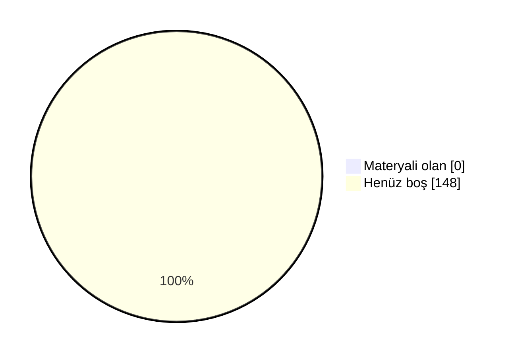

# 📖 Marmara Mekatronik Mühendisliği Arşiv

Marmara Üniversitesi Teknoloji Fakültesi Mekatronik Mühendisliği öğrencileri için düzenli, sürdürülebilir ve değer üreten bir akademik arşiv. Ders notları, ödev çözümleri, slaytlar, çıkmış sorular ve çalışma rehberleri tek bir yerde toplandı.

 ## 🗣️ Geri Bildirimde Bulunun

📬 Öğrenciler ve hocalar, derslerle ilgili hakaret içermeyen geri bildirimlerinizi aşağıdaki linkler aracılığıyla anonim olarak paylaşabilirsiniz.

- [✍️ **Hocalar için yorum linki**](https://docs.google.com/forms/d/e/1FAIpQLSfqY08FbRI_H4qhLwqeaIUbCaDnePai_3RHfHOKee2ZZriSHw/viewform)
- [✍️ **Dersler için yorum linki**](https://docs.google.com/forms/d/e/1FAIpQLSd5-R3qdn5BOVYy4Eb2TR-0Dj0-EbH724hWtz6OXWiyzjhPEg/viewform)
- [⭐ **Dersler için oylama linki**](https://docs.google.com/forms/d/e/1FAIpQLSfTRJTTY53-Ug5jtBnOFHQ4I8-jfSLU2C8g_etgvA3y0Gb2bQ/viewform)

## 🤝 Katkıda Bulunun

Elinde ders notu, slayt, çıkmış soru ya da ödev çözümü varsa arşive eklemek çok kolay:

- 📁 **GitHub kullanmıyorsan:** [Google Drive klasörümüze](https://drive.google.com/drive/folders/1KRobMRVHpJxUKcCZdCEippSZ5SmgpkZq?usp=sharing) yükle. Önce BENİOKU dosyasını oku, sonra **Mekatronik-Teknoloji** klasöründe kendi adınla bir klasör aç.
- 🌐 **GitHub hesabın varsa:** Repoyu fork'la, dosyayı ilgili ders klasörüne yükle ve pull request gönder. Kurulum gerekmez, her şey tarayıcıdan yapılır.
- 📖 **Adım adım rehber:** [CONTRIBUTING.md](CONTRIBUTING.md)

Pull request ile katkıda bulunanların adı sayfanın en altındaki **Katkıda Bulunanlar** listesine otomatik eklenir.

### 📺 Video Rehberler
- 🎬 **Repoya nasıl katkı yapılır?** (~10 dk): *yakında*
- 🎬 **Repo nasıl kullanılır?** Klasör yapısı, ders README'leri ve aradığını bulma: *yakında*

<b>🛠 Repo Kullanımı</b>

## 🛠 Repo Kullanımı

### ⚙️ Açıklamalar:
- 📋 Bölümde bilinen ve güvenilir bir kaynak olmak.
- 📋 Akademik network oluşturmak ve iş birliklerini kolaylaştırmak.
- 📋 Dışarıdan bakan biri için temiz, düzenli ve profesyonel bir imaj sunmak.
- 📋 İçerikler: ders slaytları, kişisel ders notları ve özetler, ödev çözümleri, atölye çalışmaları, çıkmış sorular ve analizleri, proje dosyaları ve örnekleri.

### 📝 Talimatlar:
- 👉 Repo içindeki README.md'leri ders bazlı takip edin.
- 👉 Ödevleri çalıştırmak için ilgili klasörlerdeki .py veya .cpp dosyalarını kullanabilirsiniz.
- 👉 Ders özetleri, kısa ve okunabilir şekilde markdown olarak hazırlanmıştır.
- 👉 Özet ve ödevleri birleştirip kendi öğrenme sürecinize uyarlayabilirsiniz.

<b>🔍 Kavramlar</b>

## 🔍 Kavramlar

📌 Bölümle ilgili sık karşılaşılan terimlerin kısa açıklamaları. Not: tarih/şart gibi somut rakamlar dönemden
döneme değişebilir, kesin ve güncel bilgi için bölüm/fakülte öğrenci işlerine danışın.

- 💡 **Bütünleme Sınavı**
  - 📘 **S: Bütünleme sınavı nedir?** **C:** Final sınavının ardından yapılan, dersten başarısız olanların
    (ve şartlı geçenlerin isterlerse) girebildiği ek bir sınavdır. Bütünlemeye giren bir öğrencinin notu,
    final notunun yerini alır — geri dönüş yoktur.
- 💡 **Çan Eğrisi**
  - 📘 **S: Çan eğrisi nedir?** **C:** Bir sınıfın sınav sonuçlarının ortalama ve standart sapmasına göre
    harf notlarının belirlendiği bağıl bir değerlendirme yöntemidir. Her hoca kullanmak zorunda değildir;
    bazı dersler mutlak (bareme dayalı) notlandırılır.
- 💡 **DC Notu / Şartlı Geçme**
  - 📘 **S: DC nedir?** **C:** Şartlı geçme notudur — dersi geçmiş sayılırsınız ama not ortalamanız
    (GANO) yeterince yüksek değilse dersi tekrar almanız istenebilir. Bütünlemeye isteğe bağlı girilebilir.
- 💡 **GANO / AGNO**
  - 📘 **S: GANO nedir?** **C:** Genel Ağırlıklı Not Ortalaması — o ana kadar alınan tüm derslerin kredi
    ağırlıklı not ortalamasıdır. Mezuniyet, ÇAP/yandal başvurusu gibi şartlarda kullanılır.
- 💡 **YANO**
  - 📘 **S: YANO nedir?** **C:** Yarıyıl Ağırlıklı Not Ortalaması — yalnızca ilgili dönemde alınan derslerin
    kredi ağırlıklı not ortalamasıdır. Her dönem sıfırdan hesaplanır; GANO ise tüm dönemleri kapsar.
- 💡 **Mazeret Sınavı**
  - 📘 **S: Mazeret sınavı nedir?** **C:** Sağlık raporu, resmi belgeli bir mazeret vb. nedenle vize/finale
    giremeyen öğrenciler için düzenlenen, geçerli belgeyle başvurulan ek sınavdır.
- 💡 **ÇAP / Yandal**
  - 📘 **S: ÇAP nedir?** **C:** Çift Anadal Programı — uygun GANO'ya sahip öğrencilerin, okurken ikinci bir
    bölümden de lisans diploması almasını sağlayan program.
  - 📘 **S: Yandal nedir?** **C:** Diploma vermeyen, ikinci bir alanda sertifika niteliğinde daha hafif bir
    program.
- 💡 **Staj 1 / Staj 2**
  - 📘 **S: Staj 1/2 nedir?** **C:** Müfredatta 3. ve 4. yıllarda yer alan, işletmede kısa süreli uygulamalı
    çalışmayı zorunlu kılan derslerdir. Hangi dönemde olduklarını dönem sayfalarında görebilirsin.
- 💡 **İş Yeri Eğitimi**
  - 📘 **S: İş Yeri Eğitimi nedir?** **C:** Staj'dan daha kapsamlı, bir dönem boyunca işletmede tam zamanlı
    çalışmayı içeren müfredat dersi (Teknoloji Fakültesi'nde 7. yarıyılda, 28 AKTS ile oldukça yüklü bir ders).
- 💡 **Bitirme Projesi**
  - 📘 **S: Bitirme Projesi nedir?** **C:** Son dönemde bir danışman hoca eşliğinde yürütülen, mezuniyet
    şartı olan bitirme çalışmasıdır.
- 💡 **Mesleki Seçmeli / Üniversite Seçmeli**
  - 📘 **S: Aralarındaki fark ne?** **C:** Mesleki Seçmeli dersler bölüm içi teknik derslerdir. Üniversite Seçmeli dersler ise bölüm dışı, daha genel/sosyal
    içeriklidir (örn. Girişimcilik, Osmanlı Tarihi). Bkz. [Seçmeli Dersler](#-seçmeli-dersler).

<!-- DOLULUK_BASLANGIC -->

<b>📊 Arşiv Doluluk Durumu</b>

## 📊 Arşiv Doluluk Durumu

Arşivdeki **148** dersin **0** tanesinde en az bir materyal var (genel doluluk **%0**).

| Dönem | Doluluk | Materyali olan ders |
|---|---|---|
| [1. Yıl Güz](./1-1/) | ⬜⬜⬜⬜⬜⬜⬜⬜⬜⬜ %0 | 0 / 9 |
| [1. Yıl Bahar](./1-2/) | ⬜⬜⬜⬜⬜⬜⬜⬜⬜⬜ %0 | 0 / 9 |
| [2. Yıl Güz](./2-1/) | ⬜⬜⬜⬜⬜⬜⬜⬜⬜⬜ %0 | 0 / 12 |
| [2. Yıl Bahar](./2-2/) | ⬜⬜⬜⬜⬜⬜⬜⬜⬜⬜ %0 | 0 / 9 |
| [3. Yıl Güz](./3-1/) | ⬜⬜⬜⬜⬜⬜⬜⬜⬜⬜ %0 | 0 / 7 |
| [3. Yıl Bahar](./3-2/) | ⬜⬜⬜⬜⬜⬜⬜⬜⬜⬜ %0 | 0 / 5 |
| [4. Yıl Güz](./4-1/) | ⬜⬜⬜⬜⬜⬜⬜⬜⬜⬜ %0 | 0 / 5 |
| [4. Yıl Bahar](./4-2/) | ⬜⬜⬜⬜⬜⬜⬜⬜⬜⬜ %0 | 0 / 5 |
| [Mesleki Seçmeli](./Mesleki%20Seçmeli/) | ⬜⬜⬜⬜⬜⬜⬜⬜⬜⬜ %0 | 0 / 64 |
| [Fakülte Teknik Seçmeli](./Fakülte%20Teknik%20Seçmeli/) | ⬜⬜⬜⬜⬜⬜⬜⬜⬜⬜ %0 | 0 / 8 |
| [Üniversite Seçmeli](./Üniversite%20Seçmeli/) | ⬜⬜⬜⬜⬜⬜⬜⬜⬜⬜ %0 | 0 / 15 |

### 🙋 Bu dersler katkını bekliyor
Elinde bu derslerden materyal varsa yukarıdaki **🤝 Katkıda Bulunun** bölümüne göz at.

- **1. Yıl Güz:** Bilgisayar Destekli Çizim, Bilgisayar Sistemlerine Giriş, Fizik 1, İngilizce 1, İş Sağlığı ve Güvenliği 1, Lineer Cebir, Matematik 1, Mekatronik Mühendisliğine Giriş, Teknik Resim
- **1. Yıl Bahar:** Bilgisayar Programlama, Devre Analizi, Fizik 2, İngilizce 2, İş Sağlığı ve Güvenliği 2, Kimya, Matematik 2, Mühendislik Mekaniği, Statik
- **2. Yıl Güz:** Bilgisayar Destekli Tasarım, Diferansiyel Denklemler, Dinamik, Elektronik 1, İleri Programlama, İş Sağlığı ve Güvenliği, Malzeme ve Üretim Teknolojileri, Mantık Devreleri, Mühendisler için İstatistik, Ölçme Tekniği, Sayısal Sistemler, Temel Elektromanyetik
- **2. Yıl Bahar:** Bilgisayar Destekli İmalat, Elektrik Makineleri ve Uygulamaları, Elektronik 2, Mukavemet, Nümerik Analiz, Sinyal İşleme Teknikleri, Termodinamik, Termo-Akışkan, Yapay Zeka Sistemleri
- **3. Yıl Güz:** Hidrolik ve Pnömatik Sistemler, Mekanik Yapı Elemanları, Mikrodenetleyiciler, Programlanabilir Lojik Kontrolörler, Robot Tekniği, Staj 1, Teknik İngilizce 1
- **3. Yıl Bahar:** Algılama ve Veri Toplama, Gömülü Sistemler ve Uygulamaları, Güç Elektroniği, Otomatik Kontrol Sistemleri, Teknik İngilizce 2
- **4. Yıl Güz:** Atatürk İlkeleri ve İnkılap Tarihi 1, İş Hukuku ve Etiği, İş Yeri Eğitimi, Staj 2, Türk Dili 1
- **4. Yıl Bahar:** Atatürk İlkeleri ve İnkılap Tarihi 2, Bitirme Projesi, Endüstriyel Haberleşme ve SCADA Uygulamaları, Görüntü İşleme, Türk Dili 2
- **Mesleki Seçmeli:** Algılayıcılar ve Eyleyiciler, Bilgi Güvenliği, Biyomedikal Cihazlar, Biyomekatronik, Deneysel Metodlar, Deneysel Mukavemet, Eklemeli İmalat, Elektrik Motor Sürücüleri, Elektrikle Tahrik Sistemleri, Elektrikli Araç Teknolojileri, Elektromekanik Enerji Dönüşümü, Elektromekanik Kumanda Tekniği, Elektromekanik Sistemler, Endüstride Dijital Dönüşüm - Dijital Hamle-A, Endüstride Otomasyon Sistemleri ve Kestirimci Bakım Uygulamaları, Endüstriyel Kontrol ve Sürücü Sistemleri, Endüstriyel Ölçme, Enerji Depolama Sistemleri, Esnek İmalat Sistemleri, Esnek Robotik, Eşzamanlı Geometrik Boyutlandırma (CMM), İleri Bilgisayar Destekli İmalat, İleri Hidrolik Pnömatik Sistemler, İleri Otomatik Kontrol, İleri PLC ve SCADA Uygulamaları, İleri Robotik, İleri Tasarım ve Modelleme, İleri Üretim Teknolojileri, Java Programlama, Kablosuz Teknolojilere Giriş, Kalite Mühendisliği ve 6 Sigma Endüstriyel Uygulamaları, Konumlandırma Tekniği, Makine Öğrenmesi, Malzeme Bilimi ve Muayenesi, Malzemelerin Elektrik, Manyetik ve Optik Özellikleri, Mekanik Ölçme ve Endüstriyel Uygulamalar, Mekanik Sistemlerin Tasarımı ve Analizi, Mekatronik Sistem Elemanları, Mekatronik Sistem Tasarımı, MEMS Teknolojileri, Mikro Makineler, Modern Seyrüsefer Sistemleri, Nesne Tabanlı Programlama, Otomasyonda Özel Elektrik Makineleri, Otonom Robotlar, Proses Kontrol, Robotlu Kaynak Teknolojisi, Sanal Üretim Tasarımı ve Optimizasyonu, Sayısal Kontrol, Sensörler ve Algılayıcılar, Sistem Bakımı ve Hata Arama, Sistem Dinamiği ve Modelleme, Sonlu Elemanlara Giriş, Tahribatsız Malzeme Muayenesi, Tasarımda Sonlu Elemanlar Analizi, Taşıt Mekatroniği, Titreşim ve Akustik, Üretim Teknikleri ve Uygulamaları, Ürün Tasarımı ve Prototipleme, Veri Yapıları, Veri Yönetim Sistemleri, VHDL ile Dijital Sistem Tasarımı, Yarı İletken Cihazlar, Yarı İletken Fiziği
- **Fakülte Teknik Seçmeli:** Araştırma Planlama ve Yönetimi, Bilgi Sistemleri Yönetimi, Çok Disiplinli Takım Çalışması Deneyimi, Disiplinler Arası Proje Tasarımı, Mühendisler için Proje Yönetimi, Mühendislik ve Teknoloji Yönetimi, Veri Bilimi ve Veri Analitiğine Giriş, Yazılım Proje Yönetimi
- **Üniversite Seçmeli:** Bilim Tarihi, Çevre ve Enerji, Fizibilite Hazırlama ve Uygulamaları, Girişimcilik, Girişimcilik ve İnovasyon, İş Psikolojisi, Kalite Yönetimi, Liderlik, Moda, Osmanlı Tarihi, Rapor Hazırlama ve Sunum Teknikleri, Sosyal Organizasyon, Teknik İletişim, Teknik Satış ve Pazarlama, Teknoloji Yönetimi

<!-- DOLULUK_BITIS -->

<b>📖 Dersler</b>

## 📖 Dersler
📄 Bu bölümde, tüm dersler hakkında detaylı bilgiler ve kaynaklar bulunmaktadır. Öğrenciler bu bölümü kullanarak ders materyallerine ve içeriklerine ulaşabilirler.

### 🗓 1. Yıl - Güz

#### 📘 Fizik 1 
  - 🏷️ **Ders Tipi:** Zorunlu
  - 🏷️ **Müfredat:** Her İki Müfredat
  - ⭐ **Yıldız Sayıları:**
      - ℹ️ Henüz yıldız veren yok. Siz de [linkten](https://docs.google.com/forms/d/e/1FAIpQLSfTRJTTY53-Ug5jtBnOFHQ4I8-jfSLU2C8g_etgvA3y0Gb2bQ/viewform?usp=pp_url&entry.380326104=Fizik%201) anonim şekilde oylamaya katılabilirsiniz.
  - 💬 **Öğrenci Görüşleri:**
      - ℹ️ Henüz yorum yok. Siz de [linkten](https://docs.google.com/forms/d/e/1FAIpQLSd5-R3qdn5BOVYy4Eb2TR-0Dj0-EbH724hWtz6OXWiyzjhPEg/viewform?usp=pp_url&entry.659808212=Fizik%201) anonim şekilde görüşlerinizi belirtebilirsiniz.
  - 👨‍🏫 👩‍🏫 **Dersi Yürüten Akademisyenler:**
    - **2026-2027**: [ÖAS](#‍-doç-dr-özge-akay-sefer)
  - 📂 [Ders Klasörü](./1-1/Fizik%201)

#### 📘 İş Sağlığı ve Güvenliği 1 
  - 🏷️ **Ders Tipi:** Zorunlu
  - 🏷️ **Müfredat:** 2026 Sonrası
      - ℹ️ 2026 öncesi müfredatta tek ders olarak "İş Sağlığı ve Güvenliği" adıyla 3. yarıyılda (2-1) yer alıyor.
  - ⭐ **Yıldız Sayıları:**
      - ℹ️ Henüz yıldız veren yok. Siz de [linkten](https://docs.google.com/forms/d/e/1FAIpQLSfTRJTTY53-Ug5jtBnOFHQ4I8-jfSLU2C8g_etgvA3y0Gb2bQ/viewform?usp=pp_url&entry.380326104=%C4%B0%C5%9F%20Sa%C4%9Fl%C4%B1%C4%9F%C4%B1%20ve%20G%C3%BCvenli%C4%9Fi%201) anonim şekilde oylamaya katılabilirsiniz.
  - 💬 **Öğrenci Görüşleri:**
      - ℹ️ Henüz yorum yok. Siz de [linkten](https://docs.google.com/forms/d/e/1FAIpQLSd5-R3qdn5BOVYy4Eb2TR-0Dj0-EbH724hWtz6OXWiyzjhPEg/viewform?usp=pp_url&entry.659808212=%C4%B0%C5%9F%20Sa%C4%9Fl%C4%B1%C4%9F%C4%B1%20ve%20G%C3%BCvenli%C4%9Fi%201) anonim şekilde görüşlerinizi belirtebilirsiniz.
  - 👨‍🏫 👩‍🏫 **Dersi Yürüten Akademisyenler:**
    - **2026-2027**: [YB](#‍-prof-dr-yahya-bozkurt)
  - 📂 [Ders Klasörü](./1-1/%C4%B0%C5%9F%20Sa%C4%9Fl%C4%B1%C4%9F%C4%B1%20ve%20G%C3%BCvenli%C4%9Fi%201)

#### 📘 Matematik 1 
  - 🏷️ **Ders Tipi:** Zorunlu
  - 🏷️ **Müfredat:** Her İki Müfredat
  - ⭐ **Yıldız Sayıları:**
      - ℹ️ Henüz yıldız veren yok. Siz de [linkten](https://docs.google.com/forms/d/e/1FAIpQLSfTRJTTY53-Ug5jtBnOFHQ4I8-jfSLU2C8g_etgvA3y0Gb2bQ/viewform?usp=pp_url&entry.380326104=Matematik%201) anonim şekilde oylamaya katılabilirsiniz.
  - 💬 **Öğrenci Görüşleri:**
      - ℹ️ Henüz yorum yok. Siz de [linkten](https://docs.google.com/forms/d/e/1FAIpQLSd5-R3qdn5BOVYy4Eb2TR-0Dj0-EbH724hWtz6OXWiyzjhPEg/viewform?usp=pp_url&entry.659808212=Matematik%201) anonim şekilde görüşlerinizi belirtebilirsiniz.
  - 👨‍🏫 👩‍🏫 **Dersi Yürüten Akademisyenler:**
    - **2026-2027**: [EŞ](#‍-dr-öğretim-üyesi-ersin-şahin)
  - 📂 [Ders Klasörü](./1-1/Matematik%201)

#### 📘 Lineer Cebir 
  - 🏷️ **Ders Tipi:** Zorunlu
  - 🏷️ **Müfredat:** Her İki Müfredat
  - ⭐ **Yıldız Sayıları:**
      - ℹ️ Henüz yıldız veren yok. Siz de [linkten](https://docs.google.com/forms/d/e/1FAIpQLSfTRJTTY53-Ug5jtBnOFHQ4I8-jfSLU2C8g_etgvA3y0Gb2bQ/viewform?usp=pp_url&entry.380326104=Lineer%20Cebir) anonim şekilde oylamaya katılabilirsiniz.
  - 💬 **Öğrenci Görüşleri:**
      - ℹ️ Henüz yorum yok. Siz de [linkten](https://docs.google.com/forms/d/e/1FAIpQLSd5-R3qdn5BOVYy4Eb2TR-0Dj0-EbH724hWtz6OXWiyzjhPEg/viewform?usp=pp_url&entry.659808212=Lineer%20Cebir) anonim şekilde görüşlerinizi belirtebilirsiniz.
  - 👨‍🏫 👩‍🏫 **Dersi Yürüten Akademisyenler:**
    - **2026-2027**: [EÇ](#‍-dr-öğretim-üyesi-ertuğrul-çetinsoy)
  - 📂 [Ders Klasörü](./1-1/Lineer%20Cebir)

#### 📘 Bilgisayar Sistemlerine Giriş 
  - 🏷️ **Ders Tipi:** Zorunlu
  - 🏷️ **Müfredat:** Her İki Müfredat
  - ⭐ **Yıldız Sayıları:**
      - ℹ️ Henüz yıldız veren yok. Siz de [linkten](https://docs.google.com/forms/d/e/1FAIpQLSfTRJTTY53-Ug5jtBnOFHQ4I8-jfSLU2C8g_etgvA3y0Gb2bQ/viewform?usp=pp_url&entry.380326104=Bilgisayar%20Sistemlerine%20Giri%C5%9F) anonim şekilde oylamaya katılabilirsiniz.
  - 💬 **Öğrenci Görüşleri:**
      - ℹ️ Henüz yorum yok. Siz de [linkten](https://docs.google.com/forms/d/e/1FAIpQLSd5-R3qdn5BOVYy4Eb2TR-0Dj0-EbH724hWtz6OXWiyzjhPEg/viewform?usp=pp_url&entry.659808212=Bilgisayar%20Sistemlerine%20Giri%C5%9F) anonim şekilde görüşlerinizi belirtebilirsiniz.
  - 👨‍🏫 👩‍🏫 **Dersi Yürüten Akademisyenler:**
    - **2026-2027**: [EŞ](#‍-dr-öğretim-üyesi-ersin-şahin)
  - 📂 [Ders Klasörü](./1-1/Bilgisayar%20Sistemlerine%20Giri%C5%9F)

#### 📘 Bilgisayar Destekli Çizim 
  - 🏷️ **Ders Tipi:** Zorunlu
  - 🏷️ **Müfredat:** 2026 Sonrası
  - ⭐ **Yıldız Sayıları:**
      - ℹ️ Henüz yıldız veren yok. Siz de [linkten](https://docs.google.com/forms/d/e/1FAIpQLSfTRJTTY53-Ug5jtBnOFHQ4I8-jfSLU2C8g_etgvA3y0Gb2bQ/viewform?usp=pp_url&entry.380326104=Bilgisayar%20Destekli%20%C3%87izim) anonim şekilde oylamaya katılabilirsiniz.
  - 💬 **Öğrenci Görüşleri:**
      - ℹ️ Henüz yorum yok. Siz de [linkten](https://docs.google.com/forms/d/e/1FAIpQLSd5-R3qdn5BOVYy4Eb2TR-0Dj0-EbH724hWtz6OXWiyzjhPEg/viewform?usp=pp_url&entry.659808212=Bilgisayar%20Destekli%20%C3%87izim) anonim şekilde görüşlerinizi belirtebilirsiniz.
  - 👨‍🏫 👩‍🏫 **Dersi Yürüten Akademisyenler:**
    - **2026-2027**: [GG](#‍-prof-dr-garip-genç)
  - 📂 [Ders Klasörü](./1-1/Bilgisayar%20Destekli%20%C3%87izim)

#### 📘 Mekatronik Mühendisliğine Giriş 
  - 🏷️ **Ders Tipi:** Zorunlu
  - 🏷️ **Müfredat:** Her İki Müfredat
  - ⭐ **Yıldız Sayıları:**
      - ℹ️ Henüz yıldız veren yok. Siz de [linkten](https://docs.google.com/forms/d/e/1FAIpQLSfTRJTTY53-Ug5jtBnOFHQ4I8-jfSLU2C8g_etgvA3y0Gb2bQ/viewform?usp=pp_url&entry.380326104=Mekatronik%20M%C3%BChendisli%C4%9Fine%20Giri%C5%9F) anonim şekilde oylamaya katılabilirsiniz.
  - 💬 **Öğrenci Görüşleri:**
      - ℹ️ Henüz yorum yok. Siz de [linkten](https://docs.google.com/forms/d/e/1FAIpQLSd5-R3qdn5BOVYy4Eb2TR-0Dj0-EbH724hWtz6OXWiyzjhPEg/viewform?usp=pp_url&entry.659808212=Mekatronik%20M%C3%BChendisli%C4%9Fine%20Giri%C5%9F) anonim şekilde görüşlerinizi belirtebilirsiniz.
  - 👨‍🏫 👩‍🏫 **Dersi Yürüten Akademisyenler:**
    - **2026-2027**: [İT](#‍-dr-öğretim-üyesi-i̇smail-temiz)
  - 📂 [Ders Klasörü](./1-1/Mekatronik%20M%C3%BChendisli%C4%9Fine%20Giri%C5%9F)

#### 📘 İngilizce 1 
  - 🏷️ **Ders Tipi:** Zorunlu
  - 🏷️ **Müfredat:** Her İki Müfredat
  - ⭐ **Yıldız Sayıları:**
      - ℹ️ Henüz yıldız veren yok. Siz de [linkten](https://docs.google.com/forms/d/e/1FAIpQLSfTRJTTY53-Ug5jtBnOFHQ4I8-jfSLU2C8g_etgvA3y0Gb2bQ/viewform?usp=pp_url&entry.380326104=%C4%B0ngilizce%201) anonim şekilde oylamaya katılabilirsiniz.
  - 💬 **Öğrenci Görüşleri:**
      - ℹ️ Henüz yorum yok. Siz de [linkten](https://docs.google.com/forms/d/e/1FAIpQLSd5-R3qdn5BOVYy4Eb2TR-0Dj0-EbH724hWtz6OXWiyzjhPEg/viewform?usp=pp_url&entry.659808212=%C4%B0ngilizce%201) anonim şekilde görüşlerinizi belirtebilirsiniz.
  - 👨‍🏫 👩‍🏫 **Dersi Yürüten Akademisyenler:**
    - **2026-2027**: [IRS](#‍-öğr-gör-dr-işıl-ruacan-silahtaroğlu)
  - 📂 [Ders Klasörü](./1-1/%C4%B0ngilizce%201)

#### 📘 Teknik Resim 
  - 🏷️ **Ders Tipi:** Zorunlu
  - 🏷️ **Müfredat:** 2026 Öncesi
      - ℹ️ 2026 sonrası müfredatta bu ders yok.
  - ⭐ **Yıldız Sayıları:**
      - ℹ️ Henüz yıldız veren yok. Siz de [linkten](https://docs.google.com/forms/d/e/1FAIpQLSfTRJTTY53-Ug5jtBnOFHQ4I8-jfSLU2C8g_etgvA3y0Gb2bQ/viewform?usp=pp_url&entry.380326104=Teknik%20Resim) anonim şekilde oylamaya katılabilirsiniz.
  - 💬 **Öğrenci Görüşleri:**
      - ℹ️ Henüz yorum yok. Siz de [linkten](https://docs.google.com/forms/d/e/1FAIpQLSd5-R3qdn5BOVYy4Eb2TR-0Dj0-EbH724hWtz6OXWiyzjhPEg/viewform?usp=pp_url&entry.659808212=Teknik%20Resim) anonim şekilde görüşlerinizi belirtebilirsiniz.
  - 👨‍🏫 👩‍🏫 **Dersi Yürüten Akademisyenler:**
    - **2026-2027** (bu yıl yeni girenler bu dersi alamaz; ders yalnızca 2026 öncesi müfredattaki öğrenciler için açıldı): [GG](#‍-prof-dr-garip-genç)
  - 📂 [Ders Klasörü](./1-1/Teknik%20Resim)

### 🗓 1. Yıl - Bahar

#### 📘 Bilgisayar Programlama 
  - 🏷️ **Ders Tipi:** Zorunlu
  - 🏷️ **Müfredat:** Her İki Müfredat
  - ⭐ **Yıldız Sayıları:**
      - ℹ️ Henüz yıldız veren yok. Siz de [linkten](https://docs.google.com/forms/d/e/1FAIpQLSfTRJTTY53-Ug5jtBnOFHQ4I8-jfSLU2C8g_etgvA3y0Gb2bQ/viewform?usp=pp_url&entry.380326104=Bilgisayar%20Programlama) anonim şekilde oylamaya katılabilirsiniz.
  - 💬 **Öğrenci Görüşleri:**
      - ℹ️ Henüz yorum yok. Siz de [linkten](https://docs.google.com/forms/d/e/1FAIpQLSd5-R3qdn5BOVYy4Eb2TR-0Dj0-EbH724hWtz6OXWiyzjhPEg/viewform?usp=pp_url&entry.659808212=Bilgisayar%20Programlama) anonim şekilde görüşlerinizi belirtebilirsiniz.
  - 👨‍🏫 👩‍🏫 **Dersi Yürüten Akademisyenler:**
    - **2025-2026**: [HY](#‍-dr-öğretim-üyesi-hüseyin-yüce)
  - 📂 [Ders Klasörü](./1-2/Bilgisayar%20Programlama)

#### 📘 Fizik 2 
  - 🏷️ **Ders Tipi:** Zorunlu
  - 🏷️ **Müfredat:** Her İki Müfredat
  - ⭐ **Yıldız Sayıları:**
      - ℹ️ Henüz yıldız veren yok. Siz de [linkten](https://docs.google.com/forms/d/e/1FAIpQLSfTRJTTY53-Ug5jtBnOFHQ4I8-jfSLU2C8g_etgvA3y0Gb2bQ/viewform?usp=pp_url&entry.380326104=Fizik%202) anonim şekilde oylamaya katılabilirsiniz.
  - 💬 **Öğrenci Görüşleri:**
      - ℹ️ Henüz yorum yok. Siz de [linkten](https://docs.google.com/forms/d/e/1FAIpQLSd5-R3qdn5BOVYy4Eb2TR-0Dj0-EbH724hWtz6OXWiyzjhPEg/viewform?usp=pp_url&entry.659808212=Fizik%202) anonim şekilde görüşlerinizi belirtebilirsiniz.
  - 👨‍🏫 👩‍🏫 **Dersi Yürüten Akademisyenler:**
    - **2025-2026**: [ÖAS](#‍-doç-dr-özge-akay-sefer)
  - 📂 [Ders Klasörü](./1-2/Fizik%202)

#### 📘 İş Sağlığı ve Güvenliği 2 
  - 🏷️ **Ders Tipi:** Zorunlu
  - 🏷️ **Müfredat:** 2026 Sonrası
      - ℹ️ 2026 öncesi müfredatta tek ders olarak "İş Sağlığı ve Güvenliği" adıyla 3. yarıyılda (2-1) yer alıyor.
  - ⭐ **Yıldız Sayıları:**
      - ℹ️ Henüz yıldız veren yok. Siz de [linkten](https://docs.google.com/forms/d/e/1FAIpQLSfTRJTTY53-Ug5jtBnOFHQ4I8-jfSLU2C8g_etgvA3y0Gb2bQ/viewform?usp=pp_url&entry.380326104=%C4%B0%C5%9F%20Sa%C4%9Fl%C4%B1%C4%9F%C4%B1%20ve%20G%C3%BCvenli%C4%9Fi%202) anonim şekilde oylamaya katılabilirsiniz.
  - 💬 **Öğrenci Görüşleri:**
      - ℹ️ Henüz yorum yok. Siz de [linkten](https://docs.google.com/forms/d/e/1FAIpQLSd5-R3qdn5BOVYy4Eb2TR-0Dj0-EbH724hWtz6OXWiyzjhPEg/viewform?usp=pp_url&entry.659808212=%C4%B0%C5%9F%20Sa%C4%9Fl%C4%B1%C4%9F%C4%B1%20ve%20G%C3%BCvenli%C4%9Fi%202) anonim şekilde görüşlerinizi belirtebilirsiniz.
  - 📂 [Ders Klasörü](./1-2/%C4%B0%C5%9F%20Sa%C4%9Fl%C4%B1%C4%9F%C4%B1%20ve%20G%C3%BCvenli%C4%9Fi%202)

#### 📘 Kimya 
  - 🏷️ **Ders Tipi:** Zorunlu
  - 🏷️ **Müfredat:** Her İki Müfredat
  - ⭐ **Yıldız Sayıları:**
      - ℹ️ Henüz yıldız veren yok. Siz de [linkten](https://docs.google.com/forms/d/e/1FAIpQLSfTRJTTY53-Ug5jtBnOFHQ4I8-jfSLU2C8g_etgvA3y0Gb2bQ/viewform?usp=pp_url&entry.380326104=Kimya) anonim şekilde oylamaya katılabilirsiniz.
  - 💬 **Öğrenci Görüşleri:**
      - ℹ️ Henüz yorum yok. Siz de [linkten](https://docs.google.com/forms/d/e/1FAIpQLSd5-R3qdn5BOVYy4Eb2TR-0Dj0-EbH724hWtz6OXWiyzjhPEg/viewform?usp=pp_url&entry.659808212=Kimya) anonim şekilde görüşlerinizi belirtebilirsiniz.
  - 👨‍🏫 👩‍🏫 **Dersi Yürüten Akademisyenler:**
    - **2025-2026**: [SD](#‍-doç-dr-sabahattin-deniz)
  - 📂 [Ders Klasörü](./1-2/Kimya)

#### 📘 Matematik 2 
  - 🏷️ **Ders Tipi:** Zorunlu
  - 🏷️ **Müfredat:** Her İki Müfredat
  - ⭐ **Yıldız Sayıları:**
      - ℹ️ Henüz yıldız veren yok. Siz de [linkten](https://docs.google.com/forms/d/e/1FAIpQLSfTRJTTY53-Ug5jtBnOFHQ4I8-jfSLU2C8g_etgvA3y0Gb2bQ/viewform?usp=pp_url&entry.380326104=Matematik%202) anonim şekilde oylamaya katılabilirsiniz.
  - 💬 **Öğrenci Görüşleri:**
      - ℹ️ Henüz yorum yok. Siz de [linkten](https://docs.google.com/forms/d/e/1FAIpQLSd5-R3qdn5BOVYy4Eb2TR-0Dj0-EbH724hWtz6OXWiyzjhPEg/viewform?usp=pp_url&entry.659808212=Matematik%202) anonim şekilde görüşlerinizi belirtebilirsiniz.
  - 👨‍🏫 👩‍🏫 **Dersi Yürüten Akademisyenler:**
    - **2025-2026**: [EŞ](#‍-dr-öğretim-üyesi-ersin-şahin)
  - 📂 [Ders Klasörü](./1-2/Matematik%202)

#### 📘 Devre Analizi 
  - 🏷️ **Ders Tipi:** Zorunlu
  - 🏷️ **Müfredat:** Her İki Müfredat
  - ⭐ **Yıldız Sayıları:**
      - ℹ️ Henüz yıldız veren yok. Siz de [linkten](https://docs.google.com/forms/d/e/1FAIpQLSfTRJTTY53-Ug5jtBnOFHQ4I8-jfSLU2C8g_etgvA3y0Gb2bQ/viewform?usp=pp_url&entry.380326104=Devre%20Analizi) anonim şekilde oylamaya katılabilirsiniz.
  - 💬 **Öğrenci Görüşleri:**
      - ℹ️ Henüz yorum yok. Siz de [linkten](https://docs.google.com/forms/d/e/1FAIpQLSd5-R3qdn5BOVYy4Eb2TR-0Dj0-EbH724hWtz6OXWiyzjhPEg/viewform?usp=pp_url&entry.659808212=Devre%20Analizi) anonim şekilde görüşlerinizi belirtebilirsiniz.
  - 👨‍🏫 👩‍🏫 **Dersi Yürüten Akademisyenler:**
    - **2025-2026**: [MCA](#‍-prof-dr-mustafa-caner-aküner)
  - 📂 [Ders Klasörü](./1-2/Devre%20Analizi)

#### 📘 Mühendislik Mekaniği 
  - 🏷️ **Ders Tipi:** Zorunlu
  - 🏷️ **Müfredat:** 2026 Sonrası
  - ⭐ **Yıldız Sayıları:**
      - ℹ️ Henüz yıldız veren yok. Siz de [linkten](https://docs.google.com/forms/d/e/1FAIpQLSfTRJTTY53-Ug5jtBnOFHQ4I8-jfSLU2C8g_etgvA3y0Gb2bQ/viewform?usp=pp_url&entry.380326104=M%C3%BChendislik%20Mekani%C4%9Fi) anonim şekilde oylamaya katılabilirsiniz.
  - 💬 **Öğrenci Görüşleri:**
      - ℹ️ Henüz yorum yok. Siz de [linkten](https://docs.google.com/forms/d/e/1FAIpQLSd5-R3qdn5BOVYy4Eb2TR-0Dj0-EbH724hWtz6OXWiyzjhPEg/viewform?usp=pp_url&entry.659808212=M%C3%BChendislik%20Mekani%C4%9Fi) anonim şekilde görüşlerinizi belirtebilirsiniz.
  - 📂 [Ders Klasörü](./1-2/M%C3%BChendislik%20Mekani%C4%9Fi)

#### 📘 İngilizce 2 
  - 🏷️ **Ders Tipi:** Zorunlu
  - 🏷️ **Müfredat:** Her İki Müfredat
  - ⭐ **Yıldız Sayıları:**
      - ℹ️ Henüz yıldız veren yok. Siz de [linkten](https://docs.google.com/forms/d/e/1FAIpQLSfTRJTTY53-Ug5jtBnOFHQ4I8-jfSLU2C8g_etgvA3y0Gb2bQ/viewform?usp=pp_url&entry.380326104=%C4%B0ngilizce%202) anonim şekilde oylamaya katılabilirsiniz.
  - 💬 **Öğrenci Görüşleri:**
      - ℹ️ Henüz yorum yok. Siz de [linkten](https://docs.google.com/forms/d/e/1FAIpQLSd5-R3qdn5BOVYy4Eb2TR-0Dj0-EbH724hWtz6OXWiyzjhPEg/viewform?usp=pp_url&entry.659808212=%C4%B0ngilizce%202) anonim şekilde görüşlerinizi belirtebilirsiniz.
  - 👨‍🏫 👩‍🏫 **Dersi Yürüten Akademisyenler:**
    - **2025-2026**: [IRS](#‍-öğr-gör-dr-işıl-ruacan-silahtaroğlu)
  - 📂 [Ders Klasörü](./1-2/%C4%B0ngilizce%202)

#### 📘 Statik 
  - 🏷️ **Ders Tipi:** Zorunlu
  - 🏷️ **Müfredat:** 2026 Öncesi
      - ℹ️ 2026 sonrası müfredatta bu ders yok.
  - ⭐ **Yıldız Sayıları:**
      - ℹ️ Henüz yıldız veren yok. Siz de [linkten](https://docs.google.com/forms/d/e/1FAIpQLSfTRJTTY53-Ug5jtBnOFHQ4I8-jfSLU2C8g_etgvA3y0Gb2bQ/viewform?usp=pp_url&entry.380326104=Statik) anonim şekilde oylamaya katılabilirsiniz.
  - 💬 **Öğrenci Görüşleri:**
      - ℹ️ Henüz yorum yok. Siz de [linkten](https://docs.google.com/forms/d/e/1FAIpQLSd5-R3qdn5BOVYy4Eb2TR-0Dj0-EbH724hWtz6OXWiyzjhPEg/viewform?usp=pp_url&entry.659808212=Statik) anonim şekilde görüşlerinizi belirtebilirsiniz.
  - 👨‍🏫 👩‍🏫 **Dersi Yürüten Akademisyenler:**
    - **2025-2026**: [ET](#‍-dr-öğretim-üyesi-ersin-toptaş)
  - 📂 [Ders Klasörü](./1-2/Statik)

### 🗓 2. Yıl - Güz

#### 📘 Elektronik 1 
  - 🏷️ **Ders Tipi:** Zorunlu
  - 🏷️ **Müfredat:** Her İki Müfredat
  - ⭐ **Yıldız Sayıları:**
      - ℹ️ Henüz yıldız veren yok. Siz de [linkten](https://docs.google.com/forms/d/e/1FAIpQLSfTRJTTY53-Ug5jtBnOFHQ4I8-jfSLU2C8g_etgvA3y0Gb2bQ/viewform?usp=pp_url&entry.380326104=Elektronik%201) anonim şekilde oylamaya katılabilirsiniz.
  - 💬 **Öğrenci Görüşleri:**
      - ℹ️ Henüz yorum yok. Siz de [linkten](https://docs.google.com/forms/d/e/1FAIpQLSd5-R3qdn5BOVYy4Eb2TR-0Dj0-EbH724hWtz6OXWiyzjhPEg/viewform?usp=pp_url&entry.659808212=Elektronik%201) anonim şekilde görüşlerinizi belirtebilirsiniz.
  - 👨‍🏫 👩‍🏫 **Dersi Yürüten Akademisyenler:**
    - **2026-2027**: [UK](#‍-dr-öğretim-üyesi-uğur-kesen)
  - 📂 [Ders Klasörü](./2-1/Elektronik%201)

#### 📘 Mühendisler için İstatistik 
  - 🏷️ **Ders Tipi:** Zorunlu
  - 🏷️ **Müfredat:** Her İki Müfredat
      - ℹ️ 2026 öncesi müfredatta 5. yarıyılda (3-1) yer alıyor.
  - ⭐ **Yıldız Sayıları:**
      - ℹ️ Henüz yıldız veren yok. Siz de [linkten](https://docs.google.com/forms/d/e/1FAIpQLSfTRJTTY53-Ug5jtBnOFHQ4I8-jfSLU2C8g_etgvA3y0Gb2bQ/viewform?usp=pp_url&entry.380326104=M%C3%BChendisler%20i%C3%A7in%20%C4%B0statistik) anonim şekilde oylamaya katılabilirsiniz.
  - 💬 **Öğrenci Görüşleri:**
      - ℹ️ Henüz yorum yok. Siz de [linkten](https://docs.google.com/forms/d/e/1FAIpQLSd5-R3qdn5BOVYy4Eb2TR-0Dj0-EbH724hWtz6OXWiyzjhPEg/viewform?usp=pp_url&entry.659808212=M%C3%BChendisler%20i%C3%A7in%20%C4%B0statistik) anonim şekilde görüşlerinizi belirtebilirsiniz.
  - 👨‍🏫 👩‍🏫 **Dersi Yürüten Akademisyenler:**
    - **2026-2027**: [MCA](#‍-prof-dr-mustafa-caner-aküner)
  - 📂 [Ders Klasörü](./2-1/M%C3%BChendisler%20i%C3%A7in%20%C4%B0statistik)

#### 📘 Diferansiyel Denklemler 
  - 🏷️ **Ders Tipi:** Zorunlu
  - 🏷️ **Müfredat:** Her İki Müfredat
  - ⭐ **Yıldız Sayıları:**
      - ℹ️ Henüz yıldız veren yok. Siz de [linkten](https://docs.google.com/forms/d/e/1FAIpQLSfTRJTTY53-Ug5jtBnOFHQ4I8-jfSLU2C8g_etgvA3y0Gb2bQ/viewform?usp=pp_url&entry.380326104=Diferansiyel%20Denklemler) anonim şekilde oylamaya katılabilirsiniz.
  - 💬 **Öğrenci Görüşleri:**
      - ℹ️ Henüz yorum yok. Siz de [linkten](https://docs.google.com/forms/d/e/1FAIpQLSd5-R3qdn5BOVYy4Eb2TR-0Dj0-EbH724hWtz6OXWiyzjhPEg/viewform?usp=pp_url&entry.659808212=Diferansiyel%20Denklemler) anonim şekilde görüşlerinizi belirtebilirsiniz.
  - 👨‍🏫 👩‍🏫 **Dersi Yürüten Akademisyenler:**
    - **2026-2027**: [EŞ](#‍-dr-öğretim-üyesi-ersin-şahin)
  - 📂 [Ders Klasörü](./2-1/Diferansiyel%20Denklemler)

#### 📘 Malzeme ve Üretim Teknolojileri 
  - 🏷️ **Ders Tipi:** Zorunlu
  - 🏷️ **Müfredat:** 2026 Sonrası
  - ⭐ **Yıldız Sayıları:**
      - ℹ️ Henüz yıldız veren yok. Siz de [linkten](https://docs.google.com/forms/d/e/1FAIpQLSfTRJTTY53-Ug5jtBnOFHQ4I8-jfSLU2C8g_etgvA3y0Gb2bQ/viewform?usp=pp_url&entry.380326104=Malzeme%20ve%20%C3%9Cretim%20Teknolojileri) anonim şekilde oylamaya katılabilirsiniz.
  - 💬 **Öğrenci Görüşleri:**
      - ℹ️ Henüz yorum yok. Siz de [linkten](https://docs.google.com/forms/d/e/1FAIpQLSd5-R3qdn5BOVYy4Eb2TR-0Dj0-EbH724hWtz6OXWiyzjhPEg/viewform?usp=pp_url&entry.659808212=Malzeme%20ve%20%C3%9Cretim%20Teknolojileri) anonim şekilde görüşlerinizi belirtebilirsiniz.
  - 📂 [Ders Klasörü](./2-1/Malzeme%20ve%20%C3%9Cretim%20Teknolojileri)

#### 📘 İleri Programlama 
  - 🏷️ **Ders Tipi:** Zorunlu
  - 🏷️ **Müfredat:** 2026 Sonrası
  - ⭐ **Yıldız Sayıları:**
      - ℹ️ Henüz yıldız veren yok. Siz de [linkten](https://docs.google.com/forms/d/e/1FAIpQLSfTRJTTY53-Ug5jtBnOFHQ4I8-jfSLU2C8g_etgvA3y0Gb2bQ/viewform?usp=pp_url&entry.380326104=%C4%B0leri%20Programlama) anonim şekilde oylamaya katılabilirsiniz.
  - 💬 **Öğrenci Görüşleri:**
      - ℹ️ Henüz yorum yok. Siz de [linkten](https://docs.google.com/forms/d/e/1FAIpQLSd5-R3qdn5BOVYy4Eb2TR-0Dj0-EbH724hWtz6OXWiyzjhPEg/viewform?usp=pp_url&entry.659808212=%C4%B0leri%20Programlama) anonim şekilde görüşlerinizi belirtebilirsiniz.
  - 📂 [Ders Klasörü](./2-1/%C4%B0leri%20Programlama)

#### 📘 Temel Elektromanyetik 
  - 🏷️ **Ders Tipi:** Zorunlu
  - 🏷️ **Müfredat:** Her İki Müfredat
  - ⭐ **Yıldız Sayıları:**
      - ℹ️ Henüz yıldız veren yok. Siz de [linkten](https://docs.google.com/forms/d/e/1FAIpQLSfTRJTTY53-Ug5jtBnOFHQ4I8-jfSLU2C8g_etgvA3y0Gb2bQ/viewform?usp=pp_url&entry.380326104=Temel%20Elektromanyetik) anonim şekilde oylamaya katılabilirsiniz.
  - 💬 **Öğrenci Görüşleri:**
      - ℹ️ Henüz yorum yok. Siz de [linkten](https://docs.google.com/forms/d/e/1FAIpQLSd5-R3qdn5BOVYy4Eb2TR-0Dj0-EbH724hWtz6OXWiyzjhPEg/viewform?usp=pp_url&entry.659808212=Temel%20Elektromanyetik) anonim şekilde görüşlerinizi belirtebilirsiniz.
  - 👨‍🏫 👩‍🏫 **Dersi Yürüten Akademisyenler:**
    - **2026-2027**: [ÖAS](#‍-doç-dr-özge-akay-sefer)
  - 📂 [Ders Klasörü](./2-1/Temel%20Elektromanyetik)

#### 📘 Mantık Devreleri 
  - 🏷️ **Ders Tipi:** Zorunlu
  - 🏷️ **Müfredat:** 2026 Sonrası
  - ⭐ **Yıldız Sayıları:**
      - ℹ️ Henüz yıldız veren yok. Siz de [linkten](https://docs.google.com/forms/d/e/1FAIpQLSfTRJTTY53-Ug5jtBnOFHQ4I8-jfSLU2C8g_etgvA3y0Gb2bQ/viewform?usp=pp_url&entry.380326104=Mant%C4%B1k%20Devreleri) anonim şekilde oylamaya katılabilirsiniz.
  - 💬 **Öğrenci Görüşleri:**
      - ℹ️ Henüz yorum yok. Siz de [linkten](https://docs.google.com/forms/d/e/1FAIpQLSd5-R3qdn5BOVYy4Eb2TR-0Dj0-EbH724hWtz6OXWiyzjhPEg/viewform?usp=pp_url&entry.659808212=Mant%C4%B1k%20Devreleri) anonim şekilde görüşlerinizi belirtebilirsiniz.
  - 📂 [Ders Klasörü](./2-1/Mant%C4%B1k%20Devreleri)

#### 📘 Ölçme Tekniği 
  - 🏷️ **Ders Tipi:** Zorunlu
  - 🏷️ **Müfredat:** 2026 Sonrası
      - ℹ️ 2026 öncesi müfredatta Mesleki Seçmeli havuzunda yer alıyor.
  - ⭐ **Yıldız Sayıları:**
      - ℹ️ Henüz yıldız veren yok. Siz de [linkten](https://docs.google.com/forms/d/e/1FAIpQLSfTRJTTY53-Ug5jtBnOFHQ4I8-jfSLU2C8g_etgvA3y0Gb2bQ/viewform?usp=pp_url&entry.380326104=%C3%96l%C3%A7me%20Tekni%C4%9Fi) anonim şekilde oylamaya katılabilirsiniz.
  - 💬 **Öğrenci Görüşleri:**
      - ℹ️ Henüz yorum yok. Siz de [linkten](https://docs.google.com/forms/d/e/1FAIpQLSd5-R3qdn5BOVYy4Eb2TR-0Dj0-EbH724hWtz6OXWiyzjhPEg/viewform?usp=pp_url&entry.659808212=%C3%96l%C3%A7me%20Tekni%C4%9Fi) anonim şekilde görüşlerinizi belirtebilirsiniz.
  - 👨‍🏫 👩‍🏫 **Dersi Yürüten Akademisyenler:**
    - **2026-2027**: [KE](#‍-dr-öğretim-üyesi-koray-erhan)
  - 📂 [Ders Klasörü](./2-1/%C3%96l%C3%A7me%20Tekni%C4%9Fi)

#### 📘 İş Sağlığı ve Güvenliği 
  - 🏷️ **Ders Tipi:** Zorunlu
  - 🏷️ **Müfredat:** 2026 Öncesi
      - ℹ️ 2026 sonrası müfredatta yerini "İş Sağlığı ve Güvenliği 1" ve "İş Sağlığı ve Güvenliği 2" almış.
  - ⭐ **Yıldız Sayıları:**
      - ℹ️ Henüz yıldız veren yok. Siz de [linkten](https://docs.google.com/forms/d/e/1FAIpQLSfTRJTTY53-Ug5jtBnOFHQ4I8-jfSLU2C8g_etgvA3y0Gb2bQ/viewform?usp=pp_url&entry.380326104=%C4%B0%C5%9F%20Sa%C4%9Fl%C4%B1%C4%9F%C4%B1%20ve%20G%C3%BCvenli%C4%9Fi) anonim şekilde oylamaya katılabilirsiniz.
  - 💬 **Öğrenci Görüşleri:**
      - ℹ️ Henüz yorum yok. Siz de [linkten](https://docs.google.com/forms/d/e/1FAIpQLSd5-R3qdn5BOVYy4Eb2TR-0Dj0-EbH724hWtz6OXWiyzjhPEg/viewform?usp=pp_url&entry.659808212=%C4%B0%C5%9F%20Sa%C4%9Fl%C4%B1%C4%9F%C4%B1%20ve%20G%C3%BCvenli%C4%9Fi) anonim şekilde görüşlerinizi belirtebilirsiniz.
  - 👨‍🏫 👩‍🏫 **Dersi Yürüten Akademisyenler:**
    - **2026-2027** (bu yıl yeni girenler bu dersi alamaz; ders yalnızca 2026 öncesi müfredattaki öğrenciler için açıldı): [İT](#‍-dr-öğretim-üyesi-i̇smail-temiz)
  - 📂 [Ders Klasörü](./2-1/%C4%B0%C5%9F%20Sa%C4%9Fl%C4%B1%C4%9F%C4%B1%20ve%20G%C3%BCvenli%C4%9Fi)

#### 📘 Dinamik 
  - 🏷️ **Ders Tipi:** Zorunlu
  - 🏷️ **Müfredat:** 2026 Öncesi
      - ℹ️ 2026 sonrası müfredatta bu ders yok.
  - ⭐ **Yıldız Sayıları:**
      - ℹ️ Henüz yıldız veren yok. Siz de [linkten](https://docs.google.com/forms/d/e/1FAIpQLSfTRJTTY53-Ug5jtBnOFHQ4I8-jfSLU2C8g_etgvA3y0Gb2bQ/viewform?usp=pp_url&entry.380326104=Dinamik) anonim şekilde oylamaya katılabilirsiniz.
  - 💬 **Öğrenci Görüşleri:**
      - ℹ️ Henüz yorum yok. Siz de [linkten](https://docs.google.com/forms/d/e/1FAIpQLSd5-R3qdn5BOVYy4Eb2TR-0Dj0-EbH724hWtz6OXWiyzjhPEg/viewform?usp=pp_url&entry.659808212=Dinamik) anonim şekilde görüşlerinizi belirtebilirsiniz.
  - 👨‍🏫 👩‍🏫 **Dersi Yürüten Akademisyenler:**
    - **2026-2027** (bu yıl yeni girenler bu dersi alamaz; ders yalnızca 2026 öncesi müfredattaki öğrenciler için açıldı): [ET](#‍-dr-öğretim-üyesi-ersin-toptaş)
  - 📂 [Ders Klasörü](./2-1/Dinamik)

#### 📘 Bilgisayar Destekli Tasarım 
  - 🏷️ **Ders Tipi:** Zorunlu
  - 🏷️ **Müfredat:** 2026 Öncesi
      - ℹ️ 2026 sonrası müfredatta bu ders yok.
  - ⭐ **Yıldız Sayıları:**
      - ℹ️ Henüz yıldız veren yok. Siz de [linkten](https://docs.google.com/forms/d/e/1FAIpQLSfTRJTTY53-Ug5jtBnOFHQ4I8-jfSLU2C8g_etgvA3y0Gb2bQ/viewform?usp=pp_url&entry.380326104=Bilgisayar%20Destekli%20Tasar%C4%B1m) anonim şekilde oylamaya katılabilirsiniz.
  - 💬 **Öğrenci Görüşleri:**
      - ℹ️ Henüz yorum yok. Siz de [linkten](https://docs.google.com/forms/d/e/1FAIpQLSd5-R3qdn5BOVYy4Eb2TR-0Dj0-EbH724hWtz6OXWiyzjhPEg/viewform?usp=pp_url&entry.659808212=Bilgisayar%20Destekli%20Tasar%C4%B1m) anonim şekilde görüşlerinizi belirtebilirsiniz.
  - 👨‍🏫 👩‍🏫 **Dersi Yürüten Akademisyenler:**
    - **2026-2027** (bu yıl yeni girenler bu dersi alamaz; ders yalnızca 2026 öncesi müfredattaki öğrenciler için açıldı): [ET](#‍-dr-öğretim-üyesi-ersin-toptaş)
  - 📂 [Ders Klasörü](./2-1/Bilgisayar%20Destekli%20Tasar%C4%B1m)

#### 📘 Sayısal Sistemler 
  - 🏷️ **Ders Tipi:** Zorunlu
  - 🏷️ **Müfredat:** 2026 Öncesi
      - ℹ️ 2026 sonrası müfredatta bu ders yok.
  - ⭐ **Yıldız Sayıları:**
      - ℹ️ Henüz yıldız veren yok. Siz de [linkten](https://docs.google.com/forms/d/e/1FAIpQLSfTRJTTY53-Ug5jtBnOFHQ4I8-jfSLU2C8g_etgvA3y0Gb2bQ/viewform?usp=pp_url&entry.380326104=Say%C4%B1sal%20Sistemler) anonim şekilde oylamaya katılabilirsiniz.
  - 💬 **Öğrenci Görüşleri:**
      - ℹ️ Henüz yorum yok. Siz de [linkten](https://docs.google.com/forms/d/e/1FAIpQLSd5-R3qdn5BOVYy4Eb2TR-0Dj0-EbH724hWtz6OXWiyzjhPEg/viewform?usp=pp_url&entry.659808212=Say%C4%B1sal%20Sistemler) anonim şekilde görüşlerinizi belirtebilirsiniz.
  - 👨‍🏫 👩‍🏫 **Dersi Yürüten Akademisyenler:**
    - **2026-2027** (bu yıl yeni girenler bu dersi alamaz; ders yalnızca 2026 öncesi müfredattaki öğrenciler için açıldı): [UK](#‍-dr-öğretim-üyesi-uğur-kesen)
  - 📂 [Ders Klasörü](./2-1/Say%C4%B1sal%20Sistemler)

### 🗓 2. Yıl - Bahar

#### 📘 Elektronik 2 
  - 🏷️ **Ders Tipi:** Zorunlu
  - 🏷️ **Müfredat:** Her İki Müfredat
  - ⭐ **Yıldız Sayıları:**
      - ℹ️ Henüz yıldız veren yok. Siz de [linkten](https://docs.google.com/forms/d/e/1FAIpQLSfTRJTTY53-Ug5jtBnOFHQ4I8-jfSLU2C8g_etgvA3y0Gb2bQ/viewform?usp=pp_url&entry.380326104=Elektronik%202) anonim şekilde oylamaya katılabilirsiniz.
  - 💬 **Öğrenci Görüşleri:**
      - ℹ️ Henüz yorum yok. Siz de [linkten](https://docs.google.com/forms/d/e/1FAIpQLSd5-R3qdn5BOVYy4Eb2TR-0Dj0-EbH724hWtz6OXWiyzjhPEg/viewform?usp=pp_url&entry.659808212=Elektronik%202) anonim şekilde görüşlerinizi belirtebilirsiniz.
  - 👨‍🏫 👩‍🏫 **Dersi Yürüten Akademisyenler:**
    - **2025-2026**: [UK](#‍-dr-öğretim-üyesi-uğur-kesen)
  - 📂 [Ders Klasörü](./2-2/Elektronik%202)

#### 📘 Mukavemet 
  - 🏷️ **Ders Tipi:** Zorunlu
  - 🏷️ **Müfredat:** Her İki Müfredat
  - ⭐ **Yıldız Sayıları:**
      - ℹ️ Henüz yıldız veren yok. Siz de [linkten](https://docs.google.com/forms/d/e/1FAIpQLSfTRJTTY53-Ug5jtBnOFHQ4I8-jfSLU2C8g_etgvA3y0Gb2bQ/viewform?usp=pp_url&entry.380326104=Mukavemet) anonim şekilde oylamaya katılabilirsiniz.
  - 💬 **Öğrenci Görüşleri:**
      - ℹ️ Henüz yorum yok. Siz de [linkten](https://docs.google.com/forms/d/e/1FAIpQLSd5-R3qdn5BOVYy4Eb2TR-0Dj0-EbH724hWtz6OXWiyzjhPEg/viewform?usp=pp_url&entry.659808212=Mukavemet) anonim şekilde görüşlerinizi belirtebilirsiniz.
  - 👨‍🏫 👩‍🏫 **Dersi Yürüten Akademisyenler:**
    - **2025-2026**: [GG](#‍-prof-dr-garip-genç)
  - 📂 [Ders Klasörü](./2-2/Mukavemet)

#### 📘 Elektrik Makineleri ve Uygulamaları 
  - 🏷️ **Ders Tipi:** Zorunlu
  - 🏷️ **Müfredat:** Her İki Müfredat
  - ⭐ **Yıldız Sayıları:**
      - ℹ️ Henüz yıldız veren yok. Siz de [linkten](https://docs.google.com/forms/d/e/1FAIpQLSfTRJTTY53-Ug5jtBnOFHQ4I8-jfSLU2C8g_etgvA3y0Gb2bQ/viewform?usp=pp_url&entry.380326104=Elektrik%20Makineleri%20ve%20Uygulamalar%C4%B1) anonim şekilde oylamaya katılabilirsiniz.
  - 💬 **Öğrenci Görüşleri:**
      - ℹ️ Henüz yorum yok. Siz de [linkten](https://docs.google.com/forms/d/e/1FAIpQLSd5-R3qdn5BOVYy4Eb2TR-0Dj0-EbH724hWtz6OXWiyzjhPEg/viewform?usp=pp_url&entry.659808212=Elektrik%20Makineleri%20ve%20Uygulamalar%C4%B1) anonim şekilde görüşlerinizi belirtebilirsiniz.
  - 👨‍🏫 👩‍🏫 **Dersi Yürüten Akademisyenler:**
    - **2025-2026**: [İT](#‍-dr-öğretim-üyesi-i̇smail-temiz)
  - 📂 [Ders Klasörü](./2-2/Elektrik%20Makineleri%20ve%20Uygulamalar%C4%B1)

#### 📘 Yapay Zeka Sistemleri 
  - 🏷️ **Ders Tipi:** Zorunlu
  - 🏷️ **Müfredat:** Her İki Müfredat
      - ℹ️ 2026 öncesi müfredatta 6. yarıyılda (3-2) yer alıyor.
  - ⭐ **Yıldız Sayıları:**
      - ℹ️ Henüz yıldız veren yok. Siz de [linkten](https://docs.google.com/forms/d/e/1FAIpQLSfTRJTTY53-Ug5jtBnOFHQ4I8-jfSLU2C8g_etgvA3y0Gb2bQ/viewform?usp=pp_url&entry.380326104=Yapay%20Zeka%20Sistemleri) anonim şekilde oylamaya katılabilirsiniz.
  - 💬 **Öğrenci Görüşleri:**
      - ℹ️ Henüz yorum yok. Siz de [linkten](https://docs.google.com/forms/d/e/1FAIpQLSd5-R3qdn5BOVYy4Eb2TR-0Dj0-EbH724hWtz6OXWiyzjhPEg/viewform?usp=pp_url&entry.659808212=Yapay%20Zeka%20Sistemleri) anonim şekilde görüşlerinizi belirtebilirsiniz.
  - 👨‍🏫 👩‍🏫 **Dersi Yürüten Akademisyenler:**
    - **2025-2026**: [EŞ](#‍-dr-öğretim-üyesi-ersin-şahin)
  - 📂 [Ders Klasörü](./2-2/Yapay%20Zeka%20Sistemleri)

#### 📘 Sinyal İşleme Teknikleri 
  - 🏷️ **Ders Tipi:** Zorunlu
  - 🏷️ **Müfredat:** 2026 Sonrası
      - ℹ️ 2026 öncesi müfredatta Mesleki Seçmeli havuzunda yer alıyor.
  - ⭐ **Yıldız Sayıları:**
      - ℹ️ Henüz yıldız veren yok. Siz de [linkten](https://docs.google.com/forms/d/e/1FAIpQLSfTRJTTY53-Ug5jtBnOFHQ4I8-jfSLU2C8g_etgvA3y0Gb2bQ/viewform?usp=pp_url&entry.380326104=Sinyal%20%C4%B0%C5%9Fleme%20Teknikleri) anonim şekilde oylamaya katılabilirsiniz.
  - 💬 **Öğrenci Görüşleri:**
      - ℹ️ Henüz yorum yok. Siz de [linkten](https://docs.google.com/forms/d/e/1FAIpQLSd5-R3qdn5BOVYy4Eb2TR-0Dj0-EbH724hWtz6OXWiyzjhPEg/viewform?usp=pp_url&entry.659808212=Sinyal%20%C4%B0%C5%9Fleme%20Teknikleri) anonim şekilde görüşlerinizi belirtebilirsiniz.
  - 📂 [Ders Klasörü](./2-2/Sinyal%20%C4%B0%C5%9Fleme%20Teknikleri)

#### 📘 Termodinamik 
  - 🏷️ **Ders Tipi:** Zorunlu
  - 🏷️ **Müfredat:** 2026 Sonrası
  - ⭐ **Yıldız Sayıları:**
      - ℹ️ Henüz yıldız veren yok. Siz de [linkten](https://docs.google.com/forms/d/e/1FAIpQLSfTRJTTY53-Ug5jtBnOFHQ4I8-jfSLU2C8g_etgvA3y0Gb2bQ/viewform?usp=pp_url&entry.380326104=Termodinamik) anonim şekilde oylamaya katılabilirsiniz.
  - 💬 **Öğrenci Görüşleri:**
      - ℹ️ Henüz yorum yok. Siz de [linkten](https://docs.google.com/forms/d/e/1FAIpQLSd5-R3qdn5BOVYy4Eb2TR-0Dj0-EbH724hWtz6OXWiyzjhPEg/viewform?usp=pp_url&entry.659808212=Termodinamik) anonim şekilde görüşlerinizi belirtebilirsiniz.
  - 📂 [Ders Klasörü](./2-2/Termodinamik)

#### 📘 Nümerik Analiz 
  - 🏷️ **Ders Tipi:** Zorunlu
  - 🏷️ **Müfredat:** 2026 Sonrası
  - ⭐ **Yıldız Sayıları:**
      - ℹ️ Henüz yıldız veren yok. Siz de [linkten](https://docs.google.com/forms/d/e/1FAIpQLSfTRJTTY53-Ug5jtBnOFHQ4I8-jfSLU2C8g_etgvA3y0Gb2bQ/viewform?usp=pp_url&entry.380326104=N%C3%BCmerik%20Analiz) anonim şekilde oylamaya katılabilirsiniz.
  - 💬 **Öğrenci Görüşleri:**
      - ℹ️ Henüz yorum yok. Siz de [linkten](https://docs.google.com/forms/d/e/1FAIpQLSd5-R3qdn5BOVYy4Eb2TR-0Dj0-EbH724hWtz6OXWiyzjhPEg/viewform?usp=pp_url&entry.659808212=N%C3%BCmerik%20Analiz) anonim şekilde görüşlerinizi belirtebilirsiniz.
  - 📂 [Ders Klasörü](./2-2/N%C3%BCmerik%20Analiz)

#### 📘 Bilgisayar Destekli İmalat 
  - 🏷️ **Ders Tipi:** Zorunlu
  - 🏷️ **Müfredat:** 2026 Öncesi (Zorunlu)
      - ℹ️ 2026 sonrası müfredatta zorunlu değil, Mesleki Seçmeli havuzuna taşınmış.
  - ⭐ **Yıldız Sayıları:**
      - ℹ️ Henüz yıldız veren yok. Siz de [linkten](https://docs.google.com/forms/d/e/1FAIpQLSfTRJTTY53-Ug5jtBnOFHQ4I8-jfSLU2C8g_etgvA3y0Gb2bQ/viewform?usp=pp_url&entry.380326104=Bilgisayar%20Destekli%20%C4%B0malat) anonim şekilde oylamaya katılabilirsiniz.
  - 💬 **Öğrenci Görüşleri:**
      - ℹ️ Henüz yorum yok. Siz de [linkten](https://docs.google.com/forms/d/e/1FAIpQLSd5-R3qdn5BOVYy4Eb2TR-0Dj0-EbH724hWtz6OXWiyzjhPEg/viewform?usp=pp_url&entry.659808212=Bilgisayar%20Destekli%20%C4%B0malat) anonim şekilde görüşlerinizi belirtebilirsiniz.
  - 👨‍🏫 👩‍🏫 **Dersi Yürüten Akademisyenler:**
    - **2025-2026**: [GG](#‍-prof-dr-garip-genç), [ET](#‍-dr-öğretim-üyesi-ersin-toptaş)
  - 📂 [Ders Klasörü](./2-2/Bilgisayar%20Destekli%20%C4%B0malat)

#### 📘 Termo-Akışkan 
  - 🏷️ **Ders Tipi:** Zorunlu
  - 🏷️ **Müfredat:** 2026 Öncesi
      - ℹ️ 2026 sonrası müfredatta bu ders yok.
  - ⭐ **Yıldız Sayıları:**
      - ℹ️ Henüz yıldız veren yok. Siz de [linkten](https://docs.google.com/forms/d/e/1FAIpQLSfTRJTTY53-Ug5jtBnOFHQ4I8-jfSLU2C8g_etgvA3y0Gb2bQ/viewform?usp=pp_url&entry.380326104=Termo-Ak%C4%B1%C5%9Fkan) anonim şekilde oylamaya katılabilirsiniz.
  - 💬 **Öğrenci Görüşleri:**
      - ℹ️ Henüz yorum yok. Siz de [linkten](https://docs.google.com/forms/d/e/1FAIpQLSd5-R3qdn5BOVYy4Eb2TR-0Dj0-EbH724hWtz6OXWiyzjhPEg/viewform?usp=pp_url&entry.659808212=Termo-Ak%C4%B1%C5%9Fkan) anonim şekilde görüşlerinizi belirtebilirsiniz.
  - 👨‍🏫 👩‍🏫 **Dersi Yürüten Akademisyenler:**
    - **2025-2026**: [MA](#‍-prof-dr-mustafa-atmaca)
  - 📂 [Ders Klasörü](./2-2/Termo-Ak%C4%B1%C5%9Fkan)

### 🗓 3. Yıl - Güz

#### 📘 Mikrodenetleyiciler 
  - 🏷️ **Ders Tipi:** Zorunlu
  - 🏷️ **Müfredat:** Her İki Müfredat
  - ⭐ **Yıldız Sayıları:**
      - ℹ️ Henüz yıldız veren yok. Siz de [linkten](https://docs.google.com/forms/d/e/1FAIpQLSfTRJTTY53-Ug5jtBnOFHQ4I8-jfSLU2C8g_etgvA3y0Gb2bQ/viewform?usp=pp_url&entry.380326104=Mikrodenetleyiciler) anonim şekilde oylamaya katılabilirsiniz.
  - 💬 **Öğrenci Görüşleri:**
      - ℹ️ Henüz yorum yok. Siz de [linkten](https://docs.google.com/forms/d/e/1FAIpQLSd5-R3qdn5BOVYy4Eb2TR-0Dj0-EbH724hWtz6OXWiyzjhPEg/viewform?usp=pp_url&entry.659808212=Mikrodenetleyiciler) anonim şekilde görüşlerinizi belirtebilirsiniz.
  - 👨‍🏫 👩‍🏫 **Dersi Yürüten Akademisyenler:**
    - **2026-2027**: [EÇ](#‍-dr-öğretim-üyesi-ertuğrul-çetinsoy)
  - 📂 [Ders Klasörü](./3-1/Mikrodenetleyiciler)

#### 📘 Staj 1 
  - 🏷️ **Ders Tipi:** Zorunlu
  - 🏷️ **Müfredat:** Her İki Müfredat
  - ⭐ **Yıldız Sayıları:**
      - ℹ️ Henüz yıldız veren yok. Siz de [linkten](https://docs.google.com/forms/d/e/1FAIpQLSfTRJTTY53-Ug5jtBnOFHQ4I8-jfSLU2C8g_etgvA3y0Gb2bQ/viewform?usp=pp_url&entry.380326104=Staj%201) anonim şekilde oylamaya katılabilirsiniz.
  - 💬 **Öğrenci Görüşleri:**
      - ℹ️ Henüz yorum yok. Siz de [linkten](https://docs.google.com/forms/d/e/1FAIpQLSd5-R3qdn5BOVYy4Eb2TR-0Dj0-EbH724hWtz6OXWiyzjhPEg/viewform?usp=pp_url&entry.659808212=Staj%201) anonim şekilde görüşlerinizi belirtebilirsiniz.
  - 📂 [Ders Klasörü](./3-1/Staj%201)

#### 📘 Programlanabilir Lojik Kontrolörler 
  - 🏷️ **Ders Tipi:** Zorunlu
  - 🏷️ **Müfredat:** Her İki Müfredat
  - ⭐ **Yıldız Sayıları:**
      - ℹ️ Henüz yıldız veren yok. Siz de [linkten](https://docs.google.com/forms/d/e/1FAIpQLSfTRJTTY53-Ug5jtBnOFHQ4I8-jfSLU2C8g_etgvA3y0Gb2bQ/viewform?usp=pp_url&entry.380326104=Programlanabilir%20Lojik%20Kontrol%C3%B6rler) anonim şekilde oylamaya katılabilirsiniz.
  - 💬 **Öğrenci Görüşleri:**
      - ℹ️ Henüz yorum yok. Siz de [linkten](https://docs.google.com/forms/d/e/1FAIpQLSd5-R3qdn5BOVYy4Eb2TR-0Dj0-EbH724hWtz6OXWiyzjhPEg/viewform?usp=pp_url&entry.659808212=Programlanabilir%20Lojik%20Kontrol%C3%B6rler) anonim şekilde görüşlerinizi belirtebilirsiniz.
  - 👨‍🏫 👩‍🏫 **Dersi Yürüten Akademisyenler:**
    - **2026-2027**: [KE](#‍-dr-öğretim-üyesi-koray-erhan)
  - 📂 [Ders Klasörü](./3-1/Programlanabilir%20Lojik%20Kontrol%C3%B6rler)

#### 📘 Hidrolik ve Pnömatik Sistemler 
  - 🏷️ **Ders Tipi:** Zorunlu
  - 🏷️ **Müfredat:** Her İki Müfredat
  - ⭐ **Yıldız Sayıları:**
      - ℹ️ Henüz yıldız veren yok. Siz de [linkten](https://docs.google.com/forms/d/e/1FAIpQLSfTRJTTY53-Ug5jtBnOFHQ4I8-jfSLU2C8g_etgvA3y0Gb2bQ/viewform?usp=pp_url&entry.380326104=Hidrolik%20ve%20Pn%C3%B6matik%20Sistemler) anonim şekilde oylamaya katılabilirsiniz.
  - 💬 **Öğrenci Görüşleri:**
      - ℹ️ Henüz yorum yok. Siz de [linkten](https://docs.google.com/forms/d/e/1FAIpQLSd5-R3qdn5BOVYy4Eb2TR-0Dj0-EbH724hWtz6OXWiyzjhPEg/viewform?usp=pp_url&entry.659808212=Hidrolik%20ve%20Pn%C3%B6matik%20Sistemler) anonim şekilde görüşlerinizi belirtebilirsiniz.
  - 👨‍🏫 👩‍🏫 **Dersi Yürüten Akademisyenler:**
    - **2026-2027**: [İT](#‍-dr-öğretim-üyesi-i̇smail-temiz)
  - 📂 [Ders Klasörü](./3-1/Hidrolik%20ve%20Pn%C3%B6matik%20Sistemler)

#### 📘 Teknik İngilizce 1 
  - 🏷️ **Ders Tipi:** Zorunlu
  - 🏷️ **Müfredat:** 2026 Sonrası
  - ⭐ **Yıldız Sayıları:**
      - ℹ️ Henüz yıldız veren yok. Siz de [linkten](https://docs.google.com/forms/d/e/1FAIpQLSfTRJTTY53-Ug5jtBnOFHQ4I8-jfSLU2C8g_etgvA3y0Gb2bQ/viewform?usp=pp_url&entry.380326104=Teknik%20%C4%B0ngilizce%201) anonim şekilde oylamaya katılabilirsiniz.
  - 💬 **Öğrenci Görüşleri:**
      - ℹ️ Henüz yorum yok. Siz de [linkten](https://docs.google.com/forms/d/e/1FAIpQLSd5-R3qdn5BOVYy4Eb2TR-0Dj0-EbH724hWtz6OXWiyzjhPEg/viewform?usp=pp_url&entry.659808212=Teknik%20%C4%B0ngilizce%201) anonim şekilde görüşlerinizi belirtebilirsiniz.
  - 📂 [Ders Klasörü](./3-1/Teknik%20%C4%B0ngilizce%201)

#### 📘 Robot Tekniği 
  - 🏷️ **Ders Tipi:** Zorunlu
  - 🏷️ **Müfredat:** Her İki Müfredat
      - ℹ️ 2026 öncesi müfredatta 4. yarıyılda (2-2) yer alıyor.
  - ⭐ **Yıldız Sayıları:**
      - ℹ️ Henüz yıldız veren yok. Siz de [linkten](https://docs.google.com/forms/d/e/1FAIpQLSfTRJTTY53-Ug5jtBnOFHQ4I8-jfSLU2C8g_etgvA3y0Gb2bQ/viewform?usp=pp_url&entry.380326104=Robot%20Tekni%C4%9Fi) anonim şekilde oylamaya katılabilirsiniz.
  - 💬 **Öğrenci Görüşleri:**
      - ℹ️ Henüz yorum yok. Siz de [linkten](https://docs.google.com/forms/d/e/1FAIpQLSd5-R3qdn5BOVYy4Eb2TR-0Dj0-EbH724hWtz6OXWiyzjhPEg/viewform?usp=pp_url&entry.659808212=Robot%20Tekni%C4%9Fi) anonim şekilde görüşlerinizi belirtebilirsiniz.
  - 👨‍🏫 👩‍🏫 **Dersi Yürüten Akademisyenler:**
    - **2025-2026**: [EÇ](#‍-dr-öğretim-üyesi-ertuğrul-çetinsoy)
  - 📂 [Ders Klasörü](./3-1/Robot%20Tekni%C4%9Fi)

#### 📘 Mekanik Yapı Elemanları 
  - 🏷️ **Ders Tipi:** Zorunlu
  - 🏷️ **Müfredat:** 2026 Öncesi
      - ℹ️ 2026 sonrası müfredatta bu ders yok.
  - ⭐ **Yıldız Sayıları:**
      - ℹ️ Henüz yıldız veren yok. Siz de [linkten](https://docs.google.com/forms/d/e/1FAIpQLSfTRJTTY53-Ug5jtBnOFHQ4I8-jfSLU2C8g_etgvA3y0Gb2bQ/viewform?usp=pp_url&entry.380326104=Mekanik%20Yap%C4%B1%20Elemanlar%C4%B1) anonim şekilde oylamaya katılabilirsiniz.
  - 💬 **Öğrenci Görüşleri:**
      - ℹ️ Henüz yorum yok. Siz de [linkten](https://docs.google.com/forms/d/e/1FAIpQLSd5-R3qdn5BOVYy4Eb2TR-0Dj0-EbH724hWtz6OXWiyzjhPEg/viewform?usp=pp_url&entry.659808212=Mekanik%20Yap%C4%B1%20Elemanlar%C4%B1) anonim şekilde görüşlerinizi belirtebilirsiniz.
  - 👨‍🏫 👩‍🏫 **Dersi Yürüten Akademisyenler:**
    - **2026-2027** (bu yıl yeni girenler bu dersi alamaz; ders yalnızca 2026 öncesi müfredattaki öğrenciler için açıldı): [GG](#‍-prof-dr-garip-genç)
  - 📂 [Ders Klasörü](./3-1/Mekanik%20Yap%C4%B1%20Elemanlar%C4%B1)

### 🗓 3. Yıl - Bahar

#### 📘 Otomatik Kontrol Sistemleri 
  - 🏷️ **Ders Tipi:** Zorunlu
  - 🏷️ **Müfredat:** Her İki Müfredat
  - ⭐ **Yıldız Sayıları:**
      - ℹ️ Henüz yıldız veren yok. Siz de [linkten](https://docs.google.com/forms/d/e/1FAIpQLSfTRJTTY53-Ug5jtBnOFHQ4I8-jfSLU2C8g_etgvA3y0Gb2bQ/viewform?usp=pp_url&entry.380326104=Otomatik%20Kontrol%20Sistemleri) anonim şekilde oylamaya katılabilirsiniz.
  - 💬 **Öğrenci Görüşleri:**
      - ℹ️ Henüz yorum yok. Siz de [linkten](https://docs.google.com/forms/d/e/1FAIpQLSd5-R3qdn5BOVYy4Eb2TR-0Dj0-EbH724hWtz6OXWiyzjhPEg/viewform?usp=pp_url&entry.659808212=Otomatik%20Kontrol%20Sistemleri) anonim şekilde görüşlerinizi belirtebilirsiniz.
  - 👨‍🏫 👩‍🏫 **Dersi Yürüten Akademisyenler:**
    - **2025-2026**: [EÇ](#‍-dr-öğretim-üyesi-ertuğrul-çetinsoy)
  - 📂 [Ders Klasörü](./3-2/Otomatik%20Kontrol%20Sistemleri)

#### 📘 Gömülü Sistemler ve Uygulamaları 
  - 🏷️ **Ders Tipi:** Zorunlu
  - 🏷️ **Müfredat:** Her İki Müfredat
  - ⭐ **Yıldız Sayıları:**
      - ℹ️ Henüz yıldız veren yok. Siz de [linkten](https://docs.google.com/forms/d/e/1FAIpQLSfTRJTTY53-Ug5jtBnOFHQ4I8-jfSLU2C8g_etgvA3y0Gb2bQ/viewform?usp=pp_url&entry.380326104=G%C3%B6m%C3%BCl%C3%BC%20Sistemler%20ve%20Uygulamalar%C4%B1) anonim şekilde oylamaya katılabilirsiniz.
  - 💬 **Öğrenci Görüşleri:**
      - ℹ️ Henüz yorum yok. Siz de [linkten](https://docs.google.com/forms/d/e/1FAIpQLSd5-R3qdn5BOVYy4Eb2TR-0Dj0-EbH724hWtz6OXWiyzjhPEg/viewform?usp=pp_url&entry.659808212=G%C3%B6m%C3%BCl%C3%BC%20Sistemler%20ve%20Uygulamalar%C4%B1) anonim şekilde görüşlerinizi belirtebilirsiniz.
  - 👨‍🏫 👩‍🏫 **Dersi Yürüten Akademisyenler:**
    - **2025-2026**: [EÇ](#‍-dr-öğretim-üyesi-ertuğrul-çetinsoy)
  - 📂 [Ders Klasörü](./3-2/G%C3%B6m%C3%BCl%C3%BC%20Sistemler%20ve%20Uygulamalar%C4%B1)

#### 📘 Teknik İngilizce 2 
  - 🏷️ **Ders Tipi:** Zorunlu
  - 🏷️ **Müfredat:** 2026 Sonrası
  - ⭐ **Yıldız Sayıları:**
      - ℹ️ Henüz yıldız veren yok. Siz de [linkten](https://docs.google.com/forms/d/e/1FAIpQLSfTRJTTY53-Ug5jtBnOFHQ4I8-jfSLU2C8g_etgvA3y0Gb2bQ/viewform?usp=pp_url&entry.380326104=Teknik%20%C4%B0ngilizce%202) anonim şekilde oylamaya katılabilirsiniz.
  - 💬 **Öğrenci Görüşleri:**
      - ℹ️ Henüz yorum yok. Siz de [linkten](https://docs.google.com/forms/d/e/1FAIpQLSd5-R3qdn5BOVYy4Eb2TR-0Dj0-EbH724hWtz6OXWiyzjhPEg/viewform?usp=pp_url&entry.659808212=Teknik%20%C4%B0ngilizce%202) anonim şekilde görüşlerinizi belirtebilirsiniz.
  - 📂 [Ders Klasörü](./3-2/Teknik%20%C4%B0ngilizce%202)

#### 📘 Güç Elektroniği 
  - 🏷️ **Ders Tipi:** Zorunlu
  - 🏷️ **Müfredat:** 2026 Sonrası
      - ℹ️ 2026 öncesi müfredatta Mesleki Seçmeli havuzunda yer alıyor.
  - ⭐ **Yıldız Sayıları:**
      - ℹ️ Henüz yıldız veren yok. Siz de [linkten](https://docs.google.com/forms/d/e/1FAIpQLSfTRJTTY53-Ug5jtBnOFHQ4I8-jfSLU2C8g_etgvA3y0Gb2bQ/viewform?usp=pp_url&entry.380326104=G%C3%BC%C3%A7%20Elektroni%C4%9Fi) anonim şekilde oylamaya katılabilirsiniz.
  - 💬 **Öğrenci Görüşleri:**
      - ℹ️ Henüz yorum yok. Siz de [linkten](https://docs.google.com/forms/d/e/1FAIpQLSd5-R3qdn5BOVYy4Eb2TR-0Dj0-EbH724hWtz6OXWiyzjhPEg/viewform?usp=pp_url&entry.659808212=G%C3%BC%C3%A7%20Elektroni%C4%9Fi) anonim şekilde görüşlerinizi belirtebilirsiniz.
  - 👨‍🏫 👩‍🏫 **Dersi Yürüten Akademisyenler:**
    - **2025-2026**: [GGÖK](#‍-prof-dr-gökhan-gökmen)
  - 📂 [Ders Klasörü](./3-2/G%C3%BC%C3%A7%20Elektroni%C4%9Fi)

#### 📘 Algılama ve Veri Toplama 
  - 🏷️ **Ders Tipi:** Zorunlu
  - 🏷️ **Müfredat:** 2026 Öncesi (Zorunlu)
      - ℹ️ 2026 sonrası müfredatta zorunlu değil, Mesleki Seçmeli havuzuna taşınmış.
  - ⭐ **Yıldız Sayıları:**
      - ℹ️ Henüz yıldız veren yok. Siz de [linkten](https://docs.google.com/forms/d/e/1FAIpQLSfTRJTTY53-Ug5jtBnOFHQ4I8-jfSLU2C8g_etgvA3y0Gb2bQ/viewform?usp=pp_url&entry.380326104=Alg%C4%B1lama%20ve%20Veri%20Toplama) anonim şekilde oylamaya katılabilirsiniz.
  - 💬 **Öğrenci Görüşleri:**
      - ℹ️ Henüz yorum yok. Siz de [linkten](https://docs.google.com/forms/d/e/1FAIpQLSd5-R3qdn5BOVYy4Eb2TR-0Dj0-EbH724hWtz6OXWiyzjhPEg/viewform?usp=pp_url&entry.659808212=Alg%C4%B1lama%20ve%20Veri%20Toplama) anonim şekilde görüşlerinizi belirtebilirsiniz.
  - 👨‍🏫 👩‍🏫 **Dersi Yürüten Akademisyenler:**
    - **2025-2026**: [GGÖK](#‍-prof-dr-gökhan-gökmen)
  - 📂 [Ders Klasörü](./3-2/Alg%C4%B1lama%20ve%20Veri%20Toplama)

### 🗓 4. Yıl - Güz

#### 📘 Atatürk İlkeleri ve İnkılap Tarihi 1 
  - 🏷️ **Ders Tipi:** Zorunlu
  - 🏷️ **Müfredat:** Her İki Müfredat
  - ⭐ **Yıldız Sayıları:**
      - ℹ️ Henüz yıldız veren yok. Siz de [linkten](https://docs.google.com/forms/d/e/1FAIpQLSfTRJTTY53-Ug5jtBnOFHQ4I8-jfSLU2C8g_etgvA3y0Gb2bQ/viewform?usp=pp_url&entry.380326104=Atat%C3%BCrk%20%C4%B0lkeleri%20ve%20%C4%B0nk%C4%B1lap%20Tarihi%201) anonim şekilde oylamaya katılabilirsiniz.
  - 💬 **Öğrenci Görüşleri:**
      - ℹ️ Henüz yorum yok. Siz de [linkten](https://docs.google.com/forms/d/e/1FAIpQLSd5-R3qdn5BOVYy4Eb2TR-0Dj0-EbH724hWtz6OXWiyzjhPEg/viewform?usp=pp_url&entry.659808212=Atat%C3%BCrk%20%C4%B0lkeleri%20ve%20%C4%B0nk%C4%B1lap%20Tarihi%201) anonim şekilde görüşlerinizi belirtebilirsiniz.
  - 👨‍🏫 👩‍🏫 **Dersi Yürüten Akademisyenler:**
    - **2026-2027**: [OAG](#‍-dr-öğretim-üyesi-oya-ayhan-girit)
  - 📂 [Ders Klasörü](./4-1/Atat%C3%BCrk%20%C4%B0lkeleri%20ve%20%C4%B0nk%C4%B1lap%20Tarihi%201)

#### 📘 İş Hukuku ve Etiği 
  - 🏷️ **Ders Tipi:** Zorunlu
  - 🏷️ **Müfredat:** 2026 Sonrası
  - ⭐ **Yıldız Sayıları:**
      - ℹ️ Henüz yıldız veren yok. Siz de [linkten](https://docs.google.com/forms/d/e/1FAIpQLSfTRJTTY53-Ug5jtBnOFHQ4I8-jfSLU2C8g_etgvA3y0Gb2bQ/viewform?usp=pp_url&entry.380326104=%C4%B0%C5%9F%20Hukuku%20ve%20Eti%C4%9Fi) anonim şekilde oylamaya katılabilirsiniz.
  - 💬 **Öğrenci Görüşleri:**
      - ℹ️ Henüz yorum yok. Siz de [linkten](https://docs.google.com/forms/d/e/1FAIpQLSd5-R3qdn5BOVYy4Eb2TR-0Dj0-EbH724hWtz6OXWiyzjhPEg/viewform?usp=pp_url&entry.659808212=%C4%B0%C5%9F%20Hukuku%20ve%20Eti%C4%9Fi) anonim şekilde görüşlerinizi belirtebilirsiniz.
  - 👨‍🏫 👩‍🏫 **Dersi Yürüten Akademisyenler:**
    - **2021-2022**: [ZBE](#‍-öğr-gör-zeynep-başak-ergen)
  - 📂 [Ders Klasörü](./4-1/%C4%B0%C5%9F%20Hukuku%20ve%20Eti%C4%9Fi)

#### 📘 Staj 2 
  - 🏷️ **Ders Tipi:** Zorunlu
  - 🏷️ **Müfredat:** Her İki Müfredat
  - ⭐ **Yıldız Sayıları:**
      - ℹ️ Henüz yıldız veren yok. Siz de [linkten](https://docs.google.com/forms/d/e/1FAIpQLSfTRJTTY53-Ug5jtBnOFHQ4I8-jfSLU2C8g_etgvA3y0Gb2bQ/viewform?usp=pp_url&entry.380326104=Staj%202) anonim şekilde oylamaya katılabilirsiniz.
  - 💬 **Öğrenci Görüşleri:**
      - ℹ️ Henüz yorum yok. Siz de [linkten](https://docs.google.com/forms/d/e/1FAIpQLSd5-R3qdn5BOVYy4Eb2TR-0Dj0-EbH724hWtz6OXWiyzjhPEg/viewform?usp=pp_url&entry.659808212=Staj%202) anonim şekilde görüşlerinizi belirtebilirsiniz.
  - 📂 [Ders Klasörü](./4-1/Staj%202)

#### 📘 İş Yeri Eğitimi 
  - 🏷️ **Ders Tipi:** Zorunlu
  - 🏷️ **Müfredat:** Her İki Müfredat
  - ⭐ **Yıldız Sayıları:**
      - ℹ️ Henüz yıldız veren yok. Siz de [linkten](https://docs.google.com/forms/d/e/1FAIpQLSfTRJTTY53-Ug5jtBnOFHQ4I8-jfSLU2C8g_etgvA3y0Gb2bQ/viewform?usp=pp_url&entry.380326104=%C4%B0%C5%9F%20Yeri%20E%C4%9Fitimi) anonim şekilde oylamaya katılabilirsiniz.
  - 💬 **Öğrenci Görüşleri:**
      - ℹ️ Henüz yorum yok. Siz de [linkten](https://docs.google.com/forms/d/e/1FAIpQLSd5-R3qdn5BOVYy4Eb2TR-0Dj0-EbH724hWtz6OXWiyzjhPEg/viewform?usp=pp_url&entry.659808212=%C4%B0%C5%9F%20Yeri%20E%C4%9Fitimi) anonim şekilde görüşlerinizi belirtebilirsiniz.
  - 👨‍🏫 👩‍🏫 **Dersi Yürüten Akademisyenler:**
    - **2026-2027**: [MCA](#‍-prof-dr-mustafa-caner-aküner), [UK](#‍-dr-öğretim-üyesi-uğur-kesen), [ET](#‍-dr-öğretim-üyesi-ersin-toptaş), [SE](#‍-prof-dr-sezgin-ersoy), [HY](#‍-dr-öğretim-üyesi-hüseyin-yüce)
  - 📂 [Ders Klasörü](./4-1/%C4%B0%C5%9F%20Yeri%20E%C4%9Fitimi)

#### 📘 Türk Dili 1 
  - 🏷️ **Ders Tipi:** Zorunlu
  - 🏷️ **Müfredat:** Her İki Müfredat
      - ℹ️ 2026 öncesi müfredatta 1. yarıyılda (1-1) yer alıyor.
  - ⭐ **Yıldız Sayıları:**
      - ℹ️ Henüz yıldız veren yok. Siz de [linkten](https://docs.google.com/forms/d/e/1FAIpQLSfTRJTTY53-Ug5jtBnOFHQ4I8-jfSLU2C8g_etgvA3y0Gb2bQ/viewform?usp=pp_url&entry.380326104=T%C3%BCrk%20Dili%201) anonim şekilde oylamaya katılabilirsiniz.
  - 💬 **Öğrenci Görüşleri:**
      - ℹ️ Henüz yorum yok. Siz de [linkten](https://docs.google.com/forms/d/e/1FAIpQLSd5-R3qdn5BOVYy4Eb2TR-0Dj0-EbH724hWtz6OXWiyzjhPEg/viewform?usp=pp_url&entry.659808212=T%C3%BCrk%20Dili%201) anonim şekilde görüşlerinizi belirtebilirsiniz.
  - 👨‍🏫 👩‍🏫 **Dersi Yürüten Akademisyenler:**
    - **2026-2027**: [MK](#‍-öğr-gör-dr-mehmet-kocakaplan)
  - 📂 [Ders Klasörü](./4-1/T%C3%BCrk%20Dili%201)

### 🗓 4. Yıl - Bahar

#### 📘 Atatürk İlkeleri ve İnkılap Tarihi 2 
  - 🏷️ **Ders Tipi:** Zorunlu
  - 🏷️ **Müfredat:** Her İki Müfredat
  - ⭐ **Yıldız Sayıları:**
      - ℹ️ Henüz yıldız veren yok. Siz de [linkten](https://docs.google.com/forms/d/e/1FAIpQLSfTRJTTY53-Ug5jtBnOFHQ4I8-jfSLU2C8g_etgvA3y0Gb2bQ/viewform?usp=pp_url&entry.380326104=Atat%C3%BCrk%20%C4%B0lkeleri%20ve%20%C4%B0nk%C4%B1lap%20Tarihi%202) anonim şekilde oylamaya katılabilirsiniz.
  - 💬 **Öğrenci Görüşleri:**
      - ℹ️ Henüz yorum yok. Siz de [linkten](https://docs.google.com/forms/d/e/1FAIpQLSd5-R3qdn5BOVYy4Eb2TR-0Dj0-EbH724hWtz6OXWiyzjhPEg/viewform?usp=pp_url&entry.659808212=Atat%C3%BCrk%20%C4%B0lkeleri%20ve%20%C4%B0nk%C4%B1lap%20Tarihi%202) anonim şekilde görüşlerinizi belirtebilirsiniz.
  - 👨‍🏫 👩‍🏫 **Dersi Yürüten Akademisyenler:**
    - **2025-2026**: [OAG](#‍-dr-öğretim-üyesi-oya-ayhan-girit)
  - 📂 [Ders Klasörü](./4-2/Atat%C3%BCrk%20%C4%B0lkeleri%20ve%20%C4%B0nk%C4%B1lap%20Tarihi%202)

#### 📘 Bitirme Projesi 
  - 🏷️ **Ders Tipi:** Zorunlu
  - 🏷️ **Müfredat:** Her İki Müfredat
  - ⭐ **Yıldız Sayıları:**
      - ℹ️ Henüz yıldız veren yok. Siz de [linkten](https://docs.google.com/forms/d/e/1FAIpQLSfTRJTTY53-Ug5jtBnOFHQ4I8-jfSLU2C8g_etgvA3y0Gb2bQ/viewform?usp=pp_url&entry.380326104=Bitirme%20Projesi) anonim şekilde oylamaya katılabilirsiniz.
  - 💬 **Öğrenci Görüşleri:**
      - ℹ️ Henüz yorum yok. Siz de [linkten](https://docs.google.com/forms/d/e/1FAIpQLSd5-R3qdn5BOVYy4Eb2TR-0Dj0-EbH724hWtz6OXWiyzjhPEg/viewform?usp=pp_url&entry.659808212=Bitirme%20Projesi) anonim şekilde görüşlerinizi belirtebilirsiniz.
  - 👨‍🏫 👩‍🏫 **Dersi Yürüten Akademisyenler:**
    - **2026-2027**: [MCA](#‍-prof-dr-mustafa-caner-aküner), [BD](#‍-dr-öğretim-üyesi-barış-doğan), [ÖAS](#‍-doç-dr-özge-akay-sefer), [EŞ](#‍-dr-öğretim-üyesi-ersin-şahin), [GGÖK](#‍-prof-dr-gökhan-gökmen), [UK](#‍-dr-öğretim-üyesi-uğur-kesen), [KE](#‍-dr-öğretim-üyesi-koray-erhan), [EÇ](#‍-dr-öğretim-üyesi-ertuğrul-çetinsoy), [ET](#‍-dr-öğretim-üyesi-ersin-toptaş), [SE](#‍-prof-dr-sezgin-ersoy), [GG](#‍-prof-dr-garip-genç), [HY](#‍-dr-öğretim-üyesi-hüseyin-yüce)
  - 📂 [Ders Klasörü](./4-2/Bitirme%20Projesi)

#### 📘 Türk Dili 2 
  - 🏷️ **Ders Tipi:** Zorunlu
  - 🏷️ **Müfredat:** Her İki Müfredat
      - ℹ️ 2026 öncesi müfredatta 2. yarıyılda (1-2) yer alıyor.
  - ⭐ **Yıldız Sayıları:**
      - ℹ️ Henüz yıldız veren yok. Siz de [linkten](https://docs.google.com/forms/d/e/1FAIpQLSfTRJTTY53-Ug5jtBnOFHQ4I8-jfSLU2C8g_etgvA3y0Gb2bQ/viewform?usp=pp_url&entry.380326104=T%C3%BCrk%20Dili%202) anonim şekilde oylamaya katılabilirsiniz.
  - 💬 **Öğrenci Görüşleri:**
      - ℹ️ Henüz yorum yok. Siz de [linkten](https://docs.google.com/forms/d/e/1FAIpQLSd5-R3qdn5BOVYy4Eb2TR-0Dj0-EbH724hWtz6OXWiyzjhPEg/viewform?usp=pp_url&entry.659808212=T%C3%BCrk%20Dili%202) anonim şekilde görüşlerinizi belirtebilirsiniz.
  - 👨‍🏫 👩‍🏫 **Dersi Yürüten Akademisyenler:**
    - **2025-2026**: [MK](#‍-öğr-gör-dr-mehmet-kocakaplan)
  - 📂 [Ders Klasörü](./4-2/T%C3%BCrk%20Dili%202)

#### 📘 Endüstriyel Haberleşme ve SCADA Uygulamaları 
  - 🏷️ **Ders Tipi:** Zorunlu
  - 🏷️ **Müfredat:** 2026 Öncesi (Zorunlu)
      - ℹ️ 2026 sonrası müfredatta zorunlu değil, Mesleki Seçmeli havuzuna taşınmış.
  - ⭐ **Yıldız Sayıları:**
      - ℹ️ Henüz yıldız veren yok. Siz de [linkten](https://docs.google.com/forms/d/e/1FAIpQLSfTRJTTY53-Ug5jtBnOFHQ4I8-jfSLU2C8g_etgvA3y0Gb2bQ/viewform?usp=pp_url&entry.380326104=End%C3%BCstriyel%20Haberle%C5%9Fme%20ve%20SCADA%20Uygulamalar%C4%B1) anonim şekilde oylamaya katılabilirsiniz.
  - 💬 **Öğrenci Görüşleri:**
      - ℹ️ Henüz yorum yok. Siz de [linkten](https://docs.google.com/forms/d/e/1FAIpQLSd5-R3qdn5BOVYy4Eb2TR-0Dj0-EbH724hWtz6OXWiyzjhPEg/viewform?usp=pp_url&entry.659808212=End%C3%BCstriyel%20Haberle%C5%9Fme%20ve%20SCADA%20Uygulamalar%C4%B1) anonim şekilde görüşlerinizi belirtebilirsiniz.
  - 👨‍🏫 👩‍🏫 **Dersi Yürüten Akademisyenler:**
    - **2026-2027** (bu yıl yeni girenler bu dersi alamaz; ders yalnızca 2026 öncesi müfredattaki öğrenciler için açıldı): [UK](#‍-dr-öğretim-üyesi-uğur-kesen)
  - 📂 [Ders Klasörü](./4-2/End%C3%BCstriyel%20Haberle%C5%9Fme%20ve%20SCADA%20Uygulamalar%C4%B1)

#### 📘 Görüntü İşleme 
  - 🏷️ **Ders Tipi:** Zorunlu
  - 🏷️ **Müfredat:** 2026 Öncesi (Zorunlu)
      - ℹ️ 2026 sonrası müfredatta zorunlu değil, Mesleki Seçmeli havuzuna taşınmış.
  - ⭐ **Yıldız Sayıları:**
      - ℹ️ Henüz yıldız veren yok. Siz de [linkten](https://docs.google.com/forms/d/e/1FAIpQLSfTRJTTY53-Ug5jtBnOFHQ4I8-jfSLU2C8g_etgvA3y0Gb2bQ/viewform?usp=pp_url&entry.380326104=G%C3%B6r%C3%BCnt%C3%BC%20%C4%B0%C5%9Fleme) anonim şekilde oylamaya katılabilirsiniz.
  - 💬 **Öğrenci Görüşleri:**
      - ℹ️ Henüz yorum yok. Siz de [linkten](https://docs.google.com/forms/d/e/1FAIpQLSd5-R3qdn5BOVYy4Eb2TR-0Dj0-EbH724hWtz6OXWiyzjhPEg/viewform?usp=pp_url&entry.659808212=G%C3%B6r%C3%BCnt%C3%BC%20%C4%B0%C5%9Fleme) anonim şekilde görüşlerinizi belirtebilirsiniz.
  - 👨‍🏫 👩‍🏫 **Dersi Yürüten Akademisyenler:**
    - **2026-2027** (bu yıl yeni girenler bu dersi alamaz; ders yalnızca 2026 öncesi müfredattaki öğrenciler için açıldı): [EŞ](#‍-dr-öğretim-üyesi-ersin-şahin)
  - 📂 [Ders Klasörü](./4-2/G%C3%B6r%C3%BCnt%C3%BC%20%C4%B0%C5%9Fleme)

<b>🧩 Seçmeli Dersler</b>

## 🧩 Seçmeli Dersler
📌 Bu dersler belirli bir yıl/döneme sabit değildir, öğrenciler ilgili yarıyıllarda havuzdan seçer. Hangi dersin hangi dönemde açıldığı değişebilir. Etiketlenmemiş dersler her iki müfredatta da ortaktır.

### 🗂 Mesleki Seçmeli

#### 📘 Algılayıcılar ve Eyleyiciler 
  - 🏷️ **Ders Tipi:** Seçmeli
  - 🏷️ **Müfredat:** 2026 Sonrası
  - ⭐ **Yıldız Sayıları:**
      - ℹ️ Henüz yıldız veren yok. Siz de [linkten](https://docs.google.com/forms/d/e/1FAIpQLSfTRJTTY53-Ug5jtBnOFHQ4I8-jfSLU2C8g_etgvA3y0Gb2bQ/viewform?usp=pp_url&entry.380326104=Alg%C4%B1lay%C4%B1c%C4%B1lar%20ve%20Eyleyiciler) anonim şekilde oylamaya katılabilirsiniz.
  - 💬 **Öğrenci Görüşleri:**
      - ℹ️ Henüz yorum yok. Siz de [linkten](https://docs.google.com/forms/d/e/1FAIpQLSd5-R3qdn5BOVYy4Eb2TR-0Dj0-EbH724hWtz6OXWiyzjhPEg/viewform?usp=pp_url&entry.659808212=Alg%C4%B1lay%C4%B1c%C4%B1lar%20ve%20Eyleyiciler) anonim şekilde görüşlerinizi belirtebilirsiniz.
  - 📂 [Ders Klasörü](./Mesleki%20Se%C3%A7meli/Alg%C4%B1lay%C4%B1c%C4%B1lar%20ve%20Eyleyiciler)

#### 📘 Bilgi Güvenliği 
  - 🏷️ **Ders Tipi:** Seçmeli
  - 🏷️ **Müfredat:** Her İki Müfredat
  - ⭐ **Yıldız Sayıları:**
      - ℹ️ Henüz yıldız veren yok. Siz de [linkten](https://docs.google.com/forms/d/e/1FAIpQLSfTRJTTY53-Ug5jtBnOFHQ4I8-jfSLU2C8g_etgvA3y0Gb2bQ/viewform?usp=pp_url&entry.380326104=Bilgi%20G%C3%BCvenli%C4%9Fi) anonim şekilde oylamaya katılabilirsiniz.
  - 💬 **Öğrenci Görüşleri:**
      - ℹ️ Henüz yorum yok. Siz de [linkten](https://docs.google.com/forms/d/e/1FAIpQLSd5-R3qdn5BOVYy4Eb2TR-0Dj0-EbH724hWtz6OXWiyzjhPEg/viewform?usp=pp_url&entry.659808212=Bilgi%20G%C3%BCvenli%C4%9Fi) anonim şekilde görüşlerinizi belirtebilirsiniz.
  - 📂 [Ders Klasörü](./Mesleki%20Se%C3%A7meli/Bilgi%20G%C3%BCvenli%C4%9Fi)

#### 📘 Biyomedikal Cihazlar 
  - 🏷️ **Ders Tipi:** Seçmeli
  - 🏷️ **Müfredat:** Her İki Müfredat
  - ⭐ **Yıldız Sayıları:**
      - ℹ️ Henüz yıldız veren yok. Siz de [linkten](https://docs.google.com/forms/d/e/1FAIpQLSfTRJTTY53-Ug5jtBnOFHQ4I8-jfSLU2C8g_etgvA3y0Gb2bQ/viewform?usp=pp_url&entry.380326104=Biyomedikal%20Cihazlar) anonim şekilde oylamaya katılabilirsiniz.
  - 💬 **Öğrenci Görüşleri:**
      - ℹ️ Henüz yorum yok. Siz de [linkten](https://docs.google.com/forms/d/e/1FAIpQLSd5-R3qdn5BOVYy4Eb2TR-0Dj0-EbH724hWtz6OXWiyzjhPEg/viewform?usp=pp_url&entry.659808212=Biyomedikal%20Cihazlar) anonim şekilde görüşlerinizi belirtebilirsiniz.
  - 👨‍🏫 👩‍🏫 **Dersi Yürüten Akademisyenler:**
    - **2024-2025**: [SE](#‍-prof-dr-sezgin-ersoy)
  - 📂 [Ders Klasörü](./Mesleki%20Se%C3%A7meli/Biyomedikal%20Cihazlar)

#### 📘 Biyomekatronik 
  - 🏷️ **Ders Tipi:** Seçmeli
  - 🏷️ **Müfredat:** 2026 Sonrası
  - ⭐ **Yıldız Sayıları:**
      - ℹ️ Henüz yıldız veren yok. Siz de [linkten](https://docs.google.com/forms/d/e/1FAIpQLSfTRJTTY53-Ug5jtBnOFHQ4I8-jfSLU2C8g_etgvA3y0Gb2bQ/viewform?usp=pp_url&entry.380326104=Biyomekatronik) anonim şekilde oylamaya katılabilirsiniz.
  - 💬 **Öğrenci Görüşleri:**
      - ℹ️ Henüz yorum yok. Siz de [linkten](https://docs.google.com/forms/d/e/1FAIpQLSd5-R3qdn5BOVYy4Eb2TR-0Dj0-EbH724hWtz6OXWiyzjhPEg/viewform?usp=pp_url&entry.659808212=Biyomekatronik) anonim şekilde görüşlerinizi belirtebilirsiniz.
  - 📂 [Ders Klasörü](./Mesleki%20Se%C3%A7meli/Biyomekatronik)

#### 📘 Deneysel Metodlar 
  - 🏷️ **Ders Tipi:** Seçmeli
  - 🏷️ **Müfredat:** 2026 Öncesi
      - ℹ️ 2026 sonrası müfredatta bu ders yok.
  - ⭐ **Yıldız Sayıları:**
      - ℹ️ Henüz yıldız veren yok. Siz de [linkten](https://docs.google.com/forms/d/e/1FAIpQLSfTRJTTY53-Ug5jtBnOFHQ4I8-jfSLU2C8g_etgvA3y0Gb2bQ/viewform?usp=pp_url&entry.380326104=Deneysel%20Metodlar) anonim şekilde oylamaya katılabilirsiniz.
  - 💬 **Öğrenci Görüşleri:**
      - ℹ️ Henüz yorum yok. Siz de [linkten](https://docs.google.com/forms/d/e/1FAIpQLSd5-R3qdn5BOVYy4Eb2TR-0Dj0-EbH724hWtz6OXWiyzjhPEg/viewform?usp=pp_url&entry.659808212=Deneysel%20Metodlar) anonim şekilde görüşlerinizi belirtebilirsiniz.
  - 📂 [Ders Klasörü](./Mesleki%20Se%C3%A7meli/Deneysel%20Metodlar)

#### 📘 Deneysel Mukavemet 
  - 🏷️ **Ders Tipi:** Seçmeli
  - 🏷️ **Müfredat:** 2026 Öncesi
      - ℹ️ 2026 sonrası müfredatta bu ders yok.
  - ⭐ **Yıldız Sayıları:**
      - ℹ️ Henüz yıldız veren yok. Siz de [linkten](https://docs.google.com/forms/d/e/1FAIpQLSfTRJTTY53-Ug5jtBnOFHQ4I8-jfSLU2C8g_etgvA3y0Gb2bQ/viewform?usp=pp_url&entry.380326104=Deneysel%20Mukavemet) anonim şekilde oylamaya katılabilirsiniz.
  - 💬 **Öğrenci Görüşleri:**
      - ℹ️ Henüz yorum yok. Siz de [linkten](https://docs.google.com/forms/d/e/1FAIpQLSd5-R3qdn5BOVYy4Eb2TR-0Dj0-EbH724hWtz6OXWiyzjhPEg/viewform?usp=pp_url&entry.659808212=Deneysel%20Mukavemet) anonim şekilde görüşlerinizi belirtebilirsiniz.
  - 📂 [Ders Klasörü](./Mesleki%20Se%C3%A7meli/Deneysel%20Mukavemet)

#### 📘 Eklemeli İmalat 
  - 🏷️ **Ders Tipi:** Seçmeli
  - 🏷️ **Müfredat:** 2026 Sonrası
  - ⭐ **Yıldız Sayıları:**
      - ℹ️ Henüz yıldız veren yok. Siz de [linkten](https://docs.google.com/forms/d/e/1FAIpQLSfTRJTTY53-Ug5jtBnOFHQ4I8-jfSLU2C8g_etgvA3y0Gb2bQ/viewform?usp=pp_url&entry.380326104=Eklemeli%20%C4%B0malat) anonim şekilde oylamaya katılabilirsiniz.
  - 💬 **Öğrenci Görüşleri:**
      - ℹ️ Henüz yorum yok. Siz de [linkten](https://docs.google.com/forms/d/e/1FAIpQLSd5-R3qdn5BOVYy4Eb2TR-0Dj0-EbH724hWtz6OXWiyzjhPEg/viewform?usp=pp_url&entry.659808212=Eklemeli%20%C4%B0malat) anonim şekilde görüşlerinizi belirtebilirsiniz.
  - 📂 [Ders Klasörü](./Mesleki%20Se%C3%A7meli/Eklemeli%20%C4%B0malat)

#### 📘 Elektrik Motor Sürücüleri 
  - 🏷️ **Ders Tipi:** Seçmeli
  - 🏷️ **Müfredat:** Her İki Müfredat
  - ⭐ **Yıldız Sayıları:**
      - ℹ️ Henüz yıldız veren yok. Siz de [linkten](https://docs.google.com/forms/d/e/1FAIpQLSfTRJTTY53-Ug5jtBnOFHQ4I8-jfSLU2C8g_etgvA3y0Gb2bQ/viewform?usp=pp_url&entry.380326104=Elektrik%20Motor%20S%C3%BCr%C3%BCc%C3%BCleri) anonim şekilde oylamaya katılabilirsiniz.
  - 💬 **Öğrenci Görüşleri:**
      - ℹ️ Henüz yorum yok. Siz de [linkten](https://docs.google.com/forms/d/e/1FAIpQLSd5-R3qdn5BOVYy4Eb2TR-0Dj0-EbH724hWtz6OXWiyzjhPEg/viewform?usp=pp_url&entry.659808212=Elektrik%20Motor%20S%C3%BCr%C3%BCc%C3%BCleri) anonim şekilde görüşlerinizi belirtebilirsiniz.
  - 👨‍🏫 👩‍🏫 **Dersi Yürüten Akademisyenler:**
    - **2026-2027**: [BD](#‍-dr-öğretim-üyesi-barış-doğan)
  - 📂 [Ders Klasörü](./Mesleki%20Se%C3%A7meli/Elektrik%20Motor%20S%C3%BCr%C3%BCc%C3%BCleri)

#### 📘 Elektrikle Tahrik Sistemleri 
  - 🏷️ **Ders Tipi:** Seçmeli
  - 🏷️ **Müfredat:** Her İki Müfredat
  - ⭐ **Yıldız Sayıları:**
      - ℹ️ Henüz yıldız veren yok. Siz de [linkten](https://docs.google.com/forms/d/e/1FAIpQLSfTRJTTY53-Ug5jtBnOFHQ4I8-jfSLU2C8g_etgvA3y0Gb2bQ/viewform?usp=pp_url&entry.380326104=Elektrikle%20Tahrik%20Sistemleri) anonim şekilde oylamaya katılabilirsiniz.
  - 💬 **Öğrenci Görüşleri:**
      - ℹ️ Henüz yorum yok. Siz de [linkten](https://docs.google.com/forms/d/e/1FAIpQLSd5-R3qdn5BOVYy4Eb2TR-0Dj0-EbH724hWtz6OXWiyzjhPEg/viewform?usp=pp_url&entry.659808212=Elektrikle%20Tahrik%20Sistemleri) anonim şekilde görüşlerinizi belirtebilirsiniz.
  - 👨‍🏫 👩‍🏫 **Dersi Yürüten Akademisyenler:**
    - **2022-2023**: [KE](#‍-dr-öğretim-üyesi-koray-erhan)
  - 📂 [Ders Klasörü](./Mesleki%20Se%C3%A7meli/Elektrikle%20Tahrik%20Sistemleri)

#### 📘 Elektrikli Araç Teknolojileri 
  - 🏷️ **Ders Tipi:** Seçmeli
  - 🏷️ **Müfredat:** 2026 Öncesi
      - ℹ️ 2026 sonrası müfredatta bu ders yok.
  - ⭐ **Yıldız Sayıları:**
      - ℹ️ Henüz yıldız veren yok. Siz de [linkten](https://docs.google.com/forms/d/e/1FAIpQLSfTRJTTY53-Ug5jtBnOFHQ4I8-jfSLU2C8g_etgvA3y0Gb2bQ/viewform?usp=pp_url&entry.380326104=Elektrikli%20Ara%C3%A7%20Teknolojileri) anonim şekilde oylamaya katılabilirsiniz.
  - 💬 **Öğrenci Görüşleri:**
      - ℹ️ Henüz yorum yok. Siz de [linkten](https://docs.google.com/forms/d/e/1FAIpQLSd5-R3qdn5BOVYy4Eb2TR-0Dj0-EbH724hWtz6OXWiyzjhPEg/viewform?usp=pp_url&entry.659808212=Elektrikli%20Ara%C3%A7%20Teknolojileri) anonim şekilde görüşlerinizi belirtebilirsiniz.
  - 👨‍🏫 👩‍🏫 **Dersi Yürüten Akademisyenler:**
    - **2026-2027** (bu yıl yeni girenler bu dersi alamaz; ders yalnızca 2026 öncesi müfredattaki öğrenciler için açıldı): [MCA](#‍-prof-dr-mustafa-caner-aküner)
  - 📂 [Ders Klasörü](./Mesleki%20Se%C3%A7meli/Elektrikli%20Ara%C3%A7%20Teknolojileri)

#### 📘 Elektromekanik Enerji Dönüşümü 
  - 🏷️ **Ders Tipi:** Seçmeli
  - 🏷️ **Müfredat:** Her İki Müfredat
  - ⭐ **Yıldız Sayıları:**
      - ℹ️ Henüz yıldız veren yok. Siz de [linkten](https://docs.google.com/forms/d/e/1FAIpQLSfTRJTTY53-Ug5jtBnOFHQ4I8-jfSLU2C8g_etgvA3y0Gb2bQ/viewform?usp=pp_url&entry.380326104=Elektromekanik%20Enerji%20D%C3%B6n%C3%BC%C5%9F%C3%BCm%C3%BC) anonim şekilde oylamaya katılabilirsiniz.
  - 💬 **Öğrenci Görüşleri:**
      - ℹ️ Henüz yorum yok. Siz de [linkten](https://docs.google.com/forms/d/e/1FAIpQLSd5-R3qdn5BOVYy4Eb2TR-0Dj0-EbH724hWtz6OXWiyzjhPEg/viewform?usp=pp_url&entry.659808212=Elektromekanik%20Enerji%20D%C3%B6n%C3%BC%C5%9F%C3%BCm%C3%BC) anonim şekilde görüşlerinizi belirtebilirsiniz.
  - 📂 [Ders Klasörü](./Mesleki%20Se%C3%A7meli/Elektromekanik%20Enerji%20D%C3%B6n%C3%BC%C5%9F%C3%BCm%C3%BC)

#### 📘 Elektromekanik Kumanda Tekniği 
  - 🏷️ **Ders Tipi:** Seçmeli
  - 🏷️ **Müfredat:** 2026 Sonrası
  - ⭐ **Yıldız Sayıları:**
      - ℹ️ Henüz yıldız veren yok. Siz de [linkten](https://docs.google.com/forms/d/e/1FAIpQLSfTRJTTY53-Ug5jtBnOFHQ4I8-jfSLU2C8g_etgvA3y0Gb2bQ/viewform?usp=pp_url&entry.380326104=Elektromekanik%20Kumanda%20Tekni%C4%9Fi) anonim şekilde oylamaya katılabilirsiniz.
  - 💬 **Öğrenci Görüşleri:**
      - ℹ️ Henüz yorum yok. Siz de [linkten](https://docs.google.com/forms/d/e/1FAIpQLSd5-R3qdn5BOVYy4Eb2TR-0Dj0-EbH724hWtz6OXWiyzjhPEg/viewform?usp=pp_url&entry.659808212=Elektromekanik%20Kumanda%20Tekni%C4%9Fi) anonim şekilde görüşlerinizi belirtebilirsiniz.
  - 📂 [Ders Klasörü](./Mesleki%20Se%C3%A7meli/Elektromekanik%20Kumanda%20Tekni%C4%9Fi)

#### 📘 Elektromekanik Sistemler 
  - 🏷️ **Ders Tipi:** Seçmeli
  - 🏷️ **Müfredat:** 2026 Öncesi
      - ℹ️ 2026 sonrası müfredatta bu ders yok.
  - ⭐ **Yıldız Sayıları:**
      - ℹ️ Henüz yıldız veren yok. Siz de [linkten](https://docs.google.com/forms/d/e/1FAIpQLSfTRJTTY53-Ug5jtBnOFHQ4I8-jfSLU2C8g_etgvA3y0Gb2bQ/viewform?usp=pp_url&entry.380326104=Elektromekanik%20Sistemler) anonim şekilde oylamaya katılabilirsiniz.
  - 💬 **Öğrenci Görüşleri:**
      - ℹ️ Henüz yorum yok. Siz de [linkten](https://docs.google.com/forms/d/e/1FAIpQLSd5-R3qdn5BOVYy4Eb2TR-0Dj0-EbH724hWtz6OXWiyzjhPEg/viewform?usp=pp_url&entry.659808212=Elektromekanik%20Sistemler) anonim şekilde görüşlerinizi belirtebilirsiniz.
  - 👨‍🏫 👩‍🏫 **Dersi Yürüten Akademisyenler:**
    - **2026-2027** (bu yıl yeni girenler bu dersi alamaz; ders yalnızca 2026 öncesi müfredattaki öğrenciler için açıldı): [GGÖK](#‍-prof-dr-gökhan-gökmen)
  - 📂 [Ders Klasörü](./Mesleki%20Se%C3%A7meli/Elektromekanik%20Sistemler)

#### 📘 Endüstride Dijital Dönüşüm - Dijital Hamle-A 
  - 🏷️ **Ders Tipi:** Seçmeli
  - 🏷️ **Müfredat:** Her İki Müfredat
  - ⭐ **Yıldız Sayıları:**
      - ℹ️ Henüz yıldız veren yok. Siz de [linkten](https://docs.google.com/forms/d/e/1FAIpQLSfTRJTTY53-Ug5jtBnOFHQ4I8-jfSLU2C8g_etgvA3y0Gb2bQ/viewform?usp=pp_url&entry.380326104=End%C3%BCstride%20Dijital%20D%C3%B6n%C3%BC%C5%9F%C3%BCm%20-%20Dijital%20Hamle-A) anonim şekilde oylamaya katılabilirsiniz.
  - 💬 **Öğrenci Görüşleri:**
      - ℹ️ Henüz yorum yok. Siz de [linkten](https://docs.google.com/forms/d/e/1FAIpQLSd5-R3qdn5BOVYy4Eb2TR-0Dj0-EbH724hWtz6OXWiyzjhPEg/viewform?usp=pp_url&entry.659808212=End%C3%BCstride%20Dijital%20D%C3%B6n%C3%BC%C5%9F%C3%BCm%20-%20Dijital%20Hamle-A) anonim şekilde görüşlerinizi belirtebilirsiniz.
  - 👨‍🏫 👩‍🏫 **Dersi Yürüten Akademisyenler:**
    - **2025-2026**: [MCA](#‍-prof-dr-mustafa-caner-aküner)
  - 📂 [Ders Klasörü](./Mesleki%20Se%C3%A7meli/End%C3%BCstride%20Dijital%20D%C3%B6n%C3%BC%C5%9F%C3%BCm%20-%20Dijital%20Hamle-A)

#### 📘 Endüstride Otomasyon Sistemleri ve Kestirimci Bakım Uygulamaları 
  - 🏷️ **Ders Tipi:** Seçmeli
  - 🏷️ **Müfredat:** Her İki Müfredat
  - ⭐ **Yıldız Sayıları:**
      - ℹ️ Henüz yıldız veren yok. Siz de [linkten](https://docs.google.com/forms/d/e/1FAIpQLSfTRJTTY53-Ug5jtBnOFHQ4I8-jfSLU2C8g_etgvA3y0Gb2bQ/viewform?usp=pp_url&entry.380326104=End%C3%BCstride%20Otomasyon%20Sistemleri%20ve%20Kestirimci%20Bak%C4%B1m%20Uygulamalar%C4%B1) anonim şekilde oylamaya katılabilirsiniz.
  - 💬 **Öğrenci Görüşleri:**
      - ℹ️ Henüz yorum yok. Siz de [linkten](https://docs.google.com/forms/d/e/1FAIpQLSd5-R3qdn5BOVYy4Eb2TR-0Dj0-EbH724hWtz6OXWiyzjhPEg/viewform?usp=pp_url&entry.659808212=End%C3%BCstride%20Otomasyon%20Sistemleri%20ve%20Kestirimci%20Bak%C4%B1m%20Uygulamalar%C4%B1) anonim şekilde görüşlerinizi belirtebilirsiniz.
  - 👨‍🏫 👩‍🏫 **Dersi Yürüten Akademisyenler:**
    - **2025-2026**: [İT](#‍-dr-öğretim-üyesi-i̇smail-temiz)
  - 📂 [Ders Klasörü](./Mesleki%20Se%C3%A7meli/End%C3%BCstride%20Otomasyon%20Sistemleri%20ve%20Kestirimci%20Bak%C4%B1m%20Uygulamalar%C4%B1)

#### 📘 Endüstriyel Kontrol ve Sürücü Sistemleri 
  - 🏷️ **Ders Tipi:** Seçmeli
  - 🏷️ **Müfredat:** Her İki Müfredat
  - ⭐ **Yıldız Sayıları:**
      - ℹ️ Henüz yıldız veren yok. Siz de [linkten](https://docs.google.com/forms/d/e/1FAIpQLSfTRJTTY53-Ug5jtBnOFHQ4I8-jfSLU2C8g_etgvA3y0Gb2bQ/viewform?usp=pp_url&entry.380326104=End%C3%BCstriyel%20Kontrol%20ve%20S%C3%BCr%C3%BCc%C3%BC%20Sistemleri) anonim şekilde oylamaya katılabilirsiniz.
  - 💬 **Öğrenci Görüşleri:**
      - ℹ️ Henüz yorum yok. Siz de [linkten](https://docs.google.com/forms/d/e/1FAIpQLSd5-R3qdn5BOVYy4Eb2TR-0Dj0-EbH724hWtz6OXWiyzjhPEg/viewform?usp=pp_url&entry.659808212=End%C3%BCstriyel%20Kontrol%20ve%20S%C3%BCr%C3%BCc%C3%BC%20Sistemleri) anonim şekilde görüşlerinizi belirtebilirsiniz.
  - 👨‍🏫 👩‍🏫 **Dersi Yürüten Akademisyenler:**
    - **2021-2022**: [GA](#‍-öğr-gör-dr-gazi-akgün)
  - 📂 [Ders Klasörü](./Mesleki%20Se%C3%A7meli/End%C3%BCstriyel%20Kontrol%20ve%20S%C3%BCr%C3%BCc%C3%BC%20Sistemleri)

#### 📘 Endüstriyel Ölçme 
  - 🏷️ **Ders Tipi:** Seçmeli
  - 🏷️ **Müfredat:** 2026 Öncesi
      - ℹ️ 2026 sonrası müfredatta bu ders yok.
  - ⭐ **Yıldız Sayıları:**
      - ℹ️ Henüz yıldız veren yok. Siz de [linkten](https://docs.google.com/forms/d/e/1FAIpQLSfTRJTTY53-Ug5jtBnOFHQ4I8-jfSLU2C8g_etgvA3y0Gb2bQ/viewform?usp=pp_url&entry.380326104=End%C3%BCstriyel%20%C3%96l%C3%A7me) anonim şekilde oylamaya katılabilirsiniz.
  - 💬 **Öğrenci Görüşleri:**
      - ℹ️ Henüz yorum yok. Siz de [linkten](https://docs.google.com/forms/d/e/1FAIpQLSd5-R3qdn5BOVYy4Eb2TR-0Dj0-EbH724hWtz6OXWiyzjhPEg/viewform?usp=pp_url&entry.659808212=End%C3%BCstriyel%20%C3%96l%C3%A7me) anonim şekilde görüşlerinizi belirtebilirsiniz.
  - 👨‍🏫 👩‍🏫 **Dersi Yürüten Akademisyenler:**
    - **2026-2027** (bu yıl yeni girenler bu dersi alamaz; ders yalnızca 2026 öncesi müfredattaki öğrenciler için açıldı): [GGÖK](#‍-prof-dr-gökhan-gökmen)
  - 📂 [Ders Klasörü](./Mesleki%20Se%C3%A7meli/End%C3%BCstriyel%20%C3%96l%C3%A7me)

#### 📘 Enerji Depolama Sistemleri 
  - 🏷️ **Ders Tipi:** Seçmeli
  - 🏷️ **Müfredat:** Her İki Müfredat
  - ⭐ **Yıldız Sayıları:**
      - ℹ️ Henüz yıldız veren yok. Siz de [linkten](https://docs.google.com/forms/d/e/1FAIpQLSfTRJTTY53-Ug5jtBnOFHQ4I8-jfSLU2C8g_etgvA3y0Gb2bQ/viewform?usp=pp_url&entry.380326104=Enerji%20Depolama%20Sistemleri) anonim şekilde oylamaya katılabilirsiniz.
  - 💬 **Öğrenci Görüşleri:**
      - ℹ️ Henüz yorum yok. Siz de [linkten](https://docs.google.com/forms/d/e/1FAIpQLSd5-R3qdn5BOVYy4Eb2TR-0Dj0-EbH724hWtz6OXWiyzjhPEg/viewform?usp=pp_url&entry.659808212=Enerji%20Depolama%20Sistemleri) anonim şekilde görüşlerinizi belirtebilirsiniz.
  - 👨‍🏫 👩‍🏫 **Dersi Yürüten Akademisyenler:**
    - **2026-2027**: [KE](#‍-dr-öğretim-üyesi-koray-erhan)
  - 📂 [Ders Klasörü](./Mesleki%20Se%C3%A7meli/Enerji%20Depolama%20Sistemleri)

#### 📘 Esnek İmalat Sistemleri 
  - 🏷️ **Ders Tipi:** Seçmeli
  - 🏷️ **Müfredat:** Her İki Müfredat
  - ⭐ **Yıldız Sayıları:**
      - ℹ️ Henüz yıldız veren yok. Siz de [linkten](https://docs.google.com/forms/d/e/1FAIpQLSfTRJTTY53-Ug5jtBnOFHQ4I8-jfSLU2C8g_etgvA3y0Gb2bQ/viewform?usp=pp_url&entry.380326104=Esnek%20%C4%B0malat%20Sistemleri) anonim şekilde oylamaya katılabilirsiniz.
  - 💬 **Öğrenci Görüşleri:**
      - ℹ️ Henüz yorum yok. Siz de [linkten](https://docs.google.com/forms/d/e/1FAIpQLSd5-R3qdn5BOVYy4Eb2TR-0Dj0-EbH724hWtz6OXWiyzjhPEg/viewform?usp=pp_url&entry.659808212=Esnek%20%C4%B0malat%20Sistemleri) anonim şekilde görüşlerinizi belirtebilirsiniz.
  - 👨‍🏫 👩‍🏫 **Dersi Yürüten Akademisyenler:**
    - **2025-2026**: [BD](#‍-dr-öğretim-üyesi-barış-doğan)
  - 📂 [Ders Klasörü](./Mesleki%20Se%C3%A7meli/Esnek%20%C4%B0malat%20Sistemleri)

#### 📘 Esnek Robotik 
  - 🏷️ **Ders Tipi:** Seçmeli
  - 🏷️ **Müfredat:** 2026 Sonrası
  - ⭐ **Yıldız Sayıları:**
      - ℹ️ Henüz yıldız veren yok. Siz de [linkten](https://docs.google.com/forms/d/e/1FAIpQLSfTRJTTY53-Ug5jtBnOFHQ4I8-jfSLU2C8g_etgvA3y0Gb2bQ/viewform?usp=pp_url&entry.380326104=Esnek%20Robotik) anonim şekilde oylamaya katılabilirsiniz.
  - 💬 **Öğrenci Görüşleri:**
      - ℹ️ Henüz yorum yok. Siz de [linkten](https://docs.google.com/forms/d/e/1FAIpQLSd5-R3qdn5BOVYy4Eb2TR-0Dj0-EbH724hWtz6OXWiyzjhPEg/viewform?usp=pp_url&entry.659808212=Esnek%20Robotik) anonim şekilde görüşlerinizi belirtebilirsiniz.
  - 📂 [Ders Klasörü](./Mesleki%20Se%C3%A7meli/Esnek%20Robotik)

#### 📘 Eşzamanlı Geometrik Boyutlandırma (CMM) 
  - 🏷️ **Ders Tipi:** Seçmeli
  - 🏷️ **Müfredat:** 2026 Öncesi
      - ℹ️ 2026 sonrası müfredatta bu ders yok.
  - ⭐ **Yıldız Sayıları:**
      - ℹ️ Henüz yıldız veren yok. Siz de [linkten](https://docs.google.com/forms/d/e/1FAIpQLSfTRJTTY53-Ug5jtBnOFHQ4I8-jfSLU2C8g_etgvA3y0Gb2bQ/viewform?usp=pp_url&entry.380326104=E%C5%9Fzamanl%C4%B1%20Geometrik%20Boyutland%C4%B1rma%20%28CMM%29) anonim şekilde oylamaya katılabilirsiniz.
  - 💬 **Öğrenci Görüşleri:**
      - ℹ️ Henüz yorum yok. Siz de [linkten](https://docs.google.com/forms/d/e/1FAIpQLSd5-R3qdn5BOVYy4Eb2TR-0Dj0-EbH724hWtz6OXWiyzjhPEg/viewform?usp=pp_url&entry.659808212=E%C5%9Fzamanl%C4%B1%20Geometrik%20Boyutland%C4%B1rma%20%28CMM%29) anonim şekilde görüşlerinizi belirtebilirsiniz.
  - 📂 [Ders Klasörü](./Mesleki%20Se%C3%A7meli/E%C5%9Fzamanl%C4%B1%20Geometrik%20Boyutland%C4%B1rma%20%28CMM%29)

#### 📘 İleri Bilgisayar Destekli İmalat 
  - 🏷️ **Ders Tipi:** Seçmeli
  - 🏷️ **Müfredat:** 2026 Öncesi
      - ℹ️ 2026 sonrası müfredatta bu ders yok.
  - ⭐ **Yıldız Sayıları:**
      - ℹ️ Henüz yıldız veren yok. Siz de [linkten](https://docs.google.com/forms/d/e/1FAIpQLSfTRJTTY53-Ug5jtBnOFHQ4I8-jfSLU2C8g_etgvA3y0Gb2bQ/viewform?usp=pp_url&entry.380326104=%C4%B0leri%20Bilgisayar%20Destekli%20%C4%B0malat) anonim şekilde oylamaya katılabilirsiniz.
  - 💬 **Öğrenci Görüşleri:**
      - ℹ️ Henüz yorum yok. Siz de [linkten](https://docs.google.com/forms/d/e/1FAIpQLSd5-R3qdn5BOVYy4Eb2TR-0Dj0-EbH724hWtz6OXWiyzjhPEg/viewform?usp=pp_url&entry.659808212=%C4%B0leri%20Bilgisayar%20Destekli%20%C4%B0malat) anonim şekilde görüşlerinizi belirtebilirsiniz.
  - 📂 [Ders Klasörü](./Mesleki%20Se%C3%A7meli/%C4%B0leri%20Bilgisayar%20Destekli%20%C4%B0malat)

#### 📘 İleri Hidrolik Pnömatik Sistemler 
  - 🏷️ **Ders Tipi:** Seçmeli
  - 🏷️ **Müfredat:** 2026 Sonrası
  - ⭐ **Yıldız Sayıları:**
      - ℹ️ Henüz yıldız veren yok. Siz de [linkten](https://docs.google.com/forms/d/e/1FAIpQLSfTRJTTY53-Ug5jtBnOFHQ4I8-jfSLU2C8g_etgvA3y0Gb2bQ/viewform?usp=pp_url&entry.380326104=%C4%B0leri%20Hidrolik%20Pn%C3%B6matik%20Sistemler) anonim şekilde oylamaya katılabilirsiniz.
  - 💬 **Öğrenci Görüşleri:**
      - ℹ️ Henüz yorum yok. Siz de [linkten](https://docs.google.com/forms/d/e/1FAIpQLSd5-R3qdn5BOVYy4Eb2TR-0Dj0-EbH724hWtz6OXWiyzjhPEg/viewform?usp=pp_url&entry.659808212=%C4%B0leri%20Hidrolik%20Pn%C3%B6matik%20Sistemler) anonim şekilde görüşlerinizi belirtebilirsiniz.
  - 📂 [Ders Klasörü](./Mesleki%20Se%C3%A7meli/%C4%B0leri%20Hidrolik%20Pn%C3%B6matik%20Sistemler)

#### 📘 İleri Otomatik Kontrol 
  - 🏷️ **Ders Tipi:** Seçmeli
  - 🏷️ **Müfredat:** Her İki Müfredat
  - ⭐ **Yıldız Sayıları:**
      - ℹ️ Henüz yıldız veren yok. Siz de [linkten](https://docs.google.com/forms/d/e/1FAIpQLSfTRJTTY53-Ug5jtBnOFHQ4I8-jfSLU2C8g_etgvA3y0Gb2bQ/viewform?usp=pp_url&entry.380326104=%C4%B0leri%20Otomatik%20Kontrol) anonim şekilde oylamaya katılabilirsiniz.
  - 💬 **Öğrenci Görüşleri:**
      - ℹ️ Henüz yorum yok. Siz de [linkten](https://docs.google.com/forms/d/e/1FAIpQLSd5-R3qdn5BOVYy4Eb2TR-0Dj0-EbH724hWtz6OXWiyzjhPEg/viewform?usp=pp_url&entry.659808212=%C4%B0leri%20Otomatik%20Kontrol) anonim şekilde görüşlerinizi belirtebilirsiniz.
  - 👨‍🏫 👩‍🏫 **Dersi Yürüten Akademisyenler:**
    - **2026-2027**: [BD](#‍-dr-öğretim-üyesi-barış-doğan)
  - 📂 [Ders Klasörü](./Mesleki%20Se%C3%A7meli/%C4%B0leri%20Otomatik%20Kontrol)

#### 📘 İleri PLC ve SCADA Uygulamaları 
  - 🏷️ **Ders Tipi:** Seçmeli
  - 🏷️ **Müfredat:** Her İki Müfredat
  - ⭐ **Yıldız Sayıları:**
      - ℹ️ Henüz yıldız veren yok. Siz de [linkten](https://docs.google.com/forms/d/e/1FAIpQLSfTRJTTY53-Ug5jtBnOFHQ4I8-jfSLU2C8g_etgvA3y0Gb2bQ/viewform?usp=pp_url&entry.380326104=%C4%B0leri%20PLC%20ve%20SCADA%20Uygulamalar%C4%B1) anonim şekilde oylamaya katılabilirsiniz.
  - 💬 **Öğrenci Görüşleri:**
      - ℹ️ Henüz yorum yok. Siz de [linkten](https://docs.google.com/forms/d/e/1FAIpQLSd5-R3qdn5BOVYy4Eb2TR-0Dj0-EbH724hWtz6OXWiyzjhPEg/viewform?usp=pp_url&entry.659808212=%C4%B0leri%20PLC%20ve%20SCADA%20Uygulamalar%C4%B1) anonim şekilde görüşlerinizi belirtebilirsiniz.
  - 📂 [Ders Klasörü](./Mesleki%20Se%C3%A7meli/%C4%B0leri%20PLC%20ve%20SCADA%20Uygulamalar%C4%B1)

#### 📘 İleri Robotik 
  - 🏷️ **Ders Tipi:** Seçmeli
  - 🏷️ **Müfredat:** Her İki Müfredat
  - ⭐ **Yıldız Sayıları:**
      - ℹ️ Henüz yıldız veren yok. Siz de [linkten](https://docs.google.com/forms/d/e/1FAIpQLSfTRJTTY53-Ug5jtBnOFHQ4I8-jfSLU2C8g_etgvA3y0Gb2bQ/viewform?usp=pp_url&entry.380326104=%C4%B0leri%20Robotik) anonim şekilde oylamaya katılabilirsiniz.
  - 💬 **Öğrenci Görüşleri:**
      - ℹ️ Henüz yorum yok. Siz de [linkten](https://docs.google.com/forms/d/e/1FAIpQLSd5-R3qdn5BOVYy4Eb2TR-0Dj0-EbH724hWtz6OXWiyzjhPEg/viewform?usp=pp_url&entry.659808212=%C4%B0leri%20Robotik) anonim şekilde görüşlerinizi belirtebilirsiniz.
  - 👨‍🏫 👩‍🏫 **Dersi Yürüten Akademisyenler:**
    - **2026-2027**: [EÇ](#‍-dr-öğretim-üyesi-ertuğrul-çetinsoy)
  - 📂 [Ders Klasörü](./Mesleki%20Se%C3%A7meli/%C4%B0leri%20Robotik)

#### 📘 İleri Tasarım ve Modelleme 
  - 🏷️ **Ders Tipi:** Seçmeli
  - 🏷️ **Müfredat:** Her İki Müfredat
  - ⭐ **Yıldız Sayıları:**
      - ℹ️ Henüz yıldız veren yok. Siz de [linkten](https://docs.google.com/forms/d/e/1FAIpQLSfTRJTTY53-Ug5jtBnOFHQ4I8-jfSLU2C8g_etgvA3y0Gb2bQ/viewform?usp=pp_url&entry.380326104=%C4%B0leri%20Tasar%C4%B1m%20ve%20Modelleme) anonim şekilde oylamaya katılabilirsiniz.
  - 💬 **Öğrenci Görüşleri:**
      - ℹ️ Henüz yorum yok. Siz de [linkten](https://docs.google.com/forms/d/e/1FAIpQLSd5-R3qdn5BOVYy4Eb2TR-0Dj0-EbH724hWtz6OXWiyzjhPEg/viewform?usp=pp_url&entry.659808212=%C4%B0leri%20Tasar%C4%B1m%20ve%20Modelleme) anonim şekilde görüşlerinizi belirtebilirsiniz.
  - 📂 [Ders Klasörü](./Mesleki%20Se%C3%A7meli/%C4%B0leri%20Tasar%C4%B1m%20ve%20Modelleme)

#### 📘 İleri Üretim Teknolojileri 
  - 🏷️ **Ders Tipi:** Seçmeli
  - 🏷️ **Müfredat:** Her İki Müfredat
  - ⭐ **Yıldız Sayıları:**
      - ℹ️ Henüz yıldız veren yok. Siz de [linkten](https://docs.google.com/forms/d/e/1FAIpQLSfTRJTTY53-Ug5jtBnOFHQ4I8-jfSLU2C8g_etgvA3y0Gb2bQ/viewform?usp=pp_url&entry.380326104=%C4%B0leri%20%C3%9Cretim%20Teknolojileri) anonim şekilde oylamaya katılabilirsiniz.
  - 💬 **Öğrenci Görüşleri:**
      - ℹ️ Henüz yorum yok. Siz de [linkten](https://docs.google.com/forms/d/e/1FAIpQLSd5-R3qdn5BOVYy4Eb2TR-0Dj0-EbH724hWtz6OXWiyzjhPEg/viewform?usp=pp_url&entry.659808212=%C4%B0leri%20%C3%9Cretim%20Teknolojileri) anonim şekilde görüşlerinizi belirtebilirsiniz.
  - 📂 [Ders Klasörü](./Mesleki%20Se%C3%A7meli/%C4%B0leri%20%C3%9Cretim%20Teknolojileri)

#### 📘 Java Programlama 
  - 🏷️ **Ders Tipi:** Seçmeli
  - 🏷️ **Müfredat:** 2026 Öncesi
      - ℹ️ 2026 sonrası müfredatta bu ders yok.
  - ⭐ **Yıldız Sayıları:**
      - ℹ️ Henüz yıldız veren yok. Siz de [linkten](https://docs.google.com/forms/d/e/1FAIpQLSfTRJTTY53-Ug5jtBnOFHQ4I8-jfSLU2C8g_etgvA3y0Gb2bQ/viewform?usp=pp_url&entry.380326104=Java%20Programlama) anonim şekilde oylamaya katılabilirsiniz.
  - 💬 **Öğrenci Görüşleri:**
      - ℹ️ Henüz yorum yok. Siz de [linkten](https://docs.google.com/forms/d/e/1FAIpQLSd5-R3qdn5BOVYy4Eb2TR-0Dj0-EbH724hWtz6OXWiyzjhPEg/viewform?usp=pp_url&entry.659808212=Java%20Programlama) anonim şekilde görüşlerinizi belirtebilirsiniz.
  - 📂 [Ders Klasörü](./Mesleki%20Se%C3%A7meli/Java%20Programlama)

#### 📘 Kablosuz Teknolojilere Giriş 
  - 🏷️ **Ders Tipi:** Seçmeli
  - 🏷️ **Müfredat:** 2026 Sonrası
  - ⭐ **Yıldız Sayıları:**
      - ℹ️ Henüz yıldız veren yok. Siz de [linkten](https://docs.google.com/forms/d/e/1FAIpQLSfTRJTTY53-Ug5jtBnOFHQ4I8-jfSLU2C8g_etgvA3y0Gb2bQ/viewform?usp=pp_url&entry.380326104=Kablosuz%20Teknolojilere%20Giri%C5%9F) anonim şekilde oylamaya katılabilirsiniz.
  - 💬 **Öğrenci Görüşleri:**
      - ℹ️ Henüz yorum yok. Siz de [linkten](https://docs.google.com/forms/d/e/1FAIpQLSd5-R3qdn5BOVYy4Eb2TR-0Dj0-EbH724hWtz6OXWiyzjhPEg/viewform?usp=pp_url&entry.659808212=Kablosuz%20Teknolojilere%20Giri%C5%9F) anonim şekilde görüşlerinizi belirtebilirsiniz.
  - 📂 [Ders Klasörü](./Mesleki%20Se%C3%A7meli/Kablosuz%20Teknolojilere%20Giri%C5%9F)

#### 📘 Kalite Mühendisliği ve 6 Sigma Endüstriyel Uygulamaları 
  - 🏷️ **Ders Tipi:** Seçmeli
  - 🏷️ **Müfredat:** 2026 Öncesi
      - ℹ️ 2026 sonrası müfredatta bu ders yok.
  - ⭐ **Yıldız Sayıları:**
      - ℹ️ Henüz yıldız veren yok. Siz de [linkten](https://docs.google.com/forms/d/e/1FAIpQLSfTRJTTY53-Ug5jtBnOFHQ4I8-jfSLU2C8g_etgvA3y0Gb2bQ/viewform?usp=pp_url&entry.380326104=Kalite%20M%C3%BChendisli%C4%9Fi%20ve%206%20Sigma%20End%C3%BCstriyel%20Uygulamalar%C4%B1) anonim şekilde oylamaya katılabilirsiniz.
  - 💬 **Öğrenci Görüşleri:**
      - ℹ️ Henüz yorum yok. Siz de [linkten](https://docs.google.com/forms/d/e/1FAIpQLSd5-R3qdn5BOVYy4Eb2TR-0Dj0-EbH724hWtz6OXWiyzjhPEg/viewform?usp=pp_url&entry.659808212=Kalite%20M%C3%BChendisli%C4%9Fi%20ve%206%20Sigma%20End%C3%BCstriyel%20Uygulamalar%C4%B1) anonim şekilde görüşlerinizi belirtebilirsiniz.
  - 👨‍🏫 👩‍🏫 **Dersi Yürüten Akademisyenler:**
    - **2026-2027** (bu yıl yeni girenler bu dersi alamaz; ders yalnızca 2026 öncesi müfredattaki öğrenciler için açıldı): [ET](#‍-dr-öğretim-üyesi-ersin-toptaş)
  - 📂 [Ders Klasörü](./Mesleki%20Se%C3%A7meli/Kalite%20M%C3%BChendisli%C4%9Fi%20ve%206%20Sigma%20End%C3%BCstriyel%20Uygulamalar%C4%B1)

#### 📘 Konumlandırma Tekniği 
  - 🏷️ **Ders Tipi:** Seçmeli
  - 🏷️ **Müfredat:** 2026 Öncesi
      - ℹ️ 2026 sonrası müfredatta bu ders yok.
  - ⭐ **Yıldız Sayıları:**
      - ℹ️ Henüz yıldız veren yok. Siz de [linkten](https://docs.google.com/forms/d/e/1FAIpQLSfTRJTTY53-Ug5jtBnOFHQ4I8-jfSLU2C8g_etgvA3y0Gb2bQ/viewform?usp=pp_url&entry.380326104=Konumland%C4%B1rma%20Tekni%C4%9Fi) anonim şekilde oylamaya katılabilirsiniz.
  - 💬 **Öğrenci Görüşleri:**
      - ℹ️ Henüz yorum yok. Siz de [linkten](https://docs.google.com/forms/d/e/1FAIpQLSd5-R3qdn5BOVYy4Eb2TR-0Dj0-EbH724hWtz6OXWiyzjhPEg/viewform?usp=pp_url&entry.659808212=Konumland%C4%B1rma%20Tekni%C4%9Fi) anonim şekilde görüşlerinizi belirtebilirsiniz.
  - 📂 [Ders Klasörü](./Mesleki%20Se%C3%A7meli/Konumland%C4%B1rma%20Tekni%C4%9Fi)

#### 📘 Makine Öğrenmesi 
  - 🏷️ **Ders Tipi:** Seçmeli
  - 🏷️ **Müfredat:** 2026 Sonrası
  - ⭐ **Yıldız Sayıları:**
      - ℹ️ Henüz yıldız veren yok. Siz de [linkten](https://docs.google.com/forms/d/e/1FAIpQLSfTRJTTY53-Ug5jtBnOFHQ4I8-jfSLU2C8g_etgvA3y0Gb2bQ/viewform?usp=pp_url&entry.380326104=Makine%20%C3%96%C4%9Frenmesi) anonim şekilde oylamaya katılabilirsiniz.
  - 💬 **Öğrenci Görüşleri:**
      - ℹ️ Henüz yorum yok. Siz de [linkten](https://docs.google.com/forms/d/e/1FAIpQLSd5-R3qdn5BOVYy4Eb2TR-0Dj0-EbH724hWtz6OXWiyzjhPEg/viewform?usp=pp_url&entry.659808212=Makine%20%C3%96%C4%9Frenmesi) anonim şekilde görüşlerinizi belirtebilirsiniz.
  - 📂 [Ders Klasörü](./Mesleki%20Se%C3%A7meli/Makine%20%C3%96%C4%9Frenmesi)

#### 📘 Malzeme Bilimi ve Muayenesi 
  - 🏷️ **Ders Tipi:** Seçmeli
  - 🏷️ **Müfredat:** Her İki Müfredat
  - ⭐ **Yıldız Sayıları:**
      - ℹ️ Henüz yıldız veren yok. Siz de [linkten](https://docs.google.com/forms/d/e/1FAIpQLSfTRJTTY53-Ug5jtBnOFHQ4I8-jfSLU2C8g_etgvA3y0Gb2bQ/viewform?usp=pp_url&entry.380326104=Malzeme%20Bilimi%20ve%20Muayenesi) anonim şekilde oylamaya katılabilirsiniz.
  - 💬 **Öğrenci Görüşleri:**
      - ℹ️ Henüz yorum yok. Siz de [linkten](https://docs.google.com/forms/d/e/1FAIpQLSd5-R3qdn5BOVYy4Eb2TR-0Dj0-EbH724hWtz6OXWiyzjhPEg/viewform?usp=pp_url&entry.659808212=Malzeme%20Bilimi%20ve%20Muayenesi) anonim şekilde görüşlerinizi belirtebilirsiniz.
  - 👨‍🏫 👩‍🏫 **Dersi Yürüten Akademisyenler:**
    - **2026-2027**: [SE](#‍-prof-dr-sezgin-ersoy)
  - 📂 [Ders Klasörü](./Mesleki%20Se%C3%A7meli/Malzeme%20Bilimi%20ve%20Muayenesi)

#### 📘 Malzemelerin Elektrik, Manyetik ve Optik Özellikleri 
  - 🏷️ **Ders Tipi:** Seçmeli
  - 🏷️ **Müfredat:** 2026 Öncesi
      - ℹ️ 2026 sonrası müfredatta bu ders yok.
  - ⭐ **Yıldız Sayıları:**
      - ℹ️ Henüz yıldız veren yok. Siz de [linkten](https://docs.google.com/forms/d/e/1FAIpQLSfTRJTTY53-Ug5jtBnOFHQ4I8-jfSLU2C8g_etgvA3y0Gb2bQ/viewform?usp=pp_url&entry.380326104=Malzemelerin%20Elektrik%2C%20Manyetik%20ve%20Optik%20%C3%96zellikleri) anonim şekilde oylamaya katılabilirsiniz.
  - 💬 **Öğrenci Görüşleri:**
      - ℹ️ Henüz yorum yok. Siz de [linkten](https://docs.google.com/forms/d/e/1FAIpQLSd5-R3qdn5BOVYy4Eb2TR-0Dj0-EbH724hWtz6OXWiyzjhPEg/viewform?usp=pp_url&entry.659808212=Malzemelerin%20Elektrik%2C%20Manyetik%20ve%20Optik%20%C3%96zellikleri) anonim şekilde görüşlerinizi belirtebilirsiniz.
  - 📂 [Ders Klasörü](./Mesleki%20Se%C3%A7meli/Malzemelerin%20Elektrik%2C%20Manyetik%20ve%20Optik%20%C3%96zellikleri)

#### 📘 Mekanik Ölçme ve Endüstriyel Uygulamalar 
  - 🏷️ **Ders Tipi:** Seçmeli
  - 🏷️ **Müfredat:** 2026 Öncesi
      - ℹ️ 2026 sonrası müfredatta bu ders yok.
  - ⭐ **Yıldız Sayıları:**
      - ℹ️ Henüz yıldız veren yok. Siz de [linkten](https://docs.google.com/forms/d/e/1FAIpQLSfTRJTTY53-Ug5jtBnOFHQ4I8-jfSLU2C8g_etgvA3y0Gb2bQ/viewform?usp=pp_url&entry.380326104=Mekanik%20%C3%96l%C3%A7me%20ve%20End%C3%BCstriyel%20Uygulamalar) anonim şekilde oylamaya katılabilirsiniz.
  - 💬 **Öğrenci Görüşleri:**
      - ℹ️ Henüz yorum yok. Siz de [linkten](https://docs.google.com/forms/d/e/1FAIpQLSd5-R3qdn5BOVYy4Eb2TR-0Dj0-EbH724hWtz6OXWiyzjhPEg/viewform?usp=pp_url&entry.659808212=Mekanik%20%C3%96l%C3%A7me%20ve%20End%C3%BCstriyel%20Uygulamalar) anonim şekilde görüşlerinizi belirtebilirsiniz.
  - 📂 [Ders Klasörü](./Mesleki%20Se%C3%A7meli/Mekanik%20%C3%96l%C3%A7me%20ve%20End%C3%BCstriyel%20Uygulamalar)

#### 📘 Mekanik Sistemlerin Tasarımı ve Analizi 
  - 🏷️ **Ders Tipi:** Seçmeli
  - 🏷️ **Müfredat:** Her İki Müfredat
  - ⭐ **Yıldız Sayıları:**
      - ℹ️ Henüz yıldız veren yok. Siz de [linkten](https://docs.google.com/forms/d/e/1FAIpQLSfTRJTTY53-Ug5jtBnOFHQ4I8-jfSLU2C8g_etgvA3y0Gb2bQ/viewform?usp=pp_url&entry.380326104=Mekanik%20Sistemlerin%20Tasar%C4%B1m%C4%B1%20ve%20Analizi) anonim şekilde oylamaya katılabilirsiniz.
  - 💬 **Öğrenci Görüşleri:**
      - ℹ️ Henüz yorum yok. Siz de [linkten](https://docs.google.com/forms/d/e/1FAIpQLSd5-R3qdn5BOVYy4Eb2TR-0Dj0-EbH724hWtz6OXWiyzjhPEg/viewform?usp=pp_url&entry.659808212=Mekanik%20Sistemlerin%20Tasar%C4%B1m%C4%B1%20ve%20Analizi) anonim şekilde görüşlerinizi belirtebilirsiniz.
  - 📂 [Ders Klasörü](./Mesleki%20Se%C3%A7meli/Mekanik%20Sistemlerin%20Tasar%C4%B1m%C4%B1%20ve%20Analizi)

#### 📘 Mekatronik Sistem Elemanları 
  - 🏷️ **Ders Tipi:** Seçmeli
  - 🏷️ **Müfredat:** 2026 Sonrası
  - ⭐ **Yıldız Sayıları:**
      - ℹ️ Henüz yıldız veren yok. Siz de [linkten](https://docs.google.com/forms/d/e/1FAIpQLSfTRJTTY53-Ug5jtBnOFHQ4I8-jfSLU2C8g_etgvA3y0Gb2bQ/viewform?usp=pp_url&entry.380326104=Mekatronik%20Sistem%20Elemanlar%C4%B1) anonim şekilde oylamaya katılabilirsiniz.
  - 💬 **Öğrenci Görüşleri:**
      - ℹ️ Henüz yorum yok. Siz de [linkten](https://docs.google.com/forms/d/e/1FAIpQLSd5-R3qdn5BOVYy4Eb2TR-0Dj0-EbH724hWtz6OXWiyzjhPEg/viewform?usp=pp_url&entry.659808212=Mekatronik%20Sistem%20Elemanlar%C4%B1) anonim şekilde görüşlerinizi belirtebilirsiniz.
  - 📂 [Ders Klasörü](./Mesleki%20Se%C3%A7meli/Mekatronik%20Sistem%20Elemanlar%C4%B1)

#### 📘 Mekatronik Sistem Tasarımı 
  - 🏷️ **Ders Tipi:** Seçmeli
  - 🏷️ **Müfredat:** Her İki Müfredat
  - ⭐ **Yıldız Sayıları:**
      - ℹ️ Henüz yıldız veren yok. Siz de [linkten](https://docs.google.com/forms/d/e/1FAIpQLSfTRJTTY53-Ug5jtBnOFHQ4I8-jfSLU2C8g_etgvA3y0Gb2bQ/viewform?usp=pp_url&entry.380326104=Mekatronik%20Sistem%20Tasar%C4%B1m%C4%B1) anonim şekilde oylamaya katılabilirsiniz.
  - 💬 **Öğrenci Görüşleri:**
      - ℹ️ Henüz yorum yok. Siz de [linkten](https://docs.google.com/forms/d/e/1FAIpQLSd5-R3qdn5BOVYy4Eb2TR-0Dj0-EbH724hWtz6OXWiyzjhPEg/viewform?usp=pp_url&entry.659808212=Mekatronik%20Sistem%20Tasar%C4%B1m%C4%B1) anonim şekilde görüşlerinizi belirtebilirsiniz.
  - 👨‍🏫 👩‍🏫 **Dersi Yürüten Akademisyenler:**
    - **2024-2025**: [UA](#‍-öğr-gör-ufuk-alemdaroğlu)
  - 📂 [Ders Klasörü](./Mesleki%20Se%C3%A7meli/Mekatronik%20Sistem%20Tasar%C4%B1m%C4%B1)

#### 📘 MEMS Teknolojileri 
  - 🏷️ **Ders Tipi:** Seçmeli
  - 🏷️ **Müfredat:** 2026 Sonrası
  - ⭐ **Yıldız Sayıları:**
      - ℹ️ Henüz yıldız veren yok. Siz de [linkten](https://docs.google.com/forms/d/e/1FAIpQLSfTRJTTY53-Ug5jtBnOFHQ4I8-jfSLU2C8g_etgvA3y0Gb2bQ/viewform?usp=pp_url&entry.380326104=MEMS%20Teknolojileri) anonim şekilde oylamaya katılabilirsiniz.
  - 💬 **Öğrenci Görüşleri:**
      - ℹ️ Henüz yorum yok. Siz de [linkten](https://docs.google.com/forms/d/e/1FAIpQLSd5-R3qdn5BOVYy4Eb2TR-0Dj0-EbH724hWtz6OXWiyzjhPEg/viewform?usp=pp_url&entry.659808212=MEMS%20Teknolojileri) anonim şekilde görüşlerinizi belirtebilirsiniz.
  - 📂 [Ders Klasörü](./Mesleki%20Se%C3%A7meli/MEMS%20Teknolojileri)

#### 📘 Mikro Makineler 
  - 🏷️ **Ders Tipi:** Seçmeli
  - 🏷️ **Müfredat:** Her İki Müfredat
  - ⭐ **Yıldız Sayıları:**
      - ℹ️ Henüz yıldız veren yok. Siz de [linkten](https://docs.google.com/forms/d/e/1FAIpQLSfTRJTTY53-Ug5jtBnOFHQ4I8-jfSLU2C8g_etgvA3y0Gb2bQ/viewform?usp=pp_url&entry.380326104=Mikro%20Makineler) anonim şekilde oylamaya katılabilirsiniz.
  - 💬 **Öğrenci Görüşleri:**
      - ℹ️ Henüz yorum yok. Siz de [linkten](https://docs.google.com/forms/d/e/1FAIpQLSd5-R3qdn5BOVYy4Eb2TR-0Dj0-EbH724hWtz6OXWiyzjhPEg/viewform?usp=pp_url&entry.659808212=Mikro%20Makineler) anonim şekilde görüşlerinizi belirtebilirsiniz.
  - 📂 [Ders Klasörü](./Mesleki%20Se%C3%A7meli/Mikro%20Makineler)

#### 📘 Modern Seyrüsefer Sistemleri 
  - 🏷️ **Ders Tipi:** Seçmeli
  - 🏷️ **Müfredat:** Her İki Müfredat
  - ⭐ **Yıldız Sayıları:**
      - ℹ️ Henüz yıldız veren yok. Siz de [linkten](https://docs.google.com/forms/d/e/1FAIpQLSfTRJTTY53-Ug5jtBnOFHQ4I8-jfSLU2C8g_etgvA3y0Gb2bQ/viewform?usp=pp_url&entry.380326104=Modern%20Seyr%C3%BCsefer%20Sistemleri) anonim şekilde oylamaya katılabilirsiniz.
  - 💬 **Öğrenci Görüşleri:**
      - ℹ️ Henüz yorum yok. Siz de [linkten](https://docs.google.com/forms/d/e/1FAIpQLSd5-R3qdn5BOVYy4Eb2TR-0Dj0-EbH724hWtz6OXWiyzjhPEg/viewform?usp=pp_url&entry.659808212=Modern%20Seyr%C3%BCsefer%20Sistemleri) anonim şekilde görüşlerinizi belirtebilirsiniz.
  - 👨‍🏫 👩‍🏫 **Dersi Yürüten Akademisyenler:**
    - **2023-2024**: [KE](#‍-dr-öğretim-üyesi-koray-erhan)
  - 📂 [Ders Klasörü](./Mesleki%20Se%C3%A7meli/Modern%20Seyr%C3%BCsefer%20Sistemleri)

#### 📘 Nesne Tabanlı Programlama 
  - 🏷️ **Ders Tipi:** Seçmeli
  - 🏷️ **Müfredat:** Her İki Müfredat
  - ⭐ **Yıldız Sayıları:**
      - ℹ️ Henüz yıldız veren yok. Siz de [linkten](https://docs.google.com/forms/d/e/1FAIpQLSfTRJTTY53-Ug5jtBnOFHQ4I8-jfSLU2C8g_etgvA3y0Gb2bQ/viewform?usp=pp_url&entry.380326104=Nesne%20Tabanl%C4%B1%20Programlama) anonim şekilde oylamaya katılabilirsiniz.
  - 💬 **Öğrenci Görüşleri:**
      - ℹ️ Henüz yorum yok. Siz de [linkten](https://docs.google.com/forms/d/e/1FAIpQLSd5-R3qdn5BOVYy4Eb2TR-0Dj0-EbH724hWtz6OXWiyzjhPEg/viewform?usp=pp_url&entry.659808212=Nesne%20Tabanl%C4%B1%20Programlama) anonim şekilde görüşlerinizi belirtebilirsiniz.
  - 👨‍🏫 👩‍🏫 **Dersi Yürüten Akademisyenler:**
    - **2026-2027**: [HY](#‍-dr-öğretim-üyesi-hüseyin-yüce)
  - 📂 [Ders Klasörü](./Mesleki%20Se%C3%A7meli/Nesne%20Tabanl%C4%B1%20Programlama)

#### 📘 Otomasyonda Özel Elektrik Makineleri 
  - 🏷️ **Ders Tipi:** Seçmeli
  - 🏷️ **Müfredat:** Her İki Müfredat
  - ⭐ **Yıldız Sayıları:**
      - ℹ️ Henüz yıldız veren yok. Siz de [linkten](https://docs.google.com/forms/d/e/1FAIpQLSfTRJTTY53-Ug5jtBnOFHQ4I8-jfSLU2C8g_etgvA3y0Gb2bQ/viewform?usp=pp_url&entry.380326104=Otomasyonda%20%C3%96zel%20Elektrik%20Makineleri) anonim şekilde oylamaya katılabilirsiniz.
  - 💬 **Öğrenci Görüşleri:**
      - ℹ️ Henüz yorum yok. Siz de [linkten](https://docs.google.com/forms/d/e/1FAIpQLSd5-R3qdn5BOVYy4Eb2TR-0Dj0-EbH724hWtz6OXWiyzjhPEg/viewform?usp=pp_url&entry.659808212=Otomasyonda%20%C3%96zel%20Elektrik%20Makineleri) anonim şekilde görüşlerinizi belirtebilirsiniz.
  - 👨‍🏫 👩‍🏫 **Dersi Yürüten Akademisyenler:**
    - **2021-2022**: [İT](#‍-dr-öğretim-üyesi-i̇smail-temiz)
  - 📂 [Ders Klasörü](./Mesleki%20Se%C3%A7meli/Otomasyonda%20%C3%96zel%20Elektrik%20Makineleri)

#### 📘 Otonom Robotlar 
  - 🏷️ **Ders Tipi:** Seçmeli
  - 🏷️ **Müfredat:** Her İki Müfredat
  - ⭐ **Yıldız Sayıları:**
      - ℹ️ Henüz yıldız veren yok. Siz de [linkten](https://docs.google.com/forms/d/e/1FAIpQLSfTRJTTY53-Ug5jtBnOFHQ4I8-jfSLU2C8g_etgvA3y0Gb2bQ/viewform?usp=pp_url&entry.380326104=Otonom%20Robotlar) anonim şekilde oylamaya katılabilirsiniz.
  - 💬 **Öğrenci Görüşleri:**
      - ℹ️ Henüz yorum yok. Siz de [linkten](https://docs.google.com/forms/d/e/1FAIpQLSd5-R3qdn5BOVYy4Eb2TR-0Dj0-EbH724hWtz6OXWiyzjhPEg/viewform?usp=pp_url&entry.659808212=Otonom%20Robotlar) anonim şekilde görüşlerinizi belirtebilirsiniz.
  - 👨‍🏫 👩‍🏫 **Dersi Yürüten Akademisyenler:**
    - **2025-2026**: [KE](#‍-dr-öğretim-üyesi-koray-erhan)
  - 📂 [Ders Klasörü](./Mesleki%20Se%C3%A7meli/Otonom%20Robotlar)

#### 📘 Proses Kontrol 
  - 🏷️ **Ders Tipi:** Seçmeli
  - 🏷️ **Müfredat:** Her İki Müfredat
  - ⭐ **Yıldız Sayıları:**
      - ℹ️ Henüz yıldız veren yok. Siz de [linkten](https://docs.google.com/forms/d/e/1FAIpQLSfTRJTTY53-Ug5jtBnOFHQ4I8-jfSLU2C8g_etgvA3y0Gb2bQ/viewform?usp=pp_url&entry.380326104=Proses%20Kontrol) anonim şekilde oylamaya katılabilirsiniz.
  - 💬 **Öğrenci Görüşleri:**
      - ℹ️ Henüz yorum yok. Siz de [linkten](https://docs.google.com/forms/d/e/1FAIpQLSd5-R3qdn5BOVYy4Eb2TR-0Dj0-EbH724hWtz6OXWiyzjhPEg/viewform?usp=pp_url&entry.659808212=Proses%20Kontrol) anonim şekilde görüşlerinizi belirtebilirsiniz.
  - 👨‍🏫 👩‍🏫 **Dersi Yürüten Akademisyenler:**
    - **2023-2024**: [GA](#‍-öğr-gör-dr-gazi-akgün)
  - 📂 [Ders Klasörü](./Mesleki%20Se%C3%A7meli/Proses%20Kontrol)

#### 📘 Robotlu Kaynak Teknolojisi 
  - 🏷️ **Ders Tipi:** Seçmeli
  - 🏷️ **Müfredat:** Her İki Müfredat
  - ⭐ **Yıldız Sayıları:**
      - ℹ️ Henüz yıldız veren yok. Siz de [linkten](https://docs.google.com/forms/d/e/1FAIpQLSfTRJTTY53-Ug5jtBnOFHQ4I8-jfSLU2C8g_etgvA3y0Gb2bQ/viewform?usp=pp_url&entry.380326104=Robotlu%20Kaynak%20Teknolojisi) anonim şekilde oylamaya katılabilirsiniz.
  - 💬 **Öğrenci Görüşleri:**
      - ℹ️ Henüz yorum yok. Siz de [linkten](https://docs.google.com/forms/d/e/1FAIpQLSd5-R3qdn5BOVYy4Eb2TR-0Dj0-EbH724hWtz6OXWiyzjhPEg/viewform?usp=pp_url&entry.659808212=Robotlu%20Kaynak%20Teknolojisi) anonim şekilde görüşlerinizi belirtebilirsiniz.
  - 👨‍🏫 👩‍🏫 **Dersi Yürüten Akademisyenler:**
    - **2024-2025**: [MB](#‍-öğr-gör-mutlu-balkan)
  - 📂 [Ders Klasörü](./Mesleki%20Se%C3%A7meli/Robotlu%20Kaynak%20Teknolojisi)

#### 📘 Sanal Üretim Tasarımı ve Optimizasyonu 
  - 🏷️ **Ders Tipi:** Seçmeli
  - 🏷️ **Müfredat:** 2026 Öncesi
      - ℹ️ 2026 sonrası müfredatta bu ders yok.
  - ⭐ **Yıldız Sayıları:**
      - ℹ️ Henüz yıldız veren yok. Siz de [linkten](https://docs.google.com/forms/d/e/1FAIpQLSfTRJTTY53-Ug5jtBnOFHQ4I8-jfSLU2C8g_etgvA3y0Gb2bQ/viewform?usp=pp_url&entry.380326104=Sanal%20%C3%9Cretim%20Tasar%C4%B1m%C4%B1%20ve%20Optimizasyonu) anonim şekilde oylamaya katılabilirsiniz.
  - 💬 **Öğrenci Görüşleri:**
      - ℹ️ Henüz yorum yok. Siz de [linkten](https://docs.google.com/forms/d/e/1FAIpQLSd5-R3qdn5BOVYy4Eb2TR-0Dj0-EbH724hWtz6OXWiyzjhPEg/viewform?usp=pp_url&entry.659808212=Sanal%20%C3%9Cretim%20Tasar%C4%B1m%C4%B1%20ve%20Optimizasyonu) anonim şekilde görüşlerinizi belirtebilirsiniz.
  - 📂 [Ders Klasörü](./Mesleki%20Se%C3%A7meli/Sanal%20%C3%9Cretim%20Tasar%C4%B1m%C4%B1%20ve%20Optimizasyonu)

#### 📘 Sayısal Kontrol 
  - 🏷️ **Ders Tipi:** Seçmeli
  - 🏷️ **Müfredat:** Her İki Müfredat
  - ⭐ **Yıldız Sayıları:**
      - ℹ️ Henüz yıldız veren yok. Siz de [linkten](https://docs.google.com/forms/d/e/1FAIpQLSfTRJTTY53-Ug5jtBnOFHQ4I8-jfSLU2C8g_etgvA3y0Gb2bQ/viewform?usp=pp_url&entry.380326104=Say%C4%B1sal%20Kontrol) anonim şekilde oylamaya katılabilirsiniz.
  - 💬 **Öğrenci Görüşleri:**
      - ℹ️ Henüz yorum yok. Siz de [linkten](https://docs.google.com/forms/d/e/1FAIpQLSd5-R3qdn5BOVYy4Eb2TR-0Dj0-EbH724hWtz6OXWiyzjhPEg/viewform?usp=pp_url&entry.659808212=Say%C4%B1sal%20Kontrol) anonim şekilde görüşlerinizi belirtebilirsiniz.
  - 👨‍🏫 👩‍🏫 **Dersi Yürüten Akademisyenler:**
    - **2025-2026**: [MFÇ](#‍-dr-öğretim-üyesi-mehmet-fatih-çelebi)
  - 📂 [Ders Klasörü](./Mesleki%20Se%C3%A7meli/Say%C4%B1sal%20Kontrol)

#### 📘 Sensörler ve Algılayıcılar 
  - 🏷️ **Ders Tipi:** Seçmeli
  - 🏷️ **Müfredat:** 2026 Öncesi
      - ℹ️ 2026 sonrası müfredatta bu ders yok.
  - ⭐ **Yıldız Sayıları:**
      - ℹ️ Henüz yıldız veren yok. Siz de [linkten](https://docs.google.com/forms/d/e/1FAIpQLSfTRJTTY53-Ug5jtBnOFHQ4I8-jfSLU2C8g_etgvA3y0Gb2bQ/viewform?usp=pp_url&entry.380326104=Sens%C3%B6rler%20ve%20Alg%C4%B1lay%C4%B1c%C4%B1lar) anonim şekilde oylamaya katılabilirsiniz.
  - 💬 **Öğrenci Görüşleri:**
      - ℹ️ Henüz yorum yok. Siz de [linkten](https://docs.google.com/forms/d/e/1FAIpQLSd5-R3qdn5BOVYy4Eb2TR-0Dj0-EbH724hWtz6OXWiyzjhPEg/viewform?usp=pp_url&entry.659808212=Sens%C3%B6rler%20ve%20Alg%C4%B1lay%C4%B1c%C4%B1lar) anonim şekilde görüşlerinizi belirtebilirsiniz.
  - 📂 [Ders Klasörü](./Mesleki%20Se%C3%A7meli/Sens%C3%B6rler%20ve%20Alg%C4%B1lay%C4%B1c%C4%B1lar)

#### 📘 Sistem Bakımı ve Hata Arama 
  - 🏷️ **Ders Tipi:** Seçmeli
  - 🏷️ **Müfredat:** Her İki Müfredat
  - ⭐ **Yıldız Sayıları:**
      - ℹ️ Henüz yıldız veren yok. Siz de [linkten](https://docs.google.com/forms/d/e/1FAIpQLSfTRJTTY53-Ug5jtBnOFHQ4I8-jfSLU2C8g_etgvA3y0Gb2bQ/viewform?usp=pp_url&entry.380326104=Sistem%20Bak%C4%B1m%C4%B1%20ve%20Hata%20Arama) anonim şekilde oylamaya katılabilirsiniz.
  - 💬 **Öğrenci Görüşleri:**
      - ℹ️ Henüz yorum yok. Siz de [linkten](https://docs.google.com/forms/d/e/1FAIpQLSd5-R3qdn5BOVYy4Eb2TR-0Dj0-EbH724hWtz6OXWiyzjhPEg/viewform?usp=pp_url&entry.659808212=Sistem%20Bak%C4%B1m%C4%B1%20ve%20Hata%20Arama) anonim şekilde görüşlerinizi belirtebilirsiniz.
  - 📂 [Ders Klasörü](./Mesleki%20Se%C3%A7meli/Sistem%20Bak%C4%B1m%C4%B1%20ve%20Hata%20Arama)

#### 📘 Sistem Dinamiği ve Modelleme 
  - 🏷️ **Ders Tipi:** Seçmeli
  - 🏷️ **Müfredat:** Her İki Müfredat
  - ⭐ **Yıldız Sayıları:**
      - ℹ️ Henüz yıldız veren yok. Siz de [linkten](https://docs.google.com/forms/d/e/1FAIpQLSfTRJTTY53-Ug5jtBnOFHQ4I8-jfSLU2C8g_etgvA3y0Gb2bQ/viewform?usp=pp_url&entry.380326104=Sistem%20Dinami%C4%9Fi%20ve%20Modelleme) anonim şekilde oylamaya katılabilirsiniz.
  - 💬 **Öğrenci Görüşleri:**
      - ℹ️ Henüz yorum yok. Siz de [linkten](https://docs.google.com/forms/d/e/1FAIpQLSd5-R3qdn5BOVYy4Eb2TR-0Dj0-EbH724hWtz6OXWiyzjhPEg/viewform?usp=pp_url&entry.659808212=Sistem%20Dinami%C4%9Fi%20ve%20Modelleme) anonim şekilde görüşlerinizi belirtebilirsiniz.
  - 👨‍🏫 👩‍🏫 **Dersi Yürüten Akademisyenler:**
    - **2023-2024**: [UD](#‍-doç-dr-uğur-demir)
  - 📂 [Ders Klasörü](./Mesleki%20Se%C3%A7meli/Sistem%20Dinami%C4%9Fi%20ve%20Modelleme)

#### 📘 Sonlu Elemanlara Giriş 
  - 🏷️ **Ders Tipi:** Seçmeli
  - 🏷️ **Müfredat:** 2026 Öncesi
      - ℹ️ 2026 sonrası müfredatta bu ders yok.
  - ⭐ **Yıldız Sayıları:**
      - ℹ️ Henüz yıldız veren yok. Siz de [linkten](https://docs.google.com/forms/d/e/1FAIpQLSfTRJTTY53-Ug5jtBnOFHQ4I8-jfSLU2C8g_etgvA3y0Gb2bQ/viewform?usp=pp_url&entry.380326104=Sonlu%20Elemanlara%20Giri%C5%9F) anonim şekilde oylamaya katılabilirsiniz.
  - 💬 **Öğrenci Görüşleri:**
      - ℹ️ Henüz yorum yok. Siz de [linkten](https://docs.google.com/forms/d/e/1FAIpQLSd5-R3qdn5BOVYy4Eb2TR-0Dj0-EbH724hWtz6OXWiyzjhPEg/viewform?usp=pp_url&entry.659808212=Sonlu%20Elemanlara%20Giri%C5%9F) anonim şekilde görüşlerinizi belirtebilirsiniz.
  - 👨‍🏫 👩‍🏫 **Dersi Yürüten Akademisyenler:**
    - **2025-2026**: [ET](#‍-dr-öğretim-üyesi-ersin-toptaş)
  - 📂 [Ders Klasörü](./Mesleki%20Se%C3%A7meli/Sonlu%20Elemanlara%20Giri%C5%9F)

#### 📘 Tahribatsız Malzeme Muayenesi 
  - 🏷️ **Ders Tipi:** Seçmeli
  - 🏷️ **Müfredat:** Her İki Müfredat
  - ⭐ **Yıldız Sayıları:**
      - ℹ️ Henüz yıldız veren yok. Siz de [linkten](https://docs.google.com/forms/d/e/1FAIpQLSfTRJTTY53-Ug5jtBnOFHQ4I8-jfSLU2C8g_etgvA3y0Gb2bQ/viewform?usp=pp_url&entry.380326104=Tahribats%C4%B1z%20Malzeme%20Muayenesi) anonim şekilde oylamaya katılabilirsiniz.
  - 💬 **Öğrenci Görüşleri:**
      - ℹ️ Henüz yorum yok. Siz de [linkten](https://docs.google.com/forms/d/e/1FAIpQLSd5-R3qdn5BOVYy4Eb2TR-0Dj0-EbH724hWtz6OXWiyzjhPEg/viewform?usp=pp_url&entry.659808212=Tahribats%C4%B1z%20Malzeme%20Muayenesi) anonim şekilde görüşlerinizi belirtebilirsiniz.
  - 📂 [Ders Klasörü](./Mesleki%20Se%C3%A7meli/Tahribats%C4%B1z%20Malzeme%20Muayenesi)

#### 📘 Tasarımda Sonlu Elemanlar Analizi 
  - 🏷️ **Ders Tipi:** Seçmeli
  - 🏷️ **Müfredat:** 2026 Sonrası
  - ⭐ **Yıldız Sayıları:**
      - ℹ️ Henüz yıldız veren yok. Siz de [linkten](https://docs.google.com/forms/d/e/1FAIpQLSfTRJTTY53-Ug5jtBnOFHQ4I8-jfSLU2C8g_etgvA3y0Gb2bQ/viewform?usp=pp_url&entry.380326104=Tasar%C4%B1mda%20Sonlu%20Elemanlar%20Analizi) anonim şekilde oylamaya katılabilirsiniz.
  - 💬 **Öğrenci Görüşleri:**
      - ℹ️ Henüz yorum yok. Siz de [linkten](https://docs.google.com/forms/d/e/1FAIpQLSd5-R3qdn5BOVYy4Eb2TR-0Dj0-EbH724hWtz6OXWiyzjhPEg/viewform?usp=pp_url&entry.659808212=Tasar%C4%B1mda%20Sonlu%20Elemanlar%20Analizi) anonim şekilde görüşlerinizi belirtebilirsiniz.
  - 📂 [Ders Klasörü](./Mesleki%20Se%C3%A7meli/Tasar%C4%B1mda%20Sonlu%20Elemanlar%20Analizi)

#### 📘 Taşıt Mekatroniği 
  - 🏷️ **Ders Tipi:** Seçmeli
  - 🏷️ **Müfredat:** Her İki Müfredat
  - ⭐ **Yıldız Sayıları:**
      - ℹ️ Henüz yıldız veren yok. Siz de [linkten](https://docs.google.com/forms/d/e/1FAIpQLSfTRJTTY53-Ug5jtBnOFHQ4I8-jfSLU2C8g_etgvA3y0Gb2bQ/viewform?usp=pp_url&entry.380326104=Ta%C5%9F%C4%B1t%20Mekatroni%C4%9Fi) anonim şekilde oylamaya katılabilirsiniz.
  - 💬 **Öğrenci Görüşleri:**
      - ℹ️ Henüz yorum yok. Siz de [linkten](https://docs.google.com/forms/d/e/1FAIpQLSd5-R3qdn5BOVYy4Eb2TR-0Dj0-EbH724hWtz6OXWiyzjhPEg/viewform?usp=pp_url&entry.659808212=Ta%C5%9F%C4%B1t%20Mekatroni%C4%9Fi) anonim şekilde görüşlerinizi belirtebilirsiniz.
  - 👨‍🏫 👩‍🏫 **Dersi Yürüten Akademisyenler:**
    - **2025-2026**: [KE](#‍-dr-öğretim-üyesi-koray-erhan)
  - 📂 [Ders Klasörü](./Mesleki%20Se%C3%A7meli/Ta%C5%9F%C4%B1t%20Mekatroni%C4%9Fi)

#### 📘 Titreşim ve Akustik 
  - 🏷️ **Ders Tipi:** Seçmeli
  - 🏷️ **Müfredat:** Her İki Müfredat
  - ⭐ **Yıldız Sayıları:**
      - ℹ️ Henüz yıldız veren yok. Siz de [linkten](https://docs.google.com/forms/d/e/1FAIpQLSfTRJTTY53-Ug5jtBnOFHQ4I8-jfSLU2C8g_etgvA3y0Gb2bQ/viewform?usp=pp_url&entry.380326104=Titre%C5%9Fim%20ve%20Akustik) anonim şekilde oylamaya katılabilirsiniz.
  - 💬 **Öğrenci Görüşleri:**
      - ℹ️ Henüz yorum yok. Siz de [linkten](https://docs.google.com/forms/d/e/1FAIpQLSd5-R3qdn5BOVYy4Eb2TR-0Dj0-EbH724hWtz6OXWiyzjhPEg/viewform?usp=pp_url&entry.659808212=Titre%C5%9Fim%20ve%20Akustik) anonim şekilde görüşlerinizi belirtebilirsiniz.
  - 👨‍🏫 👩‍🏫 **Dersi Yürüten Akademisyenler:**
    - **2021-2022**: [SE](#‍-prof-dr-sezgin-ersoy)
  - 📂 [Ders Klasörü](./Mesleki%20Se%C3%A7meli/Titre%C5%9Fim%20ve%20Akustik)

#### 📘 Üretim Teknikleri ve Uygulamaları 
  - 🏷️ **Ders Tipi:** Seçmeli
  - 🏷️ **Müfredat:** Her İki Müfredat
  - ⭐ **Yıldız Sayıları:**
      - ℹ️ Henüz yıldız veren yok. Siz de [linkten](https://docs.google.com/forms/d/e/1FAIpQLSfTRJTTY53-Ug5jtBnOFHQ4I8-jfSLU2C8g_etgvA3y0Gb2bQ/viewform?usp=pp_url&entry.380326104=%C3%9Cretim%20Teknikleri%20ve%20Uygulamalar%C4%B1) anonim şekilde oylamaya katılabilirsiniz.
  - 💬 **Öğrenci Görüşleri:**
      - ℹ️ Henüz yorum yok. Siz de [linkten](https://docs.google.com/forms/d/e/1FAIpQLSd5-R3qdn5BOVYy4Eb2TR-0Dj0-EbH724hWtz6OXWiyzjhPEg/viewform?usp=pp_url&entry.659808212=%C3%9Cretim%20Teknikleri%20ve%20Uygulamalar%C4%B1) anonim şekilde görüşlerinizi belirtebilirsiniz.
  - 📂 [Ders Klasörü](./Mesleki%20Se%C3%A7meli/%C3%9Cretim%20Teknikleri%20ve%20Uygulamalar%C4%B1)

#### 📘 Ürün Tasarımı ve Prototipleme 
  - 🏷️ **Ders Tipi:** Seçmeli
  - 🏷️ **Müfredat:** Her İki Müfredat
  - ⭐ **Yıldız Sayıları:**
      - ℹ️ Henüz yıldız veren yok. Siz de [linkten](https://docs.google.com/forms/d/e/1FAIpQLSfTRJTTY53-Ug5jtBnOFHQ4I8-jfSLU2C8g_etgvA3y0Gb2bQ/viewform?usp=pp_url&entry.380326104=%C3%9Cr%C3%BCn%20Tasar%C4%B1m%C4%B1%20ve%20Prototipleme) anonim şekilde oylamaya katılabilirsiniz.
  - 💬 **Öğrenci Görüşleri:**
      - ℹ️ Henüz yorum yok. Siz de [linkten](https://docs.google.com/forms/d/e/1FAIpQLSd5-R3qdn5BOVYy4Eb2TR-0Dj0-EbH724hWtz6OXWiyzjhPEg/viewform?usp=pp_url&entry.659808212=%C3%9Cr%C3%BCn%20Tasar%C4%B1m%C4%B1%20ve%20Prototipleme) anonim şekilde görüşlerinizi belirtebilirsiniz.
  - 📂 [Ders Klasörü](./Mesleki%20Se%C3%A7meli/%C3%9Cr%C3%BCn%20Tasar%C4%B1m%C4%B1%20ve%20Prototipleme)

#### 📘 Veri Yapıları 
  - 🏷️ **Ders Tipi:** Seçmeli
  - 🏷️ **Müfredat:** 2026 Sonrası
  - ⭐ **Yıldız Sayıları:**
      - ℹ️ Henüz yıldız veren yok. Siz de [linkten](https://docs.google.com/forms/d/e/1FAIpQLSfTRJTTY53-Ug5jtBnOFHQ4I8-jfSLU2C8g_etgvA3y0Gb2bQ/viewform?usp=pp_url&entry.380326104=Veri%20Yap%C4%B1lar%C4%B1) anonim şekilde oylamaya katılabilirsiniz.
  - 💬 **Öğrenci Görüşleri:**
      - ℹ️ Henüz yorum yok. Siz de [linkten](https://docs.google.com/forms/d/e/1FAIpQLSd5-R3qdn5BOVYy4Eb2TR-0Dj0-EbH724hWtz6OXWiyzjhPEg/viewform?usp=pp_url&entry.659808212=Veri%20Yap%C4%B1lar%C4%B1) anonim şekilde görüşlerinizi belirtebilirsiniz.
  - 📂 [Ders Klasörü](./Mesleki%20Se%C3%A7meli/Veri%20Yap%C4%B1lar%C4%B1)

#### 📘 Veri Yönetim Sistemleri 
  - 🏷️ **Ders Tipi:** Seçmeli
  - 🏷️ **Müfredat:** 2026 Öncesi
      - ℹ️ 2026 sonrası müfredatta bu ders yok.
  - ⭐ **Yıldız Sayıları:**
      - ℹ️ Henüz yıldız veren yok. Siz de [linkten](https://docs.google.com/forms/d/e/1FAIpQLSfTRJTTY53-Ug5jtBnOFHQ4I8-jfSLU2C8g_etgvA3y0Gb2bQ/viewform?usp=pp_url&entry.380326104=Veri%20Y%C3%B6netim%20Sistemleri) anonim şekilde oylamaya katılabilirsiniz.
  - 💬 **Öğrenci Görüşleri:**
      - ℹ️ Henüz yorum yok. Siz de [linkten](https://docs.google.com/forms/d/e/1FAIpQLSd5-R3qdn5BOVYy4Eb2TR-0Dj0-EbH724hWtz6OXWiyzjhPEg/viewform?usp=pp_url&entry.659808212=Veri%20Y%C3%B6netim%20Sistemleri) anonim şekilde görüşlerinizi belirtebilirsiniz.
  - 📂 [Ders Klasörü](./Mesleki%20Se%C3%A7meli/Veri%20Y%C3%B6netim%20Sistemleri)

#### 📘 VHDL ile Dijital Sistem Tasarımı 
  - 🏷️ **Ders Tipi:** Seçmeli
  - 🏷️ **Müfredat:** Her İki Müfredat
  - ⭐ **Yıldız Sayıları:**
      - ℹ️ Henüz yıldız veren yok. Siz de [linkten](https://docs.google.com/forms/d/e/1FAIpQLSfTRJTTY53-Ug5jtBnOFHQ4I8-jfSLU2C8g_etgvA3y0Gb2bQ/viewform?usp=pp_url&entry.380326104=VHDL%20ile%20Dijital%20Sistem%20Tasar%C4%B1m%C4%B1) anonim şekilde oylamaya katılabilirsiniz.
  - 💬 **Öğrenci Görüşleri:**
      - ℹ️ Henüz yorum yok. Siz de [linkten](https://docs.google.com/forms/d/e/1FAIpQLSd5-R3qdn5BOVYy4Eb2TR-0Dj0-EbH724hWtz6OXWiyzjhPEg/viewform?usp=pp_url&entry.659808212=VHDL%20ile%20Dijital%20Sistem%20Tasar%C4%B1m%C4%B1) anonim şekilde görüşlerinizi belirtebilirsiniz.
  - 👨‍🏫 👩‍🏫 **Dersi Yürüten Akademisyenler:**
    - **2025-2026**: [MCA](#‍-prof-dr-mustafa-caner-aküner)
  - 📂 [Ders Klasörü](./Mesleki%20Se%C3%A7meli/VHDL%20ile%20Dijital%20Sistem%20Tasar%C4%B1m%C4%B1)

#### 📘 Yarı İletken Cihazlar 
  - 🏷️ **Ders Tipi:** Seçmeli
  - 🏷️ **Müfredat:** 2026 Öncesi
      - ℹ️ 2026 sonrası müfredatta bu ders yok.
  - ⭐ **Yıldız Sayıları:**
      - ℹ️ Henüz yıldız veren yok. Siz de [linkten](https://docs.google.com/forms/d/e/1FAIpQLSfTRJTTY53-Ug5jtBnOFHQ4I8-jfSLU2C8g_etgvA3y0Gb2bQ/viewform?usp=pp_url&entry.380326104=Yar%C4%B1%20%C4%B0letken%20Cihazlar) anonim şekilde oylamaya katılabilirsiniz.
  - 💬 **Öğrenci Görüşleri:**
      - ℹ️ Henüz yorum yok. Siz de [linkten](https://docs.google.com/forms/d/e/1FAIpQLSd5-R3qdn5BOVYy4Eb2TR-0Dj0-EbH724hWtz6OXWiyzjhPEg/viewform?usp=pp_url&entry.659808212=Yar%C4%B1%20%C4%B0letken%20Cihazlar) anonim şekilde görüşlerinizi belirtebilirsiniz.
  - 📂 [Ders Klasörü](./Mesleki%20Se%C3%A7meli/Yar%C4%B1%20%C4%B0letken%20Cihazlar)

#### 📘 Yarı İletken Fiziği 
  - 🏷️ **Ders Tipi:** Seçmeli
  - 🏷️ **Müfredat:** Her İki Müfredat
  - ⭐ **Yıldız Sayıları:**
      - ℹ️ Henüz yıldız veren yok. Siz de [linkten](https://docs.google.com/forms/d/e/1FAIpQLSfTRJTTY53-Ug5jtBnOFHQ4I8-jfSLU2C8g_etgvA3y0Gb2bQ/viewform?usp=pp_url&entry.380326104=Yar%C4%B1%20%C4%B0letken%20Fizi%C4%9Fi) anonim şekilde oylamaya katılabilirsiniz.
  - 💬 **Öğrenci Görüşleri:**
      - ℹ️ Henüz yorum yok. Siz de [linkten](https://docs.google.com/forms/d/e/1FAIpQLSd5-R3qdn5BOVYy4Eb2TR-0Dj0-EbH724hWtz6OXWiyzjhPEg/viewform?usp=pp_url&entry.659808212=Yar%C4%B1%20%C4%B0letken%20Fizi%C4%9Fi) anonim şekilde görüşlerinizi belirtebilirsiniz.
  - 👨‍🏫 👩‍🏫 **Dersi Yürüten Akademisyenler:**
    - **2026-2027**: [ÖAS](#‍-doç-dr-özge-akay-sefer)
  - 📂 [Ders Klasörü](./Mesleki%20Se%C3%A7meli/Yar%C4%B1%20%C4%B0letken%20Fizi%C4%9Fi)

### 🗂 Fakülte Teknik Seçmeli

#### 📘 Araştırma Planlama ve Yönetimi 
  - 🏷️ **Ders Tipi:** Seçmeli
  - 🏷️ **Müfredat:** 2026 Sonrası
      - ℹ️ 2026 öncesi müfredatta bu havuzun karşılığı yok, tamamen yeni bir seçmeli havuzudur.
  - ⭐ **Yıldız Sayıları:**
      - ℹ️ Henüz yıldız veren yok. Siz de [linkten](https://docs.google.com/forms/d/e/1FAIpQLSfTRJTTY53-Ug5jtBnOFHQ4I8-jfSLU2C8g_etgvA3y0Gb2bQ/viewform?usp=pp_url&entry.380326104=Ara%C5%9Ft%C4%B1rma%20Planlama%20ve%20Y%C3%B6netimi) anonim şekilde oylamaya katılabilirsiniz.
  - 💬 **Öğrenci Görüşleri:**
      - ℹ️ Henüz yorum yok. Siz de [linkten](https://docs.google.com/forms/d/e/1FAIpQLSd5-R3qdn5BOVYy4Eb2TR-0Dj0-EbH724hWtz6OXWiyzjhPEg/viewform?usp=pp_url&entry.659808212=Ara%C5%9Ft%C4%B1rma%20Planlama%20ve%20Y%C3%B6netimi) anonim şekilde görüşlerinizi belirtebilirsiniz.
  - 📂 [Ders Klasörü](./Fak%C3%BClte%20Teknik%20Se%C3%A7meli/Ara%C5%9Ft%C4%B1rma%20Planlama%20ve%20Y%C3%B6netimi)

#### 📘 Bilgi Sistemleri Yönetimi 
  - 🏷️ **Ders Tipi:** Seçmeli
  - 🏷️ **Müfredat:** 2026 Sonrası
      - ℹ️ 2026 öncesi müfredatta bu havuzun karşılığı yok, tamamen yeni bir seçmeli havuzudur.
  - ⭐ **Yıldız Sayıları:**
      - ℹ️ Henüz yıldız veren yok. Siz de [linkten](https://docs.google.com/forms/d/e/1FAIpQLSfTRJTTY53-Ug5jtBnOFHQ4I8-jfSLU2C8g_etgvA3y0Gb2bQ/viewform?usp=pp_url&entry.380326104=Bilgi%20Sistemleri%20Y%C3%B6netimi) anonim şekilde oylamaya katılabilirsiniz.
  - 💬 **Öğrenci Görüşleri:**
      - ℹ️ Henüz yorum yok. Siz de [linkten](https://docs.google.com/forms/d/e/1FAIpQLSd5-R3qdn5BOVYy4Eb2TR-0Dj0-EbH724hWtz6OXWiyzjhPEg/viewform?usp=pp_url&entry.659808212=Bilgi%20Sistemleri%20Y%C3%B6netimi) anonim şekilde görüşlerinizi belirtebilirsiniz.
  - 📂 [Ders Klasörü](./Fak%C3%BClte%20Teknik%20Se%C3%A7meli/Bilgi%20Sistemleri%20Y%C3%B6netimi)

#### 📘 Çok Disiplinli Takım Çalışması Deneyimi 
  - 🏷️ **Ders Tipi:** Seçmeli
  - 🏷️ **Müfredat:** 2026 Sonrası
      - ℹ️ 2026 öncesi müfredatta bu havuzun karşılığı yok, tamamen yeni bir seçmeli havuzudur.
  - ⭐ **Yıldız Sayıları:**
      - ℹ️ Henüz yıldız veren yok. Siz de [linkten](https://docs.google.com/forms/d/e/1FAIpQLSfTRJTTY53-Ug5jtBnOFHQ4I8-jfSLU2C8g_etgvA3y0Gb2bQ/viewform?usp=pp_url&entry.380326104=%C3%87ok%20Disiplinli%20Tak%C4%B1m%20%C3%87al%C4%B1%C5%9Fmas%C4%B1%20Deneyimi) anonim şekilde oylamaya katılabilirsiniz.
  - 💬 **Öğrenci Görüşleri:**
      - ℹ️ Henüz yorum yok. Siz de [linkten](https://docs.google.com/forms/d/e/1FAIpQLSd5-R3qdn5BOVYy4Eb2TR-0Dj0-EbH724hWtz6OXWiyzjhPEg/viewform?usp=pp_url&entry.659808212=%C3%87ok%20Disiplinli%20Tak%C4%B1m%20%C3%87al%C4%B1%C5%9Fmas%C4%B1%20Deneyimi) anonim şekilde görüşlerinizi belirtebilirsiniz.
  - 📂 [Ders Klasörü](./Fak%C3%BClte%20Teknik%20Se%C3%A7meli/%C3%87ok%20Disiplinli%20Tak%C4%B1m%20%C3%87al%C4%B1%C5%9Fmas%C4%B1%20Deneyimi)

#### 📘 Disiplinler Arası Proje Tasarımı 
  - 🏷️ **Ders Tipi:** Seçmeli
  - 🏷️ **Müfredat:** 2026 Sonrası
      - ℹ️ 2026 öncesi müfredatta bu havuzun karşılığı yok, tamamen yeni bir seçmeli havuzudur.
  - ⭐ **Yıldız Sayıları:**
      - ℹ️ Henüz yıldız veren yok. Siz de [linkten](https://docs.google.com/forms/d/e/1FAIpQLSfTRJTTY53-Ug5jtBnOFHQ4I8-jfSLU2C8g_etgvA3y0Gb2bQ/viewform?usp=pp_url&entry.380326104=Disiplinler%20Aras%C4%B1%20Proje%20Tasar%C4%B1m%C4%B1) anonim şekilde oylamaya katılabilirsiniz.
  - 💬 **Öğrenci Görüşleri:**
      - ℹ️ Henüz yorum yok. Siz de [linkten](https://docs.google.com/forms/d/e/1FAIpQLSd5-R3qdn5BOVYy4Eb2TR-0Dj0-EbH724hWtz6OXWiyzjhPEg/viewform?usp=pp_url&entry.659808212=Disiplinler%20Aras%C4%B1%20Proje%20Tasar%C4%B1m%C4%B1) anonim şekilde görüşlerinizi belirtebilirsiniz.
  - 📂 [Ders Klasörü](./Fak%C3%BClte%20Teknik%20Se%C3%A7meli/Disiplinler%20Aras%C4%B1%20Proje%20Tasar%C4%B1m%C4%B1)

#### 📘 Mühendisler için Proje Yönetimi 
  - 🏷️ **Ders Tipi:** Seçmeli
  - 🏷️ **Müfredat:** 2026 Sonrası
      - ℹ️ 2026 öncesi müfredatta bu havuzun karşılığı yok, tamamen yeni bir seçmeli havuzudur.
  - ⭐ **Yıldız Sayıları:**
      - ℹ️ Henüz yıldız veren yok. Siz de [linkten](https://docs.google.com/forms/d/e/1FAIpQLSfTRJTTY53-Ug5jtBnOFHQ4I8-jfSLU2C8g_etgvA3y0Gb2bQ/viewform?usp=pp_url&entry.380326104=M%C3%BChendisler%20i%C3%A7in%20Proje%20Y%C3%B6netimi) anonim şekilde oylamaya katılabilirsiniz.
  - 💬 **Öğrenci Görüşleri:**
      - ℹ️ Henüz yorum yok. Siz de [linkten](https://docs.google.com/forms/d/e/1FAIpQLSd5-R3qdn5BOVYy4Eb2TR-0Dj0-EbH724hWtz6OXWiyzjhPEg/viewform?usp=pp_url&entry.659808212=M%C3%BChendisler%20i%C3%A7in%20Proje%20Y%C3%B6netimi) anonim şekilde görüşlerinizi belirtebilirsiniz.
  - 📂 [Ders Klasörü](./Fak%C3%BClte%20Teknik%20Se%C3%A7meli/M%C3%BChendisler%20i%C3%A7in%20Proje%20Y%C3%B6netimi)

#### 📘 Mühendislik ve Teknoloji Yönetimi 
  - 🏷️ **Ders Tipi:** Seçmeli
  - 🏷️ **Müfredat:** 2026 Sonrası
      - ℹ️ 2026 öncesi müfredatta bu havuzun karşılığı yok, tamamen yeni bir seçmeli havuzudur.
  - ⭐ **Yıldız Sayıları:**
      - ℹ️ Henüz yıldız veren yok. Siz de [linkten](https://docs.google.com/forms/d/e/1FAIpQLSfTRJTTY53-Ug5jtBnOFHQ4I8-jfSLU2C8g_etgvA3y0Gb2bQ/viewform?usp=pp_url&entry.380326104=M%C3%BChendislik%20ve%20Teknoloji%20Y%C3%B6netimi) anonim şekilde oylamaya katılabilirsiniz.
  - 💬 **Öğrenci Görüşleri:**
      - ℹ️ Henüz yorum yok. Siz de [linkten](https://docs.google.com/forms/d/e/1FAIpQLSd5-R3qdn5BOVYy4Eb2TR-0Dj0-EbH724hWtz6OXWiyzjhPEg/viewform?usp=pp_url&entry.659808212=M%C3%BChendislik%20ve%20Teknoloji%20Y%C3%B6netimi) anonim şekilde görüşlerinizi belirtebilirsiniz.
  - 📂 [Ders Klasörü](./Fak%C3%BClte%20Teknik%20Se%C3%A7meli/M%C3%BChendislik%20ve%20Teknoloji%20Y%C3%B6netimi)

#### 📘 Veri Bilimi ve Veri Analitiğine Giriş 
  - 🏷️ **Ders Tipi:** Seçmeli
  - 🏷️ **Müfredat:** 2026 Sonrası
      - ℹ️ 2026 öncesi müfredatta bu havuzun karşılığı yok, tamamen yeni bir seçmeli havuzudur.
  - ⭐ **Yıldız Sayıları:**
      - ℹ️ Henüz yıldız veren yok. Siz de [linkten](https://docs.google.com/forms/d/e/1FAIpQLSfTRJTTY53-Ug5jtBnOFHQ4I8-jfSLU2C8g_etgvA3y0Gb2bQ/viewform?usp=pp_url&entry.380326104=Veri%20Bilimi%20ve%20Veri%20Analiti%C4%9Fine%20Giri%C5%9F) anonim şekilde oylamaya katılabilirsiniz.
  - 💬 **Öğrenci Görüşleri:**
      - ℹ️ Henüz yorum yok. Siz de [linkten](https://docs.google.com/forms/d/e/1FAIpQLSd5-R3qdn5BOVYy4Eb2TR-0Dj0-EbH724hWtz6OXWiyzjhPEg/viewform?usp=pp_url&entry.659808212=Veri%20Bilimi%20ve%20Veri%20Analiti%C4%9Fine%20Giri%C5%9F) anonim şekilde görüşlerinizi belirtebilirsiniz.
  - 📂 [Ders Klasörü](./Fak%C3%BClte%20Teknik%20Se%C3%A7meli/Veri%20Bilimi%20ve%20Veri%20Analiti%C4%9Fine%20Giri%C5%9F)

#### 📘 Yazılım Proje Yönetimi 
  - 🏷️ **Ders Tipi:** Seçmeli
  - 🏷️ **Müfredat:** 2026 Sonrası
      - ℹ️ 2026 öncesi müfredatta bu havuzun karşılığı yok, tamamen yeni bir seçmeli havuzudur.
  - ⭐ **Yıldız Sayıları:**
      - ℹ️ Henüz yıldız veren yok. Siz de [linkten](https://docs.google.com/forms/d/e/1FAIpQLSfTRJTTY53-Ug5jtBnOFHQ4I8-jfSLU2C8g_etgvA3y0Gb2bQ/viewform?usp=pp_url&entry.380326104=Yaz%C4%B1l%C4%B1m%20Proje%20Y%C3%B6netimi) anonim şekilde oylamaya katılabilirsiniz.
  - 💬 **Öğrenci Görüşleri:**
      - ℹ️ Henüz yorum yok. Siz de [linkten](https://docs.google.com/forms/d/e/1FAIpQLSd5-R3qdn5BOVYy4Eb2TR-0Dj0-EbH724hWtz6OXWiyzjhPEg/viewform?usp=pp_url&entry.659808212=Yaz%C4%B1l%C4%B1m%20Proje%20Y%C3%B6netimi) anonim şekilde görüşlerinizi belirtebilirsiniz.
  - 📂 [Ders Klasörü](./Fak%C3%BClte%20Teknik%20Se%C3%A7meli/Yaz%C4%B1l%C4%B1m%20Proje%20Y%C3%B6netimi)

### 🗂 Üniversite Seçmeli

#### 📘 Bilim Tarihi 
  - 🏷️ **Ders Tipi:** Seçmeli
  - 🏷️ **Müfredat:** Her İki Müfredat
  - ⭐ **Yıldız Sayıları:**
      - ℹ️ Henüz yıldız veren yok. Siz de [linkten](https://docs.google.com/forms/d/e/1FAIpQLSfTRJTTY53-Ug5jtBnOFHQ4I8-jfSLU2C8g_etgvA3y0Gb2bQ/viewform?usp=pp_url&entry.380326104=Bilim%20Tarihi) anonim şekilde oylamaya katılabilirsiniz.
  - 💬 **Öğrenci Görüşleri:**
      - ℹ️ Henüz yorum yok. Siz de [linkten](https://docs.google.com/forms/d/e/1FAIpQLSd5-R3qdn5BOVYy4Eb2TR-0Dj0-EbH724hWtz6OXWiyzjhPEg/viewform?usp=pp_url&entry.659808212=Bilim%20Tarihi) anonim şekilde görüşlerinizi belirtebilirsiniz.
  - 👨‍🏫 👩‍🏫 **Dersi Yürüten Akademisyenler:**
    - **2025-2026**: [MFÇ](#‍-dr-öğretim-üyesi-mehmet-fatih-çelebi)
  - 📂 [Ders Klasörü](./%C3%9Cniversite%20Se%C3%A7meli/Bilim%20Tarihi)

#### 📘 Çevre ve Enerji 
  - 🏷️ **Ders Tipi:** Seçmeli
  - 🏷️ **Müfredat:** Her İki Müfredat
  - ⭐ **Yıldız Sayıları:**
      - ℹ️ Henüz yıldız veren yok. Siz de [linkten](https://docs.google.com/forms/d/e/1FAIpQLSfTRJTTY53-Ug5jtBnOFHQ4I8-jfSLU2C8g_etgvA3y0Gb2bQ/viewform?usp=pp_url&entry.380326104=%C3%87evre%20ve%20Enerji) anonim şekilde oylamaya katılabilirsiniz.
  - 💬 **Öğrenci Görüşleri:**
      - ℹ️ Henüz yorum yok. Siz de [linkten](https://docs.google.com/forms/d/e/1FAIpQLSd5-R3qdn5BOVYy4Eb2TR-0Dj0-EbH724hWtz6OXWiyzjhPEg/viewform?usp=pp_url&entry.659808212=%C3%87evre%20ve%20Enerji) anonim şekilde görüşlerinizi belirtebilirsiniz.
  - 👨‍🏫 👩‍🏫 **Dersi Yürüten Akademisyenler:**
    - **2025-2026**: [İT](#‍-dr-öğretim-üyesi-i̇smail-temiz)
  - 📂 [Ders Klasörü](./%C3%9Cniversite%20Se%C3%A7meli/%C3%87evre%20ve%20Enerji)

#### 📘 Fizibilite Hazırlama ve Uygulamaları 
  - 🏷️ **Ders Tipi:** Seçmeli
  - 🏷️ **Müfredat:** Her İki Müfredat
  - ⭐ **Yıldız Sayıları:**
      - ℹ️ Henüz yıldız veren yok. Siz de [linkten](https://docs.google.com/forms/d/e/1FAIpQLSfTRJTTY53-Ug5jtBnOFHQ4I8-jfSLU2C8g_etgvA3y0Gb2bQ/viewform?usp=pp_url&entry.380326104=Fizibilite%20Haz%C4%B1rlama%20ve%20Uygulamalar%C4%B1) anonim şekilde oylamaya katılabilirsiniz.
  - 💬 **Öğrenci Görüşleri:**
      - ℹ️ Henüz yorum yok. Siz de [linkten](https://docs.google.com/forms/d/e/1FAIpQLSd5-R3qdn5BOVYy4Eb2TR-0Dj0-EbH724hWtz6OXWiyzjhPEg/viewform?usp=pp_url&entry.659808212=Fizibilite%20Haz%C4%B1rlama%20ve%20Uygulamalar%C4%B1) anonim şekilde görüşlerinizi belirtebilirsiniz.
  - 📂 [Ders Klasörü](./%C3%9Cniversite%20Se%C3%A7meli/Fizibilite%20Haz%C4%B1rlama%20ve%20Uygulamalar%C4%B1)

#### 📘 Girişimcilik 
  - 🏷️ **Ders Tipi:** Seçmeli
  - 🏷️ **Müfredat:** Her İki Müfredat
  - ⭐ **Yıldız Sayıları:**
      - ℹ️ Henüz yıldız veren yok. Siz de [linkten](https://docs.google.com/forms/d/e/1FAIpQLSfTRJTTY53-Ug5jtBnOFHQ4I8-jfSLU2C8g_etgvA3y0Gb2bQ/viewform?usp=pp_url&entry.380326104=Giri%C5%9Fimcilik) anonim şekilde oylamaya katılabilirsiniz.
  - 💬 **Öğrenci Görüşleri:**
      - ℹ️ Henüz yorum yok. Siz de [linkten](https://docs.google.com/forms/d/e/1FAIpQLSd5-R3qdn5BOVYy4Eb2TR-0Dj0-EbH724hWtz6OXWiyzjhPEg/viewform?usp=pp_url&entry.659808212=Giri%C5%9Fimcilik) anonim şekilde görüşlerinizi belirtebilirsiniz.
  - 📂 [Ders Klasörü](./%C3%9Cniversite%20Se%C3%A7meli/Giri%C5%9Fimcilik)

#### 📘 Girişimcilik ve İnovasyon 
  - 🏷️ **Ders Tipi:** Seçmeli
  - 🏷️ **Müfredat:** Her İki Müfredat
  - ⭐ **Yıldız Sayıları:**
      - ℹ️ Henüz yıldız veren yok. Siz de [linkten](https://docs.google.com/forms/d/e/1FAIpQLSfTRJTTY53-Ug5jtBnOFHQ4I8-jfSLU2C8g_etgvA3y0Gb2bQ/viewform?usp=pp_url&entry.380326104=Giri%C5%9Fimcilik%20ve%20%C4%B0novasyon) anonim şekilde oylamaya katılabilirsiniz.
  - 💬 **Öğrenci Görüşleri:**
      - ℹ️ Henüz yorum yok. Siz de [linkten](https://docs.google.com/forms/d/e/1FAIpQLSd5-R3qdn5BOVYy4Eb2TR-0Dj0-EbH724hWtz6OXWiyzjhPEg/viewform?usp=pp_url&entry.659808212=Giri%C5%9Fimcilik%20ve%20%C4%B0novasyon) anonim şekilde görüşlerinizi belirtebilirsiniz.
  - 👨‍🏫 👩‍🏫 **Dersi Yürüten Akademisyenler:**
    - **2021-2022**: [ÖAS](#‍-doç-dr-özge-akay-sefer)
  - 📂 [Ders Klasörü](./%C3%9Cniversite%20Se%C3%A7meli/Giri%C5%9Fimcilik%20ve%20%C4%B0novasyon)

#### 📘 İş Psikolojisi 
  - 🏷️ **Ders Tipi:** Seçmeli
  - 🏷️ **Müfredat:** Her İki Müfredat
  - ⭐ **Yıldız Sayıları:**
      - ℹ️ Henüz yıldız veren yok. Siz de [linkten](https://docs.google.com/forms/d/e/1FAIpQLSfTRJTTY53-Ug5jtBnOFHQ4I8-jfSLU2C8g_etgvA3y0Gb2bQ/viewform?usp=pp_url&entry.380326104=%C4%B0%C5%9F%20Psikolojisi) anonim şekilde oylamaya katılabilirsiniz.
  - 💬 **Öğrenci Görüşleri:**
      - ℹ️ Henüz yorum yok. Siz de [linkten](https://docs.google.com/forms/d/e/1FAIpQLSd5-R3qdn5BOVYy4Eb2TR-0Dj0-EbH724hWtz6OXWiyzjhPEg/viewform?usp=pp_url&entry.659808212=%C4%B0%C5%9F%20Psikolojisi) anonim şekilde görüşlerinizi belirtebilirsiniz.
  - 📂 [Ders Klasörü](./%C3%9Cniversite%20Se%C3%A7meli/%C4%B0%C5%9F%20Psikolojisi)

#### 📘 Kalite Yönetimi 
  - 🏷️ **Ders Tipi:** Seçmeli
  - 🏷️ **Müfredat:** Her İki Müfredat
  - ⭐ **Yıldız Sayıları:**
      - ℹ️ Henüz yıldız veren yok. Siz de [linkten](https://docs.google.com/forms/d/e/1FAIpQLSfTRJTTY53-Ug5jtBnOFHQ4I8-jfSLU2C8g_etgvA3y0Gb2bQ/viewform?usp=pp_url&entry.380326104=Kalite%20Y%C3%B6netimi) anonim şekilde oylamaya katılabilirsiniz.
  - 💬 **Öğrenci Görüşleri:**
      - ℹ️ Henüz yorum yok. Siz de [linkten](https://docs.google.com/forms/d/e/1FAIpQLSd5-R3qdn5BOVYy4Eb2TR-0Dj0-EbH724hWtz6OXWiyzjhPEg/viewform?usp=pp_url&entry.659808212=Kalite%20Y%C3%B6netimi) anonim şekilde görüşlerinizi belirtebilirsiniz.
  - 👨‍🏫 👩‍🏫 **Dersi Yürüten Akademisyenler:**
    - **2022-2023**: [SE](#‍-prof-dr-sezgin-ersoy)
  - 📂 [Ders Klasörü](./%C3%9Cniversite%20Se%C3%A7meli/Kalite%20Y%C3%B6netimi)

#### 📘 Liderlik 
  - 🏷️ **Ders Tipi:** Seçmeli
  - 🏷️ **Müfredat:** Her İki Müfredat
  - ⭐ **Yıldız Sayıları:**
      - ℹ️ Henüz yıldız veren yok. Siz de [linkten](https://docs.google.com/forms/d/e/1FAIpQLSfTRJTTY53-Ug5jtBnOFHQ4I8-jfSLU2C8g_etgvA3y0Gb2bQ/viewform?usp=pp_url&entry.380326104=Liderlik) anonim şekilde oylamaya katılabilirsiniz.
  - 💬 **Öğrenci Görüşleri:**
      - ℹ️ Henüz yorum yok. Siz de [linkten](https://docs.google.com/forms/d/e/1FAIpQLSd5-R3qdn5BOVYy4Eb2TR-0Dj0-EbH724hWtz6OXWiyzjhPEg/viewform?usp=pp_url&entry.659808212=Liderlik) anonim şekilde görüşlerinizi belirtebilirsiniz.
  - 👨‍🏫 👩‍🏫 **Dersi Yürüten Akademisyenler:**
    - **2021-2022**: [MCA](#‍-prof-dr-mustafa-caner-aküner)
  - 📂 [Ders Klasörü](./%C3%9Cniversite%20Se%C3%A7meli/Liderlik)

#### 📘 Moda 
  - 🏷️ **Ders Tipi:** Seçmeli
  - 🏷️ **Müfredat:** Her İki Müfredat
  - ⭐ **Yıldız Sayıları:**
      - ℹ️ Henüz yıldız veren yok. Siz de [linkten](https://docs.google.com/forms/d/e/1FAIpQLSfTRJTTY53-Ug5jtBnOFHQ4I8-jfSLU2C8g_etgvA3y0Gb2bQ/viewform?usp=pp_url&entry.380326104=Moda) anonim şekilde oylamaya katılabilirsiniz.
  - 💬 **Öğrenci Görüşleri:**
      - ℹ️ Henüz yorum yok. Siz de [linkten](https://docs.google.com/forms/d/e/1FAIpQLSd5-R3qdn5BOVYy4Eb2TR-0Dj0-EbH724hWtz6OXWiyzjhPEg/viewform?usp=pp_url&entry.659808212=Moda) anonim şekilde görüşlerinizi belirtebilirsiniz.
  - 📂 [Ders Klasörü](./%C3%9Cniversite%20Se%C3%A7meli/Moda)

#### 📘 Osmanlı Tarihi 
  - 🏷️ **Ders Tipi:** Seçmeli
  - 🏷️ **Müfredat:** Her İki Müfredat
  - ⭐ **Yıldız Sayıları:**
      - ℹ️ Henüz yıldız veren yok. Siz de [linkten](https://docs.google.com/forms/d/e/1FAIpQLSfTRJTTY53-Ug5jtBnOFHQ4I8-jfSLU2C8g_etgvA3y0Gb2bQ/viewform?usp=pp_url&entry.380326104=Osmanl%C4%B1%20Tarihi) anonim şekilde oylamaya katılabilirsiniz.
  - 💬 **Öğrenci Görüşleri:**
      - ℹ️ Henüz yorum yok. Siz de [linkten](https://docs.google.com/forms/d/e/1FAIpQLSd5-R3qdn5BOVYy4Eb2TR-0Dj0-EbH724hWtz6OXWiyzjhPEg/viewform?usp=pp_url&entry.659808212=Osmanl%C4%B1%20Tarihi) anonim şekilde görüşlerinizi belirtebilirsiniz.
  - 📂 [Ders Klasörü](./%C3%9Cniversite%20Se%C3%A7meli/Osmanl%C4%B1%20Tarihi)

#### 📘 Rapor Hazırlama ve Sunum Teknikleri 
  - 🏷️ **Ders Tipi:** Seçmeli
  - 🏷️ **Müfredat:** Her İki Müfredat
  - ⭐ **Yıldız Sayıları:**
      - ℹ️ Henüz yıldız veren yok. Siz de [linkten](https://docs.google.com/forms/d/e/1FAIpQLSfTRJTTY53-Ug5jtBnOFHQ4I8-jfSLU2C8g_etgvA3y0Gb2bQ/viewform?usp=pp_url&entry.380326104=Rapor%20Haz%C4%B1rlama%20ve%20Sunum%20Teknikleri) anonim şekilde oylamaya katılabilirsiniz.
  - 💬 **Öğrenci Görüşleri:**
      - ℹ️ Henüz yorum yok. Siz de [linkten](https://docs.google.com/forms/d/e/1FAIpQLSd5-R3qdn5BOVYy4Eb2TR-0Dj0-EbH724hWtz6OXWiyzjhPEg/viewform?usp=pp_url&entry.659808212=Rapor%20Haz%C4%B1rlama%20ve%20Sunum%20Teknikleri) anonim şekilde görüşlerinizi belirtebilirsiniz.
  - 👨‍🏫 👩‍🏫 **Dersi Yürüten Akademisyenler:**
    - **2025-2026**: [ÖAS](#‍-doç-dr-özge-akay-sefer)
  - 📂 [Ders Klasörü](./%C3%9Cniversite%20Se%C3%A7meli/Rapor%20Haz%C4%B1rlama%20ve%20Sunum%20Teknikleri)

#### 📘 Sosyal Organizasyon 
  - 🏷️ **Ders Tipi:** Seçmeli
  - 🏷️ **Müfredat:** Her İki Müfredat
  - ⭐ **Yıldız Sayıları:**
      - ℹ️ Henüz yıldız veren yok. Siz de [linkten](https://docs.google.com/forms/d/e/1FAIpQLSfTRJTTY53-Ug5jtBnOFHQ4I8-jfSLU2C8g_etgvA3y0Gb2bQ/viewform?usp=pp_url&entry.380326104=Sosyal%20Organizasyon) anonim şekilde oylamaya katılabilirsiniz.
  - 💬 **Öğrenci Görüşleri:**
      - ℹ️ Henüz yorum yok. Siz de [linkten](https://docs.google.com/forms/d/e/1FAIpQLSd5-R3qdn5BOVYy4Eb2TR-0Dj0-EbH724hWtz6OXWiyzjhPEg/viewform?usp=pp_url&entry.659808212=Sosyal%20Organizasyon) anonim şekilde görüşlerinizi belirtebilirsiniz.
  - 📂 [Ders Klasörü](./%C3%9Cniversite%20Se%C3%A7meli/Sosyal%20Organizasyon)

#### 📘 Teknik İletişim 
  - 🏷️ **Ders Tipi:** Seçmeli
  - 🏷️ **Müfredat:** Her İki Müfredat
  - ⭐ **Yıldız Sayıları:**
      - ℹ️ Henüz yıldız veren yok. Siz de [linkten](https://docs.google.com/forms/d/e/1FAIpQLSfTRJTTY53-Ug5jtBnOFHQ4I8-jfSLU2C8g_etgvA3y0Gb2bQ/viewform?usp=pp_url&entry.380326104=Teknik%20%C4%B0leti%C5%9Fim) anonim şekilde oylamaya katılabilirsiniz.
  - 💬 **Öğrenci Görüşleri:**
      - ℹ️ Henüz yorum yok. Siz de [linkten](https://docs.google.com/forms/d/e/1FAIpQLSd5-R3qdn5BOVYy4Eb2TR-0Dj0-EbH724hWtz6OXWiyzjhPEg/viewform?usp=pp_url&entry.659808212=Teknik%20%C4%B0leti%C5%9Fim) anonim şekilde görüşlerinizi belirtebilirsiniz.
  - 📂 [Ders Klasörü](./%C3%9Cniversite%20Se%C3%A7meli/Teknik%20%C4%B0leti%C5%9Fim)

#### 📘 Teknik Satış ve Pazarlama 
  - 🏷️ **Ders Tipi:** Seçmeli
  - 🏷️ **Müfredat:** Her İki Müfredat
  - ⭐ **Yıldız Sayıları:**
      - ℹ️ Henüz yıldız veren yok. Siz de [linkten](https://docs.google.com/forms/d/e/1FAIpQLSfTRJTTY53-Ug5jtBnOFHQ4I8-jfSLU2C8g_etgvA3y0Gb2bQ/viewform?usp=pp_url&entry.380326104=Teknik%20Sat%C4%B1%C5%9F%20ve%20Pazarlama) anonim şekilde oylamaya katılabilirsiniz.
  - 💬 **Öğrenci Görüşleri:**
      - ℹ️ Henüz yorum yok. Siz de [linkten](https://docs.google.com/forms/d/e/1FAIpQLSd5-R3qdn5BOVYy4Eb2TR-0Dj0-EbH724hWtz6OXWiyzjhPEg/viewform?usp=pp_url&entry.659808212=Teknik%20Sat%C4%B1%C5%9F%20ve%20Pazarlama) anonim şekilde görüşlerinizi belirtebilirsiniz.
  - 📂 [Ders Klasörü](./%C3%9Cniversite%20Se%C3%A7meli/Teknik%20Sat%C4%B1%C5%9F%20ve%20Pazarlama)

#### 📘 Teknoloji Yönetimi 
  - 🏷️ **Ders Tipi:** Seçmeli
  - 🏷️ **Müfredat:** Her İki Müfredat
  - ⭐ **Yıldız Sayıları:**
      - ℹ️ Henüz yıldız veren yok. Siz de [linkten](https://docs.google.com/forms/d/e/1FAIpQLSfTRJTTY53-Ug5jtBnOFHQ4I8-jfSLU2C8g_etgvA3y0Gb2bQ/viewform?usp=pp_url&entry.380326104=Teknoloji%20Y%C3%B6netimi) anonim şekilde oylamaya katılabilirsiniz.
  - 💬 **Öğrenci Görüşleri:**
      - ℹ️ Henüz yorum yok. Siz de [linkten](https://docs.google.com/forms/d/e/1FAIpQLSd5-R3qdn5BOVYy4Eb2TR-0Dj0-EbH724hWtz6OXWiyzjhPEg/viewform?usp=pp_url&entry.659808212=Teknoloji%20Y%C3%B6netimi) anonim şekilde görüşlerinizi belirtebilirsiniz.
  - 📂 [Ders Klasörü](./%C3%9Cniversite%20Se%C3%A7meli/Teknoloji%20Y%C3%B6netimi)

<b>🎓 Hocalar</b>

## 🎓 Hocalar
📚 Bu bölüm, Marmara Üniversitesi Teknoloji Fakültesi Mekatronik Mühendisliği bölümündeki hocaların detaylı bilgilerini içerir. Hocaların adları, ofis bilgileri, araştırma sayfalarının bağlantıları ve verdikleri bazı dersler bu bölümde listelenmektedir. Hocaların puanlamaları tamamen subjektiftir ve 0-10 yıldız arasında yapılmıştır.

### Profesörler

#### 👨‍🏫 Prof. Dr. Garip Genç 
- 🚪 **Ofis:** 
- 🔗 **Araştırma Sayfası:** 
- 💬 **Öğrenci Görüşleri:**
  - ℹ️ Henüz yorum yok. Siz de [linkten](https://docs.google.com/forms/d/e/1FAIpQLSfqY08FbRI_H4qhLwqeaIUbCaDnePai_3RHfHOKee2ZZriSHw/viewform?usp=pp_url&entry.1937243189=Prof.%20Dr.%20Garip%20Gen%C3%A7) anonim şekilde görüşlerinizi belirtebilirsiniz.
- 📚 **Verdiği Dersler:**
  - 📖 [Bilgisayar Destekli Çizim](#-bilgisayar-destekli-çizim) (2026-2027)
  - 📖 [Teknik Resim](#-teknik-resim) (2021-2022 → 2026-2027)
  - 📖 [Mekanik Yapı Elemanları](#-mekanik-yapı-elemanları) (2021-2022 → 2026-2027)
  - 📖 [Bitirme Projesi](#-bitirme-projesi) (2021-2022 → 2026-2027)
  - 📖 [Mukavemet](#-mukavemet) (2021-2022 → 2025-2026)
  - 📖 [Bilgisayar Destekli İmalat](#-bilgisayar-destekli-i̇malat) (2021-2022 → 2025-2026)
  - 📖 [İş Yeri Eğitimi](#-i̇ş-yeri-eğitimi) (2023-2024 → 2025-2026)

#### 👨‍🏫 Prof. Dr. Gökhan Gökmen 
- 🚪 **Ofis:** 
- 🔗 **Araştırma Sayfası:** 
- 💬 **Öğrenci Görüşleri:**
  - ℹ️ Henüz yorum yok. Siz de [linkten](https://docs.google.com/forms/d/e/1FAIpQLSfqY08FbRI_H4qhLwqeaIUbCaDnePai_3RHfHOKee2ZZriSHw/viewform?usp=pp_url&entry.1937243189=Prof.%20Dr.%20G%C3%B6khan%20G%C3%B6kmen) anonim şekilde görüşlerinizi belirtebilirsiniz.
- 📚 **Verdiği Dersler:**
  - 📖 [Bitirme Projesi](#-bitirme-projesi) (2021-2022 → 2026-2027)
  - 📖 [Elektromekanik Sistemler](#-elektromekanik-sistemler) (2021-2022 → 2023-2024, 2025-2026 → 2026-2027)
  - 📖 [Endüstriyel Ölçme](#-endüstriyel-ölçme) (2021-2022 → 2023-2024, 2025-2026 → 2026-2027)
  - 📖 [Güç Elektroniği](#-güç-elektroniği) (2021-2022 → 2023-2024, 2025-2026)
  - 📖 [Algılama ve Veri Toplama](#-algılama-ve-veri-toplama) (2021-2022 → 2025-2026)

#### 👨‍🏫 Prof. Dr. Mustafa Atmaca 
- 🚪 **Ofis:** 
- 🔗 **Araştırma Sayfası:** 
- 💬 **Öğrenci Görüşleri:**
  - ℹ️ Henüz yorum yok. Siz de [linkten](https://docs.google.com/forms/d/e/1FAIpQLSfqY08FbRI_H4qhLwqeaIUbCaDnePai_3RHfHOKee2ZZriSHw/viewform?usp=pp_url&entry.1937243189=Prof.%20Dr.%20Mustafa%20Atmaca) anonim şekilde görüşlerinizi belirtebilirsiniz.
- 📚 **Verdiği Dersler:**
  - 📖 [Termo-Akışkan](#-termo-akışkan) (2021-2022 → 2025-2026)

#### 👨‍🏫 Prof. Dr. Mustafa Caner Aküner 
- 🚪 **Ofis:** 
- 🔗 **Araştırma Sayfası:** 
- 💬 **Öğrenci Görüşleri:**
  - ℹ️ Henüz yorum yok. Siz de [linkten](https://docs.google.com/forms/d/e/1FAIpQLSfqY08FbRI_H4qhLwqeaIUbCaDnePai_3RHfHOKee2ZZriSHw/viewform?usp=pp_url&entry.1937243189=Prof.%20Dr.%20Mustafa%20Caner%20Ak%C3%BCner) anonim şekilde görüşlerinizi belirtebilirsiniz.
- 📚 **Verdiği Dersler:**
  - 📖 [Mühendisler için İstatistik](#-mühendisler-için-i̇statistik) (2021-2022 → 2026-2027)
  - 📖 [İş Yeri Eğitimi](#-i̇ş-yeri-eğitimi) (2022-2023 → 2026-2027)
  - 📖 [Bitirme Projesi](#-bitirme-projesi) (2021-2022 → 2026-2027)
  - 📖 [Elektrikli Araç Teknolojileri](#-elektrikli-araç-teknolojileri) (2026-2027)
  - 📖 [Devre Analizi](#-devre-analizi) (2021-2022 → 2025-2026)
  - 📖 [Endüstride Dijital Dönüşüm - Dijital Hamle-A](#-endüstride-dijital-dönüşüm---dijital-hamle-a) (2025-2026)
  - 📖 [VHDL ile Dijital Sistem Tasarımı](#-vhdl-ile-dijital-sistem-tasarımı) (2025-2026)
  - 📖 [Liderlik](#-liderlik) (2021-2022)

#### 🧑‍🏫 Prof. Dr. Sezgin Ersoy 
- 🚪 **Ofis:** 
- 🔗 **Araştırma Sayfası:** 
- 💬 **Öğrenci Görüşleri:**
  - ℹ️ Henüz yorum yok. Siz de [linkten](https://docs.google.com/forms/d/e/1FAIpQLSfqY08FbRI_H4qhLwqeaIUbCaDnePai_3RHfHOKee2ZZriSHw/viewform?usp=pp_url&entry.1937243189=Prof.%20Dr.%20Sezgin%20Ersoy) anonim şekilde görüşlerinizi belirtebilirsiniz.
- 📚 **Verdiği Dersler:**
  - 📖 [İş Yeri Eğitimi](#-i̇ş-yeri-eğitimi) (2022-2023, 2026-2027)
  - 📖 [Bitirme Projesi](#-bitirme-projesi) (2021-2022 → 2024-2025, 2026-2027)
  - 📖 [Malzeme Bilimi ve Muayenesi](#-malzeme-bilimi-ve-muayenesi) (2021-2022 → 2022-2023, 2024-2025, 2026-2027)
  - 📖 [Biyomedikal Cihazlar](#-biyomedikal-cihazlar) (2021-2022 → 2022-2023, 2024-2025)
  - 📖 [İş Sağlığı ve Güvenliği](#-i̇ş-sağlığı-ve-güvenliği) (2021-2022 → 2022-2023)
  - 📖 [Taşıt Mekatroniği](#-taşıt-mekatroniği) (2021-2022 → 2022-2023)
  - 📖 [Kalite Yönetimi](#-kalite-yönetimi) (2021-2022 → 2022-2023)
  - 📖 [Titreşim ve Akustik](#-titreşim-ve-akustik) (2021-2022)
  - 📖 [Bilim Tarihi](#-bilim-tarihi) (2021-2022)

### Doçentler

#### 👩‍🏫 Doç. Dr. Özge Akay Sefer 
- 🚪 **Ofis:** 
- 🔗 **Araştırma Sayfası:** 
- 💬 **Öğrenci Görüşleri:**
  - ℹ️ Henüz yorum yok. Siz de [linkten](https://docs.google.com/forms/d/e/1FAIpQLSfqY08FbRI_H4qhLwqeaIUbCaDnePai_3RHfHOKee2ZZriSHw/viewform?usp=pp_url&entry.1937243189=Do%C3%A7.%20Dr.%20%C3%96zge%20Akay%20Sefer) anonim şekilde görüşlerinizi belirtebilirsiniz.
- 📚 **Verdiği Dersler:**
  - 📖 [Fizik 1](#-fizik-1) (2021-2022 → 2026-2027)
  - 📖 [Temel Elektromanyetik](#-temel-elektromanyetik) (2021-2022 → 2026-2027)
  - 📖 [Bitirme Projesi](#-bitirme-projesi) (2021-2022 → 2026-2027)
  - 📖 [Yarı İletken Fiziği](#-yarı-i̇letken-fiziği) (2021-2022 → 2026-2027)
  - 📖 [Fizik 2](#-fizik-2) (2021-2022 → 2022-2023, 2024-2025 → 2025-2026)
  - 📖 [Rapor Hazırlama ve Sunum Teknikleri](#-rapor-hazırlama-ve-sunum-teknikleri) (2021-2022 → 2022-2023, 2024-2025 → 2025-2026)
  - 📖 [Girişimcilik ve İnovasyon](#-girişimcilik-ve-i̇novasyon) (2021-2022)

### Doktor Öğretim Üyeleri

#### 👨‍🏫 Dr. Öğretim Üyesi Barış Doğan 
- 🚪 **Ofis:** 
- 🔗 **Araştırma Sayfası:** 
- 💬 **Öğrenci Görüşleri:**
  - ℹ️ Henüz yorum yok. Siz de [linkten](https://docs.google.com/forms/d/e/1FAIpQLSfqY08FbRI_H4qhLwqeaIUbCaDnePai_3RHfHOKee2ZZriSHw/viewform?usp=pp_url&entry.1937243189=Dr.%20%C3%96%C4%9Fretim%20%C3%9Cyesi%20Bar%C4%B1%C5%9F%20Do%C4%9Fan) anonim şekilde görüşlerinizi belirtebilirsiniz.
- 📚 **Verdiği Dersler:**
  - 📖 [Bitirme Projesi](#-bitirme-projesi) (2021-2022 → 2026-2027)
  - 📖 [Elektrik Motor Sürücüleri](#-elektrik-motor-sürücüleri) (2021-2022 → 2026-2027)
  - 📖 [İleri Otomatik Kontrol](#-i̇leri-otomatik-kontrol) (2022-2023 → 2026-2027)
  - 📖 [Esnek İmalat Sistemleri](#-esnek-i̇malat-sistemleri) (2021-2022 → 2022-2023, 2024-2025 → 2025-2026)
  - 📖 [Bilgisayar Sistemlerine Giriş](#-bilgisayar-sistemlerine-giriş) (2021-2022)
  - 📖 [Otomatik Kontrol Sistemleri](#-otomatik-kontrol-sistemleri) (2021-2022)

#### 👨‍🏫 Dr. Öğretim Üyesi Ersin Şahin 
- 🚪 **Ofis:** 
- 🔗 **Araştırma Sayfası:** 
- 💬 **Öğrenci Görüşleri:**
  - ℹ️ Henüz yorum yok. Siz de [linkten](https://docs.google.com/forms/d/e/1FAIpQLSfqY08FbRI_H4qhLwqeaIUbCaDnePai_3RHfHOKee2ZZriSHw/viewform?usp=pp_url&entry.1937243189=Dr.%20%C3%96%C4%9Fretim%20%C3%9Cyesi%20Ersin%20%C5%9Eahin) anonim şekilde görüşlerinizi belirtebilirsiniz.
- 📚 **Verdiği Dersler:**
  - 📖 [Matematik 1](#-matematik-1) (2025-2026 → 2026-2027)
  - 📖 [Bilgisayar Sistemlerine Giriş](#-bilgisayar-sistemlerine-giriş) (2025-2026 → 2026-2027)
  - 📖 [Diferansiyel Denklemler](#-diferansiyel-denklemler) (2024-2025 → 2026-2027)
  - 📖 [Bitirme Projesi](#-bitirme-projesi) (2025-2026 → 2026-2027)
  - 📖 [Görüntü İşleme](#-görüntü-i̇şleme) (2026-2027)
  - 📖 [Matematik 2](#-matematik-2) (2025-2026)
  - 📖 [Yapay Zeka Sistemleri](#-yapay-zeka-sistemleri) (2024-2025 → 2025-2026)

#### 👨‍🏫 Dr. Öğretim Üyesi Ersin Toptaş 
- 🚪 **Ofis:** 
- 🔗 **Araştırma Sayfası:** 
- 💬 **Öğrenci Görüşleri:**
  - ℹ️ Henüz yorum yok. Siz de [linkten](https://docs.google.com/forms/d/e/1FAIpQLSfqY08FbRI_H4qhLwqeaIUbCaDnePai_3RHfHOKee2ZZriSHw/viewform?usp=pp_url&entry.1937243189=Dr.%20%C3%96%C4%9Fretim%20%C3%9Cyesi%20Ersin%20Topta%C5%9F) anonim şekilde görüşlerinizi belirtebilirsiniz.
- 📚 **Verdiği Dersler:**
  - 📖 [Dinamik](#-dinamik) (2021-2022 → 2026-2027)
  - 📖 [Bilgisayar Destekli Tasarım](#-bilgisayar-destekli-tasarım) (2021-2022 → 2026-2027)
  - 📖 [İş Yeri Eğitimi](#-i̇ş-yeri-eğitimi) (2024-2025 → 2026-2027)
  - 📖 [Bitirme Projesi](#-bitirme-projesi) (2021-2022 → 2026-2027)
  - 📖 [Kalite Mühendisliği ve 6 Sigma Endüstriyel Uygulamaları](#-kalite-mühendisliği-ve-6-sigma-endüstriyel-uygulamaları) (2026-2027)
  - 📖 [Statik](#-statik) (2021-2022 → 2025-2026)
  - 📖 [Bilgisayar Destekli İmalat](#-bilgisayar-destekli-i̇malat) (2021-2022 → 2025-2026)
  - 📖 [Sonlu Elemanlara Giriş](#-sonlu-elemanlara-giriş) (2021-2022 → 2025-2026)
  - 📖 [Esnek İmalat Sistemleri](#-esnek-i̇malat-sistemleri) (2021-2022)

#### 👨‍🏫 Dr. Öğretim Üyesi Ertuğrul Çetinsoy 
- 🚪 **Ofis:** 
- 🔗 **Araştırma Sayfası:** 
- 💬 **Öğrenci Görüşleri:**
  - ℹ️ Henüz yorum yok. Siz de [linkten](https://docs.google.com/forms/d/e/1FAIpQLSfqY08FbRI_H4qhLwqeaIUbCaDnePai_3RHfHOKee2ZZriSHw/viewform?usp=pp_url&entry.1937243189=Dr.%20%C3%96%C4%9Fretim%20%C3%9Cyesi%20Ertu%C4%9Frul%20%C3%87etinsoy) anonim şekilde görüşlerinizi belirtebilirsiniz.
- 📚 **Verdiği Dersler:**
  - 📖 [Lineer Cebir](#-lineer-cebir) (2022-2023 → 2026-2027)
  - 📖 [Mikrodenetleyiciler](#-mikrodenetleyiciler) (2021-2022 → 2026-2027)
  - 📖 [Bitirme Projesi](#-bitirme-projesi) (2021-2022 → 2026-2027)
  - 📖 [İleri Robotik](#-i̇leri-robotik) (2025-2026 → 2026-2027)
  - 📖 [Robot Tekniği](#-robot-tekniği) (2025-2026)
  - 📖 [Otomatik Kontrol Sistemleri](#-otomatik-kontrol-sistemleri) (2021-2022 → 2025-2026)
  - 📖 [Gömülü Sistemler ve Uygulamaları](#-gömülü-sistemler-ve-uygulamaları) (2021-2022 → 2025-2026)
  - 📖 [Matematik 1](#-matematik-1) (2021-2022 → 2024-2025)
  - 📖 [Matematik 2](#-matematik-2) (2021-2022 → 2024-2025)

#### 👨‍🏫 Dr. Öğretim Üyesi Hüseyin Yüce 
- 🚪 **Ofis:** 
- 🔗 **Araştırma Sayfası:** 
- 💬 **Öğrenci Görüşleri:**
  - ℹ️ Henüz yorum yok. Siz de [linkten](https://docs.google.com/forms/d/e/1FAIpQLSfqY08FbRI_H4qhLwqeaIUbCaDnePai_3RHfHOKee2ZZriSHw/viewform?usp=pp_url&entry.1937243189=Dr.%20%C3%96%C4%9Fretim%20%C3%9Cyesi%20H%C3%BCseyin%20Y%C3%BCce) anonim şekilde görüşlerinizi belirtebilirsiniz.
- 📚 **Verdiği Dersler:**
  - 📖 [İş Yeri Eğitimi](#-i̇ş-yeri-eğitimi) (2022-2023 → 2026-2027)
  - 📖 [Bitirme Projesi](#-bitirme-projesi) (2021-2022 → 2023-2024, 2025-2026 → 2026-2027)
  - 📖 [Nesne Tabanlı Programlama](#-nesne-tabanlı-programlama) (2021-2022 → 2026-2027)
  - 📖 [Bilgisayar Programlama](#-bilgisayar-programlama) (2021-2022 → 2025-2026)
  - 📖 [Bilgisayar Sistemlerine Giriş](#-bilgisayar-sistemlerine-giriş) (2022-2023 → 2024-2025)

#### 👨‍🏫 Dr. Öğretim Üyesi İsmail Temiz 
- 🚪 **Ofis:** 
- 🔗 **Araştırma Sayfası:** 
- 💬 **Öğrenci Görüşleri:**
  - ℹ️ Henüz yorum yok. Siz de [linkten](https://docs.google.com/forms/d/e/1FAIpQLSfqY08FbRI_H4qhLwqeaIUbCaDnePai_3RHfHOKee2ZZriSHw/viewform?usp=pp_url&entry.1937243189=Dr.%20%C3%96%C4%9Fretim%20%C3%9Cyesi%20%C4%B0smail%20Temiz) anonim şekilde görüşlerinizi belirtebilirsiniz.
- 📚 **Verdiği Dersler:**
  - 📖 [Mekatronik Mühendisliğine Giriş](#-mekatronik-mühendisliğine-giriş) (2021-2022 → 2026-2027)
  - 📖 [İş Sağlığı ve Güvenliği](#-i̇ş-sağlığı-ve-güvenliği) (2023-2024 → 2026-2027)
  - 📖 [Hidrolik ve Pnömatik Sistemler](#-hidrolik-ve-pnömatik-sistemler) (2021-2022 → 2026-2027)
  - 📖 [Elektrik Makineleri ve Uygulamaları](#-elektrik-makineleri-ve-uygulamaları) (2021-2022 → 2025-2026)
  - 📖 [Bitirme Projesi](#-bitirme-projesi) (2021-2022 → 2025-2026)
  - 📖 [Endüstride Otomasyon Sistemleri ve Kestirimci Bakım Uygulamaları](#-endüstride-otomasyon-sistemleri-ve-kestirimci-bakım-uygulamaları) (2025-2026)
  - 📖 [Çevre ve Enerji](#-çevre-ve-enerji) (2021-2022 → 2025-2026)
  - 📖 [Elektromekanik Sistemler](#-elektromekanik-sistemler) (2024-2025)
  - 📖 [İş Yeri Eğitimi](#-i̇ş-yeri-eğitimi) (2021-2022 → 2022-2023)
  - 📖 [Robot Tekniği](#-robot-tekniği) (2021-2022)
  - 📖 [Otomasyonda Özel Elektrik Makineleri](#-otomasyonda-özel-elektrik-makineleri) (2021-2022)

#### 👨‍🏫 Dr. Öğretim Üyesi Koray Erhan 
- 🚪 **Ofis:** 
- 🔗 **Araştırma Sayfası:** 
- 💬 **Öğrenci Görüşleri:**
  - ℹ️ Henüz yorum yok. Siz de [linkten](https://docs.google.com/forms/d/e/1FAIpQLSfqY08FbRI_H4qhLwqeaIUbCaDnePai_3RHfHOKee2ZZriSHw/viewform?usp=pp_url&entry.1937243189=Dr.%20%C3%96%C4%9Fretim%20%C3%9Cyesi%20Koray%20Erhan) anonim şekilde görüşlerinizi belirtebilirsiniz.
- 📚 **Verdiği Dersler:**
  - 📖 [Ölçme Tekniği](#-ölçme-tekniği) (2023-2024 → 2026-2027)
  - 📖 [Programlanabilir Lojik Kontrolörler](#-programlanabilir-lojik-kontrolörler) (2023-2024 → 2026-2027)
  - 📖 [Bitirme Projesi](#-bitirme-projesi) (2022-2023 → 2026-2027)
  - 📖 [Enerji Depolama Sistemleri](#-enerji-depolama-sistemleri) (2023-2024 → 2026-2027)
  - 📖 [Otonom Robotlar](#-otonom-robotlar) (2023-2024 → 2025-2026)
  - 📖 [Taşıt Mekatroniği](#-taşıt-mekatroniği) (2025-2026)
  - 📖 [Güç Elektroniği](#-güç-elektroniği) (2024-2025)
  - 📖 [Mekatronik Sistem Tasarımı](#-mekatronik-sistem-tasarımı) (2022-2023 → 2023-2024)
  - 📖 [Modern Seyrüsefer Sistemleri](#-modern-seyrüsefer-sistemleri) (2023-2024)
  - 📖 [Elektrikle Tahrik Sistemleri](#-elektrikle-tahrik-sistemleri) (2022-2023)

#### 👨‍🏫 Dr. Öğretim Üyesi Mehmet Fatih Çelebi 
- 🚪 **Ofis:** 
- 🔗 **Araştırma Sayfası:** 
- 💬 **Öğrenci Görüşleri:**
  - ℹ️ Henüz yorum yok. Siz de [linkten](https://docs.google.com/forms/d/e/1FAIpQLSfqY08FbRI_H4qhLwqeaIUbCaDnePai_3RHfHOKee2ZZriSHw/viewform?usp=pp_url&entry.1937243189=Dr.%20%C3%96%C4%9Fretim%20%C3%9Cyesi%20Mehmet%20Fatih%20%C3%87elebi) anonim şekilde görüşlerinizi belirtebilirsiniz.
- 📚 **Verdiği Dersler:**
  - 📖 [Sayısal Sistemler](#-sayısal-sistemler) (2024-2025 → 2025-2026)
  - 📖 [Bitirme Projesi](#-bitirme-projesi) (2024-2025 → 2025-2026)
  - 📖 [Görüntü İşleme](#-görüntü-i̇şleme) (2024-2025 → 2025-2026)
  - 📖 [Sayısal Kontrol](#-sayısal-kontrol) (2024-2025 → 2025-2026)
  - 📖 [Bilim Tarihi](#-bilim-tarihi) (2025-2026)

#### 👨‍🏫 Dr. Öğretim Üyesi Uğur Kesen 
- 🚪 **Ofis:** 
- 🔗 **Araştırma Sayfası:** 
- 💬 **Öğrenci Görüşleri:**
  - ℹ️ Henüz yorum yok. Siz de [linkten](https://docs.google.com/forms/d/e/1FAIpQLSfqY08FbRI_H4qhLwqeaIUbCaDnePai_3RHfHOKee2ZZriSHw/viewform?usp=pp_url&entry.1937243189=Dr.%20%C3%96%C4%9Fretim%20%C3%9Cyesi%20U%C4%9Fur%20Kesen) anonim şekilde görüşlerinizi belirtebilirsiniz.
- 📚 **Verdiği Dersler:**
  - 📖 [Elektronik 1](#-elektronik-1) (2021-2022 → 2026-2027)
  - 📖 [Sayısal Sistemler](#-sayısal-sistemler) (2026-2027)
  - 📖 [İş Yeri Eğitimi](#-i̇ş-yeri-eğitimi) (2021-2022 → 2026-2027)
  - 📖 [Bitirme Projesi](#-bitirme-projesi) (2021-2022 → 2026-2027)
  - 📖 [Endüstriyel Haberleşme ve SCADA Uygulamaları](#-endüstriyel-haberleşme-ve-scada-uygulamaları) (2021-2022 → 2026-2027)
  - 📖 [Elektronik 2](#-elektronik-2) (2021-2022 → 2025-2026)

### Diğer Bölümlerden Ders Veren Hocalar

Bölüme servis dersi (Fizik, Matematik, Kimya, Türk Dili, İngilizce vb.) veren, başka bölümlerden gelen hocalar.

#### 👩‍🏫 Öğr. Gör. Dr. Işıl Ruacan Silahtaroğlu 
- 🚪 **Ofis:** 
- 🔗 **Araştırma Sayfası:** 
- 💬 **Öğrenci Görüşleri:**
  - ℹ️ Henüz yorum yok. Siz de [linkten](https://docs.google.com/forms/d/e/1FAIpQLSfqY08FbRI_H4qhLwqeaIUbCaDnePai_3RHfHOKee2ZZriSHw/viewform?usp=pp_url&entry.1937243189=%C3%96%C4%9Fr.%20G%C3%B6r.%20Dr.%20I%C5%9F%C4%B1l%20Ruacan%20Silahtaro%C4%9Flu) anonim şekilde görüşlerinizi belirtebilirsiniz.
- 📚 **Verdiği Dersler:**
  - 📖 [İngilizce 1](#-i̇ngilizce-1) (2025-2026 → 2026-2027)
  - 📖 [İngilizce 2](#-i̇ngilizce-2) (2025-2026)

#### 👨‍🏫 Öğr. Gör. Dr. Mehmet Kocakaplan 
- 🚪 **Ofis:** 
- 🔗 **Araştırma Sayfası:** 
- 💬 **Öğrenci Görüşleri:**
  - ℹ️ Henüz yorum yok. Siz de [linkten](https://docs.google.com/forms/d/e/1FAIpQLSfqY08FbRI_H4qhLwqeaIUbCaDnePai_3RHfHOKee2ZZriSHw/viewform?usp=pp_url&entry.1937243189=%C3%96%C4%9Fr.%20G%C3%B6r.%20Dr.%20Mehmet%20Kocakaplan) anonim şekilde görüşlerinizi belirtebilirsiniz.
- 📚 **Verdiği Dersler:**
  - 📖 [Türk Dili 1](#-türk-dili-1) (2024-2025 → 2026-2027)
  - 📖 [Türk Dili 2](#-türk-dili-2) (2024-2025 → 2025-2026)

#### 👩‍🏫 Dr. Öğretim Üyesi Oya Ayhan Girit 
- 🚪 **Ofis:** 
- 🔗 **Araştırma Sayfası:** 
- 💬 **Öğrenci Görüşleri:**
  - ℹ️ Henüz yorum yok. Siz de [linkten](https://docs.google.com/forms/d/e/1FAIpQLSfqY08FbRI_H4qhLwqeaIUbCaDnePai_3RHfHOKee2ZZriSHw/viewform?usp=pp_url&entry.1937243189=Dr.%20%C3%96%C4%9Fretim%20%C3%9Cyesi%20Oya%20Ayhan%20Girit) anonim şekilde görüşlerinizi belirtebilirsiniz.
- 📚 **Verdiği Dersler:**
  - 📖 [Atatürk İlkeleri ve İnkılap Tarihi 1](#-atatürk-i̇lkeleri-ve-i̇nkılap-tarihi-1) (2021-2022 → 2026-2027)
  - 📖 [Atatürk İlkeleri ve İnkılap Tarihi 2](#-atatürk-i̇lkeleri-ve-i̇nkılap-tarihi-2) (2021-2022 → 2025-2026)

#### 👨‍🏫 Doç. Dr. Sabahattin Deniz 
- 🚪 **Ofis:** 
- 🔗 **Araştırma Sayfası:** 
- 💬 **Öğrenci Görüşleri:**
  - ℹ️ Henüz yorum yok. Siz de [linkten](https://docs.google.com/forms/d/e/1FAIpQLSfqY08FbRI_H4qhLwqeaIUbCaDnePai_3RHfHOKee2ZZriSHw/viewform?usp=pp_url&entry.1937243189=Do%C3%A7.%20Dr.%20Sabahattin%20Deniz) anonim şekilde görüşlerinizi belirtebilirsiniz.
- 📚 **Verdiği Dersler:**
  - 📖 [Kimya](#-kimya) (2021-2022 → 2025-2026)

#### 👨‍🏫 Prof. Dr. Yahya Bozkurt 
- 🚪 **Ofis:** 
- 🔗 **Araştırma Sayfası:** 
- 💬 **Öğrenci Görüşleri:**
  - ℹ️ Henüz yorum yok. Siz de [linkten](https://docs.google.com/forms/d/e/1FAIpQLSfqY08FbRI_H4qhLwqeaIUbCaDnePai_3RHfHOKee2ZZriSHw/viewform?usp=pp_url&entry.1937243189=Prof.%20Dr.%20Yahya%20Bozkurt) anonim şekilde görüşlerinizi belirtebilirsiniz.
- 📚 **Verdiği Dersler:**
  - 📖 [İş Sağlığı ve Güvenliği 1](#-i̇ş-sağlığı-ve-güvenliği-1) (2026-2027)

### Önceki Yıllarda Ders Veren Hocalar

Son iki akademik yılda bölümde dersi görünmeyen hocalar.

#### 👨‍🏫 Öğr. Gör. Abdullah Mert Pekel 
- 🚪 **Ofis:** 
- 🔗 **Araştırma Sayfası:** 
- 💬 **Öğrenci Görüşleri:**
  - ℹ️ Henüz yorum yok. Siz de [linkten](https://docs.google.com/forms/d/e/1FAIpQLSfqY08FbRI_H4qhLwqeaIUbCaDnePai_3RHfHOKee2ZZriSHw/viewform?usp=pp_url&entry.1937243189=%C3%96%C4%9Fr.%20G%C3%B6r.%20Abdullah%20Mert%20Pekel) anonim şekilde görüşlerinizi belirtebilirsiniz.
- 📚 **Verdiği Dersler:**
  - 📖 [İngilizce 1](#-i̇ngilizce-1) (2021-2022)
  - 📖 [İngilizce 2](#-i̇ngilizce-2) (2021-2022)

#### 👨‍🏫 Doç. Dr. Ahmet Özbek 
- 🚪 **Ofis:** 
- 🔗 **Araştırma Sayfası:** 
- 💬 **Öğrenci Görüşleri:**
  - ℹ️ Henüz yorum yok. Siz de [linkten](https://docs.google.com/forms/d/e/1FAIpQLSfqY08FbRI_H4qhLwqeaIUbCaDnePai_3RHfHOKee2ZZriSHw/viewform?usp=pp_url&entry.1937243189=Do%C3%A7.%20Dr.%20Ahmet%20%C3%96zbek) anonim şekilde görüşlerinizi belirtebilirsiniz.
- 📚 **Verdiği Dersler:**
  - 📖 [Rapor Hazırlama ve Sunum Teknikleri](#-rapor-hazırlama-ve-sunum-teknikleri) (2023-2024)

#### 👩‍🏫 Öğr. Gör. Aysu Öztürk 
- 🚪 **Ofis:** 
- 🔗 **Araştırma Sayfası:** 
- 💬 **Öğrenci Görüşleri:**
  - ℹ️ Henüz yorum yok. Siz de [linkten](https://docs.google.com/forms/d/e/1FAIpQLSfqY08FbRI_H4qhLwqeaIUbCaDnePai_3RHfHOKee2ZZriSHw/viewform?usp=pp_url&entry.1937243189=%C3%96%C4%9Fr.%20G%C3%B6r.%20Aysu%20%C3%96zt%C3%BCrk) anonim şekilde görüşlerinizi belirtebilirsiniz.
- 📚 **Verdiği Dersler:**
  - 📖 [İngilizce 1](#-i̇ngilizce-1) (2022-2023, 2024-2025)

#### 👨‍🏫 Öğr. Gör. Dr. Gazi Akgün 
- 🚪 **Ofis:** 
- 🔗 **Araştırma Sayfası:** 
- 💬 **Öğrenci Görüşleri:**
  - ℹ️ Henüz yorum yok. Siz de [linkten](https://docs.google.com/forms/d/e/1FAIpQLSfqY08FbRI_H4qhLwqeaIUbCaDnePai_3RHfHOKee2ZZriSHw/viewform?usp=pp_url&entry.1937243189=%C3%96%C4%9Fr.%20G%C3%B6r.%20Dr.%20Gazi%20Akg%C3%BCn) anonim şekilde görüşlerinizi belirtebilirsiniz.
- 📚 **Verdiği Dersler:**
  - 📖 [Sayısal Sistemler](#-sayısal-sistemler) (2021-2022 → 2023-2024)
  - 📖 [Yapay Zeka Sistemleri](#-yapay-zeka-sistemleri) (2021-2022 → 2023-2024)
  - 📖 [İş Yeri Eğitimi](#-i̇ş-yeri-eğitimi) (2023-2024)
  - 📖 [Bitirme Projesi](#-bitirme-projesi) (2021-2022 → 2023-2024)
  - 📖 [Görüntü İşleme](#-görüntü-i̇şleme) (2021-2022 → 2023-2024)
  - 📖 [Proses Kontrol](#-proses-kontrol) (2023-2024)
  - 📖 [Programlanabilir Lojik Kontrolörler](#-programlanabilir-lojik-kontrolörler) (2021-2022 → 2022-2023)
  - 📖 [Sayısal Kontrol](#-sayısal-kontrol) (2022-2023)
  - 📖 [Endüstriyel Kontrol ve Sürücü Sistemleri](#-endüstriyel-kontrol-ve-sürücü-sistemleri) (2021-2022)

#### 👨‍🏫 Doç. Dr. İlyas Kartal 
- 🚪 **Ofis:** 
- 🔗 **Araştırma Sayfası:** 
- 💬 **Öğrenci Görüşleri:**
  - ℹ️ Henüz yorum yok. Siz de [linkten](https://docs.google.com/forms/d/e/1FAIpQLSfqY08FbRI_H4qhLwqeaIUbCaDnePai_3RHfHOKee2ZZriSHw/viewform?usp=pp_url&entry.1937243189=Do%C3%A7.%20Dr.%20%C4%B0lyas%20Kartal) anonim şekilde görüşlerinizi belirtebilirsiniz.
- 📚 **Verdiği Dersler:**
  - 📖 [Rapor Hazırlama ve Sunum Teknikleri](#-rapor-hazırlama-ve-sunum-teknikleri) (2021-2022)

#### 👩‍🏫 Öğr. Gör. Dr. İrem Konca 
- 🚪 **Ofis:** 
- 🔗 **Araştırma Sayfası:** 
- 💬 **Öğrenci Görüşleri:**
  - ℹ️ Henüz yorum yok. Siz de [linkten](https://docs.google.com/forms/d/e/1FAIpQLSfqY08FbRI_H4qhLwqeaIUbCaDnePai_3RHfHOKee2ZZriSHw/viewform?usp=pp_url&entry.1937243189=%C3%96%C4%9Fr.%20G%C3%B6r.%20Dr.%20%C4%B0rem%20Konca) anonim şekilde görüşlerinizi belirtebilirsiniz.
- 📚 **Verdiği Dersler:**
  - 📖 [İngilizce 1](#-i̇ngilizce-1) (2023-2024)
  - 📖 [İngilizce 2](#-i̇ngilizce-2) (2023-2024)

#### 👨‍🏫 Öğr. Gör. Dr. Mehmet Vehbi Büker 
- 🚪 **Ofis:** 
- 🔗 **Araştırma Sayfası:** 
- 💬 **Öğrenci Görüşleri:**
  - ℹ️ Henüz yorum yok. Siz de [linkten](https://docs.google.com/forms/d/e/1FAIpQLSfqY08FbRI_H4qhLwqeaIUbCaDnePai_3RHfHOKee2ZZriSHw/viewform?usp=pp_url&entry.1937243189=%C3%96%C4%9Fr.%20G%C3%B6r.%20Dr.%20Mehmet%20Vehbi%20B%C3%BCker) anonim şekilde görüşlerinizi belirtebilirsiniz.
- 📚 **Verdiği Dersler:**
  - 📖 [Türk Dili 1](#-türk-dili-1) (2023-2024)
  - 📖 [Türk Dili 2](#-türk-dili-2) (2023-2024)

#### 🧑‍🏫 Öğr. Gör. Mutlu Balkan 
- 🚪 **Ofis:** 
- 🔗 **Araştırma Sayfası:** 
- 💬 **Öğrenci Görüşleri:**
  - ℹ️ Henüz yorum yok. Siz de [linkten](https://docs.google.com/forms/d/e/1FAIpQLSfqY08FbRI_H4qhLwqeaIUbCaDnePai_3RHfHOKee2ZZriSHw/viewform?usp=pp_url&entry.1937243189=%C3%96%C4%9Fr.%20G%C3%B6r.%20Mutlu%20Balkan) anonim şekilde görüşlerinizi belirtebilirsiniz.
- 📚 **Verdiği Dersler:**
  - 📖 [Robot Tekniği](#-robot-tekniği) (2021-2022 → 2024-2025)
  - 📖 [İleri Robotik](#-i̇leri-robotik) (2021-2022 → 2024-2025)
  - 📖 [Robotlu Kaynak Teknolojisi](#-robotlu-kaynak-teknolojisi) (2021-2022 → 2024-2025)

#### 👩‍🏫 Öğr. Gör. Dr. Nurgül Yıldız 
- 🚪 **Ofis:** 
- 🔗 **Araştırma Sayfası:** 
- 💬 **Öğrenci Görüşleri:**
  - ℹ️ Henüz yorum yok. Siz de [linkten](https://docs.google.com/forms/d/e/1FAIpQLSfqY08FbRI_H4qhLwqeaIUbCaDnePai_3RHfHOKee2ZZriSHw/viewform?usp=pp_url&entry.1937243189=%C3%96%C4%9Fr.%20G%C3%B6r.%20Dr.%20Nurg%C3%BCl%20Y%C4%B1ld%C4%B1z) anonim şekilde görüşlerinizi belirtebilirsiniz.
- 📚 **Verdiği Dersler:**
  - 📖 [Türk Dili 1](#-türk-dili-1) (2021-2022)
  - 📖 [Türk Dili 2](#-türk-dili-2) (2021-2022)

#### 👩‍🏫 Öğr. Gör. Sanem Soner 
- 🚪 **Ofis:** 
- 🔗 **Araştırma Sayfası:** 
- 💬 **Öğrenci Görüşleri:**
  - ℹ️ Henüz yorum yok. Siz de [linkten](https://docs.google.com/forms/d/e/1FAIpQLSfqY08FbRI_H4qhLwqeaIUbCaDnePai_3RHfHOKee2ZZriSHw/viewform?usp=pp_url&entry.1937243189=%C3%96%C4%9Fr.%20G%C3%B6r.%20Sanem%20Soner) anonim şekilde görüşlerinizi belirtebilirsiniz.
- 📚 **Verdiği Dersler:**
  - 📖 [İngilizce 2](#-i̇ngilizce-2) (2022-2023, 2024-2025)

#### 👨‍🏫 Prof. Dr. Şahin Uyaver 
- 🚪 **Ofis:** 
- 🔗 **Araştırma Sayfası:** 
- 💬 **Öğrenci Görüşleri:**
  - ℹ️ Henüz yorum yok. Siz de [linkten](https://docs.google.com/forms/d/e/1FAIpQLSfqY08FbRI_H4qhLwqeaIUbCaDnePai_3RHfHOKee2ZZriSHw/viewform?usp=pp_url&entry.1937243189=Prof.%20Dr.%20%C5%9Eahin%20Uyaver) anonim şekilde görüşlerinizi belirtebilirsiniz.
- 📚 **Verdiği Dersler:**
  - 📖 [Fizik 2](#-fizik-2) (2023-2024)

#### 🧑‍🏫 Öğr. Gör. Ufuk Alemdaroğlu 
- 🚪 **Ofis:** 
- 🔗 **Araştırma Sayfası:** 
- 💬 **Öğrenci Görüşleri:**
  - ℹ️ Henüz yorum yok. Siz de [linkten](https://docs.google.com/forms/d/e/1FAIpQLSfqY08FbRI_H4qhLwqeaIUbCaDnePai_3RHfHOKee2ZZriSHw/viewform?usp=pp_url&entry.1937243189=%C3%96%C4%9Fr.%20G%C3%B6r.%20Ufuk%20Alemdaro%C4%9Flu) anonim şekilde görüşlerinizi belirtebilirsiniz.
- 📚 **Verdiği Dersler:**
  - 📖 [Mekatronik Sistem Tasarımı](#-mekatronik-sistem-tasarımı) (2024-2025)

#### 👨‍🏫 Doç. Dr. Uğur Demir 
- 🚪 **Ofis:** 
- 🔗 **Araştırma Sayfası:** 
- 💬 **Öğrenci Görüşleri:**
  - ℹ️ Henüz yorum yok. Siz de [linkten](https://docs.google.com/forms/d/e/1FAIpQLSfqY08FbRI_H4qhLwqeaIUbCaDnePai_3RHfHOKee2ZZriSHw/viewform?usp=pp_url&entry.1937243189=Do%C3%A7.%20Dr.%20U%C4%9Fur%20Demir) anonim şekilde görüşlerinizi belirtebilirsiniz.
- 📚 **Verdiği Dersler:**
  - 📖 [Diferansiyel Denklemler](#-diferansiyel-denklemler) (2021-2022 → 2023-2024)
  - 📖 [Bitirme Projesi](#-bitirme-projesi) (2021-2022 → 2023-2024)
  - 📖 [Otonom Robotlar](#-otonom-robotlar) (2021-2022 → 2023-2024)
  - 📖 [Sistem Dinamiği ve Modelleme](#-sistem-dinamiği-ve-modelleme) (2021-2022 → 2023-2024)
  - 📖 [Lineer Cebir](#-lineer-cebir) (2021-2022)
  - 📖 [Gömülü Sistemler ve Uygulamaları](#-gömülü-sistemler-ve-uygulamaları) (2021-2022)
  - 📖 [İleri Otomatik Kontrol](#-i̇leri-otomatik-kontrol) (2021-2022)

#### 👩‍🏫 Öğr. Gör. Dr. Yasemin Bulut 
- 🚪 **Ofis:** 
- 🔗 **Araştırma Sayfası:** 
- 💬 **Öğrenci Görüşleri:**
  - ℹ️ Henüz yorum yok. Siz de [linkten](https://docs.google.com/forms/d/e/1FAIpQLSfqY08FbRI_H4qhLwqeaIUbCaDnePai_3RHfHOKee2ZZriSHw/viewform?usp=pp_url&entry.1937243189=%C3%96%C4%9Fr.%20G%C3%B6r.%20Dr.%20Yasemin%20Bulut) anonim şekilde görüşlerinizi belirtebilirsiniz.
- 📚 **Verdiği Dersler:**
  - 📖 [Türk Dili 1](#-türk-dili-1) (2022-2023)
  - 📖 [Türk Dili 2](#-türk-dili-2) (2022-2023)

#### 👩‍🏫 Öğr. Gör. Zeynep Başak Ergen 
- 🚪 **Ofis:** 
- 🔗 **Araştırma Sayfası:** 
- 💬 **Öğrenci Görüşleri:**
  - ℹ️ Henüz yorum yok. Siz de [linkten](https://docs.google.com/forms/d/e/1FAIpQLSfqY08FbRI_H4qhLwqeaIUbCaDnePai_3RHfHOKee2ZZriSHw/viewform?usp=pp_url&entry.1937243189=%C3%96%C4%9Fr.%20G%C3%B6r.%20Zeynep%20Ba%C5%9Fak%20Ergen) anonim şekilde görüşlerinizi belirtebilirsiniz.
- 📚 **Verdiği Dersler:**
  - 📖 [İş Hukuku ve Etiği](#-i̇ş-hukuku-ve-etiği) (2021-2022)

<b>🆎 Hoca Kısaltmaları</b>

<h2 align='center'>🆎 Hoca Kısaltmaları</h2>

🔹 <b>AMP</b> &emsp; Öğr. Gör. Abdullah Mert Pekel 🔹

🔹 <b>AÖ</b> &emsp; Doç. Dr. Ahmet Özbek 🔹

🔹 <b>AÖZT</b> &emsp; Öğr. Gör. Aysu Öztürk 🔹

🔹 <b>BD</b> &emsp; Dr. Öğretim Üyesi Barış Doğan 🔹

🔹 <b>EÇ</b> &emsp; Dr. Öğretim Üyesi Ertuğrul Çetinsoy 🔹

🔹 <b>EŞ</b> &emsp; Dr. Öğretim Üyesi Ersin Şahin 🔹

🔹 <b>ET</b> &emsp; Dr. Öğretim Üyesi Ersin Toptaş 🔹

🔹 <b>GA</b> &emsp; Öğr. Gör. Dr. Gazi Akgün 🔹

🔹 <b>GG</b> &emsp; Prof. Dr. Garip Genç 🔹

🔹 <b>GGÖK</b> &emsp; Prof. Dr. Gökhan Gökmen 🔹

🔹 <b>HY</b> &emsp; Dr. Öğretim Üyesi Hüseyin Yüce 🔹

🔹 <b>IRS</b> &emsp; Öğr. Gör. Dr. Işıl Ruacan Silahtaroğlu 🔹

🔹 <b>İK</b> &emsp; Doç. Dr. İlyas Kartal 🔹

🔹 <b>İKON</b> &emsp; Öğr. Gör. Dr. İrem Konca 🔹

🔹 <b>İT</b> &emsp; Dr. Öğretim Üyesi İsmail Temiz 🔹

🔹 <b>KE</b> &emsp; Dr. Öğretim Üyesi Koray Erhan 🔹

🔹 <b>MA</b> &emsp; Prof. Dr. Mustafa Atmaca 🔹

🔹 <b>MB</b> &emsp; Öğr. Gör. Mutlu Balkan 🔹

🔹 <b>MCA</b> &emsp; Prof. Dr. Mustafa Caner Aküner 🔹

🔹 <b>MFÇ</b> &emsp; Dr. Öğretim Üyesi Mehmet Fatih Çelebi 🔹

🔹 <b>MK</b> &emsp; Öğr. Gör. Dr. Mehmet Kocakaplan 🔹

🔹 <b>MVB</b> &emsp; Öğr. Gör. Dr. Mehmet Vehbi Büker 🔹

🔹 <b>NY</b> &emsp; Öğr. Gör. Dr. Nurgül Yıldız 🔹

🔹 <b>OAG</b> &emsp; Dr. Öğretim Üyesi Oya Ayhan Girit 🔹

🔹 <b>ÖAS</b> &emsp; Doç. Dr. Özge Akay Sefer 🔹

🔹 <b>SD</b> &emsp; Doç. Dr. Sabahattin Deniz 🔹

🔹 <b>SE</b> &emsp; Prof. Dr. Sezgin Ersoy 🔹

🔹 <b>SS</b> &emsp; Öğr. Gör. Sanem Soner 🔹

🔹 <b>ŞU</b> &emsp; Prof. Dr. Şahin Uyaver 🔹

🔹 <b>UA</b> &emsp; Öğr. Gör. Ufuk Alemdaroğlu 🔹

🔹 <b>UD</b> &emsp; Doç. Dr. Uğur Demir 🔹

🔹 <b>UK</b> &emsp; Dr. Öğretim Üyesi Uğur Kesen 🔹

🔹 <b>YB</b> &emsp; Prof. Dr. Yahya Bozkurt 🔹

🔹 <b>YBUL</b> &emsp; Öğr. Gör. Dr. Yasemin Bulut 🔹

🔹 <b>ZBE</b> &emsp; Öğr. Gör. Zeynep Başak Ergen 🔹

<b>🤝 Katkıda Bulunanlar</b>

<h2 align='center'>🤝 Katkıda Bulunanlar</h2>

Bu bölümde reponun hazırlanmasında katkıda bulunan insanlar listelenmiştir. Pull request ile katkıda bulunanlar bu listeye otomatik olarak eklenir. Nasıl katkıda bulunabileceğini README'nin başındaki **🤝 Katkıda Bulunun** bölümünde ve [CONTRIBUTING.md](CONTRIBUTING.md) dosyasında bulabilirsin. Burada isminin yer alması için bölüm dersleriyle alakalı, elle tutulur bir katkı yapman beklenir. 📝 README.md dosyaları otomatik olarak oluşturulduğu için README hatalarını doğrudan düzeltmek yerine bize bildirmen yeterli.

## Yıldız Geçmişi

